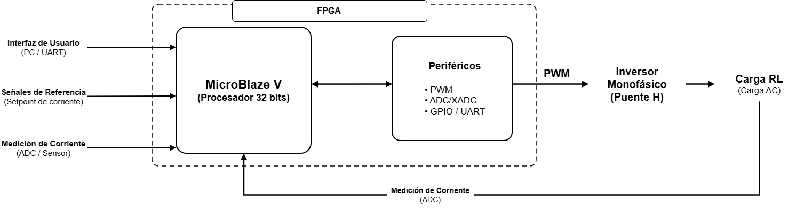
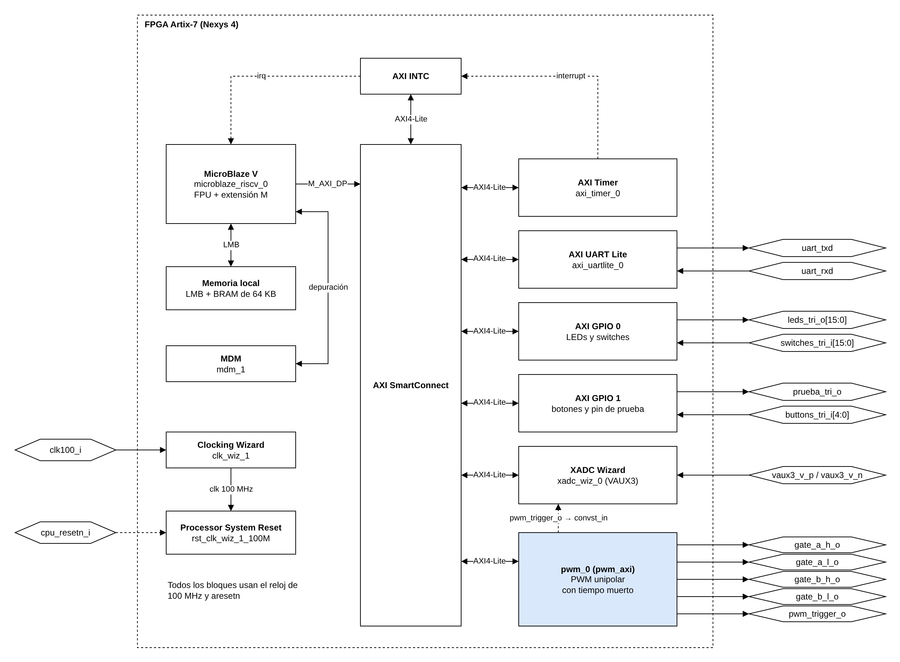
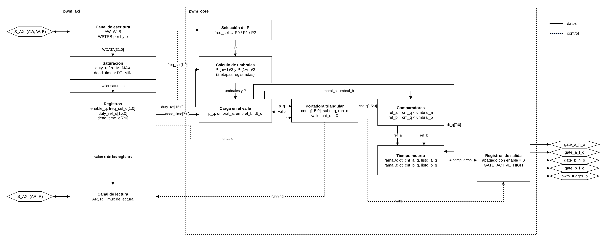
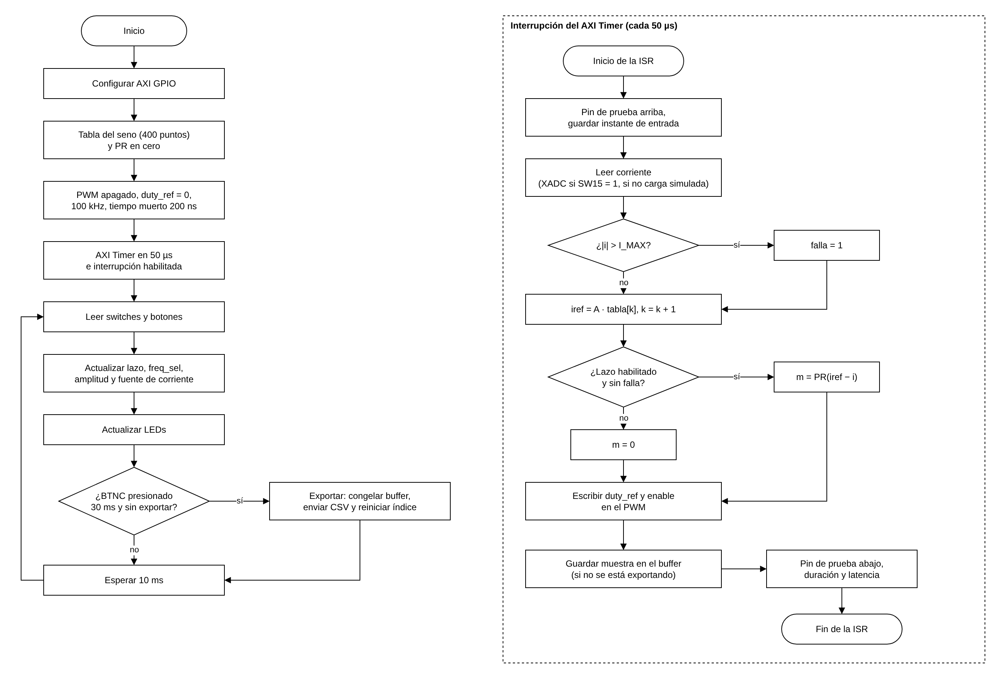

# Planteamiento del diseño — Proyecto 4

**Control de corriente en un inversor monofásico mediante un regulador PR discreto sobre MicroBlaze V**
---

## 1. Alcance

El proyecto regula la corriente de un inversor monofásico en puente H con un regulador PR discreto que se ejecuta en un **MicroBlaze V** (procesador RISC-V de 32 bits de AMD) sobre la Nexys 4 (Artix-7 xc7a100t). El procesador corre la ley de control en C (*bare-metal*) y los periféricos en hardware generan el PWM, adquieren la corriente y se comunican con la PC.

Este documento cubre la **parte digital** (Taller):

| Incluye | No incluye (lo diseña PEDP) |
|---|---|
| Arquitectura del sistema embebido y Block Design | Puente H, drivers de compuerta y semiconductores |
| Periférico PWM personalizado (SystemVerilog + AXI4-Lite) | Dimensionamiento de la carga RL |
| Adquisición con el XADC y su sincronización con el PWM | Sintonización y discretización del PR |
| Software de control, buffer y exportación por UART | Sensor de corriente y su acondicionamiento |
| Estrategia de validación de la parte digital | Ensayos con la etapa de potencia |

El puente H se trata como un bloque externo: recibe las cuatro señales de compuerta de la FPGA y entrega la tensión a la carga. La corriente se mide con un sensor y una etapa de acondicionamiento que la lleva al rango de la entrada analógica del XADC (0 a 1 V).

---

## 2. Idea general de la solución

El sistema es un lazo cerrado que se repite cada período de control $T_s = 50\ \mu s$:

1. **Base de tiempo.** El AXI Timer genera una interrupción cada 50 µs a través del AXI INTC.
2. **Generación del PWM.** El periférico PWM produce las cuatro señales de compuerta con modulación unipolar y tiempo muerto. El índice de modulación lo fija el registro `duty_ref`.
3. **Puente H (externo).** Aplica $\pm V_{dc}$ o 0 sobre la carga RL.
4. **Medición.** El sensor y el acondicionamiento llevan la corriente a la entrada VAUX3 del XADC.
5. **Muestreo sincronizado.** El PWM emite `pwm_trigger_o` en el valle de la portadora y ese pulso inicia la conversión del XADC, así la muestra se toma siempre en el mismo punto de la conmutación.
6. **Cálculo del control.** En la interrupción, el MicroBlaze V lee la última muestra, la compara con la referencia de 50 Hz (tabla en software), calcula el PR y escribe el nuevo `duty_ref`.
7. **Registro y exportación.** Cada muestra se guarda en un buffer circular. Al presionar BTNC, el lazo principal envía el buffer por UART a la PC sin detener la interrupción.

### 2.1 Secuencia de un período de control

| Instante | Qué pasa | Quién lo hace |
|---|---|---|
| Valle de la portadora (cada $1/f_{sw}$) | `pwm_trigger_o` inicia una conversión del XADC; se cargan los valores nuevos de `duty_ref`, `freq_sel` y tiempo muerto | PWM y XADC (hardware) |
| ≈ 1 µs después del valle | La conversión termina y se levanta el aviso EOC | XADC |
| Cada 50 µs | Interrupción del Timer | AXI Timer + AXI INTC |
| Dentro de la ISR | Leer la muestra, proteger, calcular referencia y PR, escribir `duty_ref`, guardar la muestra | Software |
| Siguiente valle | El `duty_ref` nuevo se aplica | PWM |

Con $f_{sw}$ = 100 kHz caben 5 períodos de conmutación en cada período de control (4 a 80 kHz). La ISR siempre usa la conversión más reciente, tomada como máximo un período de conmutación antes.

---

## 3. Arquitectura del sistema

### 3.1 Diagrama de primer nivel



*Figura 1. Sistema de control en la FPGA con sus entradas y salidas.*

| | Señal | Descripción |
|---|---|---|
| Entradas | `vaux3_v_p`, `vaux3_v_n` | Corriente de la carga ya acondicionada (0 a 1 V), JXADC pines 1 y 7 |
| | `switches_tri_i[15:0]` | Habilitación del lazo, `freq_sel`, amplitud de la referencia y fuente de la corriente |
| | `buttons_tri_i[4:0]` | BTNC inicia la exportación |
| | `uart_rxd` | Recepción de la UART (no se usa) |
| | `clk100_i`, `cpu_resetn_i` | Reloj de 100 MHz y reset de la tarjeta (activo en bajo) |
| Salidas | `gate_a_h_o`, `gate_a_l_o`, `gate_b_h_o`, `gate_b_l_o` | Compuertas del puente H (JA1 a JA4) |
| | `pwm_trigger_o` | Disparo de la conversión; también sale a JA7 para medirlo |
| | `uart_txd` | Exportación de las muestras a la PC |
| | `leds_tri_o[15:0]` | Estado: lazo habilitado, falla, exportando |
| | `prueba_tri_o` | Pin de prueba (JA8) que cambia en cada interrupción |

### 3.2 Diagrama de segundo nivel



*Figura 2. Bloques del sistema MicroBlaze V.*

| Bloque | Tipo | Rol |
|---|---|---|
| MicroBlaze V + memoria local (LMB/BRAM) | IP de AMD | Ejecuta la aplicación en C |
| AXI SmartConnect | IP de AMD | Conecta el MicroBlaze V con los periféricos AXI4-Lite |
| `pwm_0` (`pwm_axi`) | **Personalizado** | PWM unipolar con tiempo muerto y `pwm_trigger_o` |
| XADC Wizard | IP de AMD | Conversión de la corriente; arranca con `pwm_trigger_o` o por software |
| AXI Timer + AXI INTC | IP de AMD | Interrupción periódica del lazo |
| AXI UART Lite | IP de AMD | Exportación a 115 200 baudios |
| AXI GPIO 0 y 1 | IP de AMD | LEDs y switches; botones y pin de prueba (JA8) |
| MDM | IP de AMD | Depuración |
| Clocking Wizard + Processor System Reset | IP de AMD | Reloj de 100 MHz y reset síncrono del sistema |

### 3.3 Configuración del MicroBlaze V

| Parámetro | Valor | Comentario |
|---|---|---|
| Frecuencia | 100 MHz | Enunciado |
| Memoria local | **64 KB** de BRAM | El enunciado pide 32 KB; el programa con el buffer ocupa ≈ 36 KB.|
| Caché de instrucciones | Sin caché activa | Todo el programa corre desde la memoria local, donde la caché no actúa|
| Bus | AXI4-Lite maestro | |
| Depuración | MDM | |
| Interrupción | AXI Timer → AXI INTC → MicroBlaze V | Única fuente de interrupción |
| Aritmética | Extensión M (multiplicación/división) y FPU | El PR y la referencia se calculan en punto flotante |

### 3.4 Mapa de direcciones (asignado por Vivado)

| Periférico | Dirección base | Tamaño |
|---|---|---|
| Memoria local | `0x0000_0000` | 64 KB |
| PWM (`pwm_0`) | `0x0001_0000` | 4 KB |
| AXI GPIO 0 (LEDs y switches) | `0x4000_0000` | 64 KB |
| AXI GPIO 1 (botones y pin de prueba) | `0x4001_0000` | 64 KB |
| AXI UART Lite | `0x4060_0000` | 64 KB |
| AXI INTC | `0x4120_0000` | 64 KB |
| AXI Timer | `0x41C0_0000` | 64 KB |
| XADC Wizard | `0x44A0_0000` | 64 KB |

### 3.5 Reloj y reset

Hay un solo dominio de reloj de 100 MHz que sale del Clocking Wizard, así que no hay cruces de dominio. El botón CPU RESET (`cpu_resetn_i`, activo en bajo) entra al Processor System Reset, que entrega `S_AXI_ARESETN` (síncrono, activo en bajo) a todos los periféricos, incluido el PWM.

---

## 4. Parámetros de diseño

Los valores de la carga y la alimentación vienen del diseño de potencia de PEDP (2 de noviembre de 2026).

| Parámetro | Valor | Origen |
|---|---|---|
| Reloj del sistema | 100 MHz | Enunciado |
| Carga | $R \approx 9{,}97\ \Omega$, $L \approx 166\ \mu H$ ($\tau = L/R \approx 16{,}6\ \mu s$) | Medida por PEDP |
| Alimentación del puente | $V_{dc} = 18$ V (provisional, rango del enunciado 12 a 24 V) | PEDP |
| Frecuencia de conmutación nominal | 100 kHz (además 80 y 125 kHz seleccionables) | PEDP / Taller |
| Tiempo muerto | Mínimo ≈ 75 a 100 ns; 200 ns como valor conservador | PEDP |
| Referencia | Sinusoide de 50 Hz; 0,2 / 0,5 / 1,0 A pico | Enunciado |
| Período de control | $T_s = 50\ \mu s$ (20 kHz) | Taller, por confirmar con PEDP |

Como la carga es casi resistiva a 50 Hz, la tensión pico necesaria es $V_1 = I_{pico}\,|Z|$ y el índice de modulación es $m = V_1/V_{dc}$:

| $I_{pico}$ | $V_1$ | $m$ con 18 V |
|---|---|---|
| 0,2 A | 1,99 V | 0,111 |
| 0,5 A | 4,99 V | 0,277 |
| 1,0 A | 9,97 V | 0,554 |

Consecuencias para la parte digital:

- **Saturación.** El índice más alto en régimen es 0,554, así que limitar $|m|$ a 0,95 en hardware deja margen para que el PR corrija el tiempo muerto y los transitorios.
- **Resolución.** A 100 kHz la portadora tiene 500 pasos por semiperíodo (≈ 9 bits). Con 18 V un paso son ≈ 36 mV; a 0,2 A la amplitud cubre ≈ 55 pasos.
- **Retardo.** $\tau$ es menor que $T_s$, así que la planta responde dentro de un período de control. El retardo de muestreo y actualización (≈ 1,5 $T_s$ = 75 µs) lo debe incluir PEDP en el análisis de estabilidad del PR.

---

## 5. Estructura de módulos

### 5.1 Jerarquía

```text
sistema_microblaze (Block Design de Vivado)
├── microblaze_riscv_0          MicroBlaze V (FPU + extensión M)
├── microblaze_riscv_0_local_memory   LMB + 64 KB de BRAM
├── microblaze_riscv_0_axi_intc       AXI INTC
├── microblaze_riscv_0_axi_periph     AXI SmartConnect
├── mdm_1                       Depuración
├── clk_wiz_1 / rst_clk_wiz_1_100M    Reloj y reset
├── axi_timer_0                 Interrupción del lazo
├── axi_uartlite_0              Exportación
├── axi_gpio_0 / axi_gpio_1     LEDs, switches, botones y pin de prueba
├── xadc_wiz_0                  XADC con interfaz AXI4-Lite (VAUX3)
└── pwm_0 (pwm_bd, personalizado)
    └── pwm_axi                 Interfaz AXI4-Lite, registros y saturación
        └── pwm_core            Portadora, umbrales, tiempo muerto y pwm_trigger_o
```

### 5.2 Responsabilidad de cada módulo personalizado

| Módulo | Responsabilidad | Interfaz |
|---|---|---|
| `pwm_bd.v` | Envoltura en Verilog para meter `pwm_axi` al Block Design como *module reference* | Igual a `pwm_axi` |
| `pwm_axi.sv` | Esclavo AXI4-Lite (5 canales, WSTRB), banco de registros, saturación de `duty_ref` y del tiempo muerto, lectura de `running` | AXI4-Lite ↔ señales hacia `pwm_core` |
| `pwm_core.sv` | Portadora triangular, cálculo de umbrales, comparación, tiempo muerto, salidas seguras y `pwm_trigger_o`. No conoce AXI | `enable_i`, `freq_sel_i`, `duty_ref_i`, `dead_time_i` → compuertas y disparo |

### 5.3 Diagrama de tercer nivel del PWM



*Figura 3. Estructura interna del periférico PWM.*

---

## 6. Diseño del PWM

### 6.1 Modulación unipolar

Una portadora triangular (contador que sube de 0 a $P$ y baja de $P$ a 0) se compara con el índice de modulación $m \in [-1, 1]$:

- Rama A con $+m$: $d_A = (1 + m)/2$.
- Rama B con $-m$: $d_B = (1 - m)/2$.
- Tensión promedio sobre la carga: $v_{AB} = V_{dc}\,(d_A - d_B) = V_{dc}\,m$.

Cada transistor conmuta a $f_{sw}$, pero la tensión diferencial tiene su componente predominante en $2 f_{sw}$ (200 kHz a 100 kHz).

En el contador, la rama A está arriba mientras $cnt < P\,(m+1)/2$. Con $m$ en Q1.15 eso es $cnt < P\,(m + 32768)/65536$, una suma y una multiplicación por $P$. Ese cálculo se hace en dos etapas registradas para cumplir el reloj de 100 MHz.

### 6.2 Frecuencias de conmutación

$P = f_{clk}/(2 f_{sw})$ y el período de la portadora es $2P$ ciclos.

| `freq_sel` | $f_{sw}$ | $P$ | Período | Predominante en $v_{AB}$ |
|---|---|---|---|---|
| `00` | 100 kHz (nominal) | 500 | 1000 ciclos | 200 kHz |
| `01` | 80 kHz | 625 | 1250 ciclos | 160 kHz |
| `10` | 125 kHz | 400 | 800 ciclos | 250 kHz |
| `11` | igual que `00` | | | |

Las tres frecuencias dan un número entero de ciclos, así que son exactas. Se escogieron alrededor de la nominal de PEDP: 80 kHz sigue cumpliendo el rizado de 0,20 A ($f_{sw} \ge 67{,}8$ kHz con 18 V) y 125 kHz baja el rizado a cambio de más pérdidas. La resolución va de 400 a 625 pasos por semiperíodo (8,6 a 9,3 bits).

### 6.3 Tiempo muerto

Cada salida se enciende `dead_time` ciclos después de que su complementaria se apagó (retardo al encendido). Cada rama tiene un contador que se reinicia cuando la señal cambia; la salida solo se habilita cuando el contador llega a `dead_time`.

- Registro `0x08`, en ciclos de 10 ns: valor tras reset 20 (200 ns), mínimo 10 (100 ns), máximo 255 (2,55 µs).
- Una escritura menor que 10 se satura a 10.
- Si `dead_time` cambia a mitad de un pulso, el pulso que ya empezó no se corta.

### 6.4 Saturación y actualización en el valle

- **Saturación.** `duty_ref` en Q1.15 se limita a $\pm$`M_MAX` = ±31129 (±0,95) al escribirlo, así el pulso más angosto siempre es mayor que el tiempo muerto.
- **Actualización en el valle.** `duty_ref`, `freq_sel` y `dead_time` solo se cargan en el valle de la portadora, así un cambio nunca corta un pulso a la mitad. Un valor escrito menos de 3 ciclos antes del valle se aplica en el siguiente.

### 6.5 `pwm_trigger_o`

Es un pulso de un ciclo en cada valle de la portadora. En el valle (centro del pulso de abajo) la corriente pasa por su valor promedio del período de conmutación, así la muestra no queda afectada por el rizado. Coincide con lo que recomienda PEDP (muestreo en el vértice).

### 6.6 Estado seguro

- Con `enable = 0` las cuatro compuertas se apagan en el siguiente ciclo y no hay disparos.
- En reset todos los registros vuelven a su valor inicial y las salidas quedan apagadas.
- El parámetro `GATE_ACTIVE_HIGH` invierte las salidas si los drivers que escoja PEDP son activos en bajo (pendiente).

### 6.7 Registros (AXI4-Lite)

Dirección base `0x0001_0000`. Los offsets `0x00` y `0x04` son los de la interfaz sugerida; `0x08` se agregó para el tiempo muerto.

| Offset | Bits | Campo | Acceso | Tras reset | Descripción |
|---|---|---|---|---|---|
| `0x00` | 0 | `enable` | R/W | 0 | Habilita el PWM |
| | [2:1] | `freq_sel` | R/W | `00` | Frecuencia de conmutación (tabla 6.2) |
| | 3 | `running` | RO | 0 | El PWM está generando; una escritura no lo cambia |
| | [31:4] | — | — | 0 | Reservado, lee 0 |
| `0x04` | [15:0] | `duty_ref` | R/W | 0 | Índice de modulación en Q1.15 con signo, saturado a ±0,95 |
| | [31:16] | — | — | 0 | Reservado, lee 0 |
| `0x08` | [7:0] | `dead_time` | R/W | 20 | Tiempo muerto en ciclos de 10 ns, mínimo 10 |
| | [31:8] | — | — | 0 | Reservado, lee 0 |
| `0x0C` | [31:0] | — | — | 0 | Reservado |

Todas las respuestas son OKAY. WSTRB se respeta byte por byte. AW y W se pueden recibir en ciclos distintos.

### 6.8 Puertos y parámetros

| Puerto | Dir. | Ancho | Descripción |
|---|---|---|---|
| `S_AXI_*` | E/S | | Interfaz AXI4-Lite esclava (`S_AXI_ACLK`, `S_AXI_ARESETN` activo en bajo) |
| `gate_a_h_o`, `gate_a_l_o` | S | 1 | Compuertas de la rama A (arriba, abajo) |
| `gate_b_h_o`, `gate_b_l_o` | S | 1 | Compuertas de la rama B (arriba, abajo) |
| `pwm_trigger_o` | S | 1 | Disparo hacia el XADC (`convst_in`) |

| Parámetro | Valor | Uso |
|---|---|---|
| `CLK_HZ` | 100 000 000 | Todas las cuentas se calculan desde aquí |
| `F_SW0`, `F_SW1`, `F_SW2` | 100 000, 80 000, 125 000 | Frecuencias de `freq_sel` |
| `M_MAX` | 31129 | Límite de `duty_ref` (0,95) |
| `DT_RESET`, `DT_MIN` | 20, 10 | Tiempo muerto tras reset y mínimo |
| `GATE_ACTIVE_HIGH` | 1 | Polaridad de las compuertas |

---

## 7. Adquisición de la corriente (XADC)

### 7.1 Acondicionamiento

El XADC acepta de 0 a 1 V en modo unipolar. Como la corriente es alterna, el acondicionamiento de PEDP debe sumarle un offset en la mitad del rango. Mientras PEDP define el sensor se usan como **supuesto** un offset de 0,5 V y una ganancia de 0,4 V/A, que dan un rango de ±1,25 A:

$$i = \frac{v_{adc} - 0{,}5\ \text{V}}{0{,}4\ \text{V/A}}$$

La entrada es VAUX3 (JXADC pin 1 = VAUX3P, pin 7 = VAUX3N).

### 7.2 Configuración del XADC Wizard

Se usa el XADC Wizard con su propia interfaz AXI4-Lite, sin un wrapper propio (se consulta, sección 12). Está en modo de evento, con un solo canal (VAUX3) y entrada unipolar. La conversión arranca de dos formas:

- **Por hardware:** `pwm_trigger_o` está conectado a `convst_in`.
- **Por software:** escribiendo 1 y luego 0 en el registro CONVST (el XADC arranca en el flanco).

| Registro (base `0x44A0_0000`) | Offset | Uso |
|---|---|---|
| CONVST | `0x00C` | Inicio de conversión por software |
| IPISR | `0x060` | Bit EOC (`0x20`): hay una muestra nueva; se limpia escribiendo 1 |
| VAUX3 | `0x24C` | Dato de 12 bits en [15:4] |

### 7.3 Uso en la ISR

Con el PWM encendido la ISR no inicia conversiones: revisa EOC, lee la última muestra y limpia el aviso. Si no hay muestra nueva, usa la anterior y lo cuenta. Con el PWM apagado, la ISR inicia la conversión por software.

---

## 8. Software de control

### 8.1 Inicialización

1. Configurar el AXI GPIO. La UART y el XADC (canal, modo de evento) ya quedan configurados desde el Block Design.
2. Llenar la tabla de la referencia y poner en cero los estados del PR.
3. Dejar el PWM apagado, con `duty_ref = 0`, 100 kHz y tiempo muerto de 200 ns.
4. Configurar el AXI Timer en 50 µs (auto-recarga), conectar su interrupción al INTC y habilitarla.
5. Pasar al lazo principal: leer switches y botones, actualizar LEDs y exportar cuando se presiona BTNC.



*Figura 4. Inicialización, lazo principal e ISR.*

### 8.2 Rutina de interrupción (cada 50 µs)

Siempre ejecuta la misma secuencia:

1. Leer la corriente (XADC o, para pruebas sin potencia, un modelo discreto de la carga RL).
2. Protección: si $|i|$ supera el límite, apagar el PWM y encender el LED de falla.
3. Referencia: $i_{ref} = A \sin(2\pi\,50\,n T_s)$, tomada de una tabla de 400 puntos (un ciclo de 50 Hz).
4. PR y escritura de `duty_ref`.
5. Guardar la muestra en el buffer.

La ISR no hace nada de UART ni esperas. Su duración y su latencia se miden con el contador del AXI Timer y con un pin (JA8) que cambia en cada interrupción.

### 8.3 Controlador PR

PEDP definió el PR ideal $C(s) = K_p + \dfrac{K_r\,s}{s^2 + \omega_0^2}$ con $K_p = 2$, $K_r = 3000$ y $\omega_0 = 2\pi\,50$. Se discretiza con Tustin y *prewarping* a 50 Hz con $T_s = 50\ \mu s$:

$$y[n] = b_0\,e[n] + b_2\,e[n-2] - a_1\,y[n-1] - a_2\,y[n-2]$$
$$u[n] = K_p\,e[n] + y[n], \qquad m[n] = \text{sat}\!\left(\frac{u[n]}{V_{dc}}\right)$$

con $b_0 = -b_2 = 0{,}0750$, $a_1 = -1{,}99975$ y $a_2 = 1$. El PR se calcula en punto flotante (FPU) y está en una sola función (`control_pr_paso`), así un cambio de coeficientes de PEDP no toca el resto del código.

### 8.4 Buffer circular y exportación por UART

| Parámetro | Valor |
|---|---|
| Tamaño | 2000 muestras = 100 ms = 5 ciclos de 50 Hz |
| Cada muestra | `iref_ma`, `i_ma` (mA) y `duty_q15`, 16 bits cada uno (12 KB en total) |
| UART | 115 200 baudios, 8N1 |
| Formato | Texto CSV: línea `INICIO` con $T_s$, encabezado, una muestra por línea y `FIN` |

Al presionar BTNC (con antirrebote de 30 ms), el lazo principal recorre el buffer y lo transmite. Mientras tanto la ISR sigue controlando pero no guarda muestras nuevas, así lo que se exporta es un bloque continuo sin mezclar muestras de antes y después (se consulta, sección 12). En la PC, `graficar_muestras.py` recibe el CSV y lo grafica.

### 8.5 Interfaz de usuario

| Control | Función |
|---|---|
| SW0 | Habilita el lazo (al bajarlo se borra la falla) |
| SW2..SW1 | `freq_sel` |
| SW4..SW3 | Amplitud: `00` = 0,2 A, `01` = 0,5 A, `1x` = 1,0 A pico |
| SW15 | 1 = corriente del XADC, 0 = carga simulada |
| BTNC | Exportar |
| LD0 / LD1 / LD2 | Lazo habilitado / falla / exportando |

### 8.6 Organización del código

| Archivo | Contenido |
|---|---|
| `main.c` | Inicialización, lectura de switches y botones, LEDs y exportación |
| `control_isr.c/.h` | ISR, referencia, protección, buffer y variables compartidas (`volatile`) |
| `control_pr.c/.h` | Ecuación en diferencias del PR |
| `pwm_driver.h` | Offsets y funciones de acceso al PWM |
| `adc_driver.h` | Offsets y funciones de acceso al XADC |

---

## 9. Estrategia de integración con la etapa de potencia

1. **Sin potencia.** Lazo cerrado con la carga simulada en el software (SW15 = 0) para probar el PR, la ISR y la exportación.
2. **Señales de compuerta.** Con el puente desenergizado, PWM habilitado en lazo abierto: revisar con osciloscopio las cuatro compuertas, el tiempo muerto real y `pwm_trigger_o`.
3. **Medición.** Con el sensor conectado y corriente cero, comprobar el offset que lee el XADC; luego con una corriente conocida, la ganancia.
4. **Energizar en lazo abierto.** $V_{dc}$ bajo y con limitación de corriente, `duty_ref` fijo pequeño; después 18 V.
5. **Lazo cerrado.** 0,2 A → 0,5 A → 1,0 A pico, con la protección de corriente activa.


---

## 10. Plan de validación

| # | Prueba | Herramienta | Criterio de paso |
|---|---|---|---|
| 1 | `tb_pwm_core`: frecuencias, umbrales, tiempo muerto, saturación, carga en el valle, `pwm_trigger_o`, `enable` y reset | Simulación RTL en Vivado, autoverificable | Todas las pruebas PASS; nunca dos transistores de una rama encendidos |
| 2 | `tb_pwm_axi`: reset, lectura/escritura, `running` RO, saturación, WSTRB, AW y W en ciclos distintos, arranque y apagado | Simulación RTL en Vivado, autoverificable | Todas las pruebas PASS |
| 3 | Detección de errores | Las dos con `FORZAR_FALLA` | Aparece exactamente una falla |
| 4 | `tb_pwm_axi` con retardos reales | Simulación post-implementación temporizada | Todas las pruebas PASS, sin X en las salidas |
| 5 | Síntesis e implementación | Vivado | Sin latches, timing cerrado a 100 MHz |
| 6 | Sistema base: UART, LEDs, botones, Timer | Nexys 4 | Responde como se espera |
| 7 | Registros del PWM desde C | Nexys 4 | Se leen los valores escritos y la saturación |
| 8 | XADC con tensión conocida, con los dos disparos | Nexys 4 | Lectura correcta y una muestra nueva por interrupción |
| 9 | Lazo cerrado con la carga simulada | Nexys 4 | La corriente sigue la referencia |
| 10 | Exportación por UART | Nexys 4 + `graficar_muestras.py` | Se reciben las 2000 muestras completas |
| 11 | Período, latencia, duración de la ISR y jitter | Contador del Timer y pin JA8 con osciloscopio | ISR menor que 50 µs; jitter medido en operación extendida |
| 12 | Compuertas y tiempo muerto en los pines | Osciloscopio, potencia desenergizada | Tiempo muerto ≥ el que pide PEDP, sin solape |

---

## 11. Interfaz con PEDP

| Dato | Valor | Estado |
|---|---|---|
| Frecuencia de conmutación | 100 kHz nominal (80 y 125 kHz seleccionables) | Acordado |
| Período de control | 50 µs | Propuesto por Taller, falta que PEDP lo incluya en su análisis |
| Instante de muestreo | Valle de la portadora | Acordado |
| Tiempo muerto | 200 ns tras reset, configurable de 100 ns a 2,55 µs | PEDP propone 75–100 ns: si baja de 100 ns hay que bajar `DT_MIN` |
| Polaridad y número de compuertas | 4 salidas de 3,3 V, activas en alto | Pendiente: depende de los drivers |
| Sensor y escala hacia el XADC | Supuesto: 0,5 V de offset, 0,4 V/A | Pendiente |
| PR y coeficientes | $K_p = 2$, $K_r = 3000$, Tustin con prewarping | Primer intento de PEDP, sintonización pendiente |
| Saturación de $m$ | ±0,95 en el PWM | Acordado; el software usa un límite propio de 0,8 (por confirmar) |
| Límite de corriente para la protección | Supuesto: 1,5 A | Pendiente; debe quedar dentro del rango del sensor |

---

## 12. Decisiones de diseño

| Decisión | Alternativa considerada | Razón |
|---|---|---|
| `duty_ref` en Q1.15 con signo | Ciclo de trabajo sin signo por rama | Un solo valor $m$ con signo da las dos ramas ($+m$ y $-m$) y es el formato sugerido |
| 100 / 80 / 125 kHz | 80 / 100 / 120 kHz | Las tres dan un número entero de ciclos y la nominal es la que eligió PEDP |
| Disparo y carga de registros en el valle | En el pico, o actualización inmediata | Muestra en el promedio de la corriente y ningún pulso se corta a la mitad |
| Tiempo muerto configurable en `0x08` | Parámetro fijo de síntesis | Se puede ajustar desde software al valor que mida PEDP, sin volver a sintetizar |
| PWM como *module reference* | Empaquetar el IP con Create and Package IP | Cada cambio del RTL se ve en el Block Design sin reempaquetar |
| XADC Wizard con su AXI4-Lite | Wrapper AXI4-Lite propio | Ya tiene inicio por software (CONVST), entrada `convst_in` y aviso EOC; el único periférico personalizado obligatorio es el PWM |
| $T_s$ = 50 µs | $T_s = 1/f_{sw}$ (10 µs) | Deja tiempo para la ISR con el PR en flotante y el PR no necesita correr a $f_{sw}$ (PEDP) |
| FPU y extensión M | Punto fijo | El PR en flotante es más fácil de seguir y de cambiar cuando PEDP ajuste los coeficientes |
| 64 KB de memoria local | 32 KB | El programa con el buffer de 2000 muestras ocupa ≈ 36 KB |
| Buffer de 2000 muestras y CSV | Decimación y formato binario | 2000 muestras ya cubren 5 ciclos de 50 Hz sin decimar, y el CSV se lee y grafica directo |

---

## Referencias

1. D. Harris y S. Harris, *Digital Design and Computer Architecture, RISC-V Edition*. Morgan Kaufmann, 2022.
2. P. P. Chu, *FPGA Prototyping by SystemVerilog Examples*. Wiley, 2018.
3. AMD, *MicroBlaze V Embedded Design Tutorial* (UG1711).
4. AMD, *MicroBlaze Processor Reference Guide* (UG984).
5. AMD, *Vivado Design Suite User Guide: Creating and Packaging Custom IP* (UG1118).
6. AMD, *AXI Reference Guide* (UG1037).
7. AMD, *7 Series FPGAs and Zynq-7000 SoC XADC Dual 12-Bit 1 MSPS ADC User Guide* (UG480).
8. AMD, *Vitis Unified Software Platform Documentation* (UG1416).
9. D. W. Hart, *Power Electronics*. McGraw-Hill, 2011.
