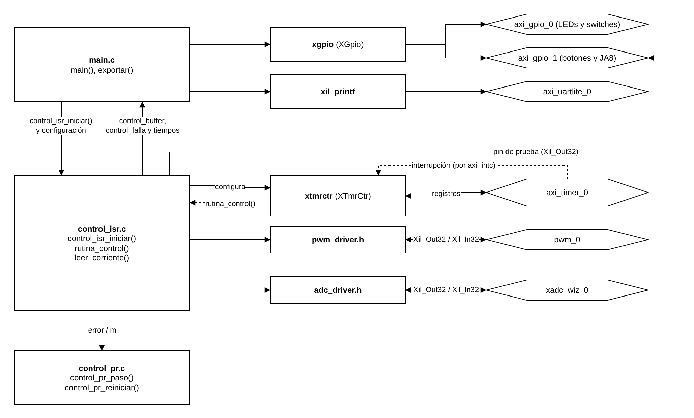
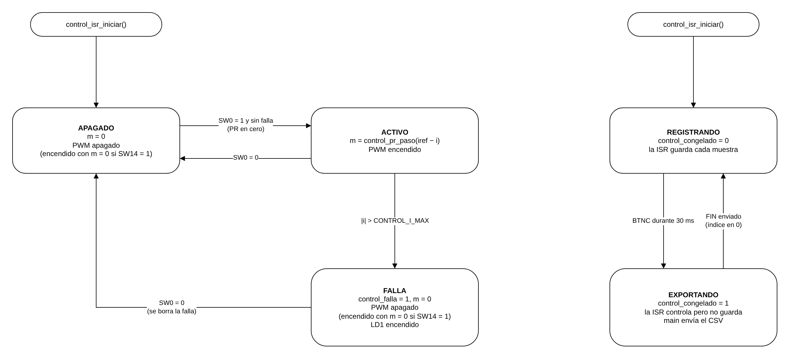
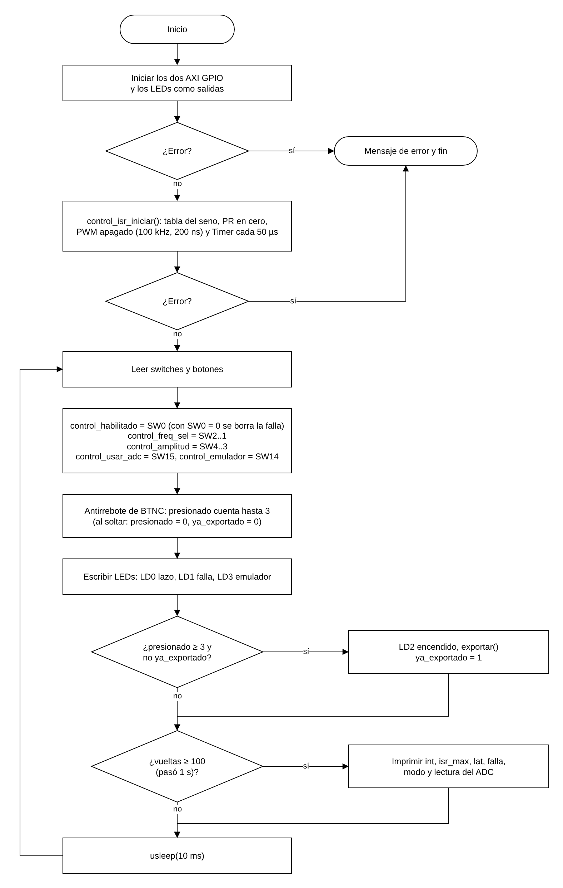
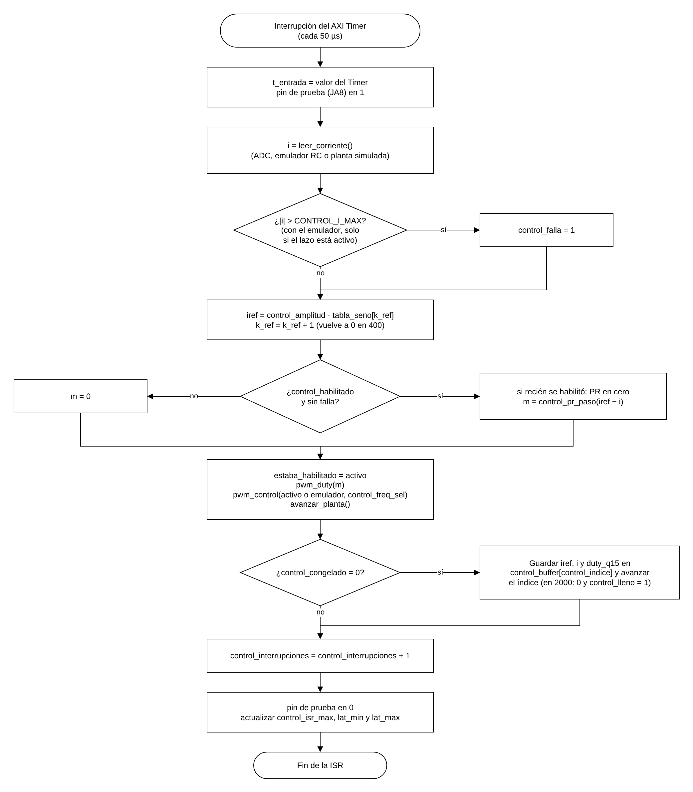
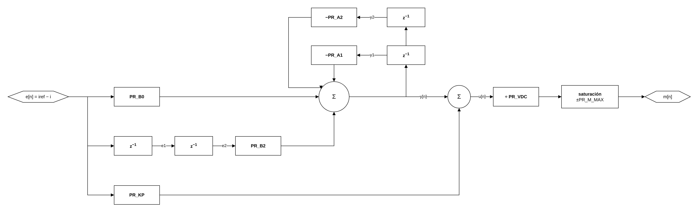

# Aplicación de control en C


# 1. Introducción

Este documento describe el programa en C que corre en el MicroBlaze V y hace el lazo de control de corriente. El programa lee la corriente, calcula el controlador proporcional-resonante (PR), actualiza el ciclo de trabajo del PWM y guarda cada muestra en un buffer para exportarla por UART.

El programa está dividido en tres archivos:

| Archivo | Función principal |
|---------|-------------------|
| `main.c` | Inicializa el sistema y, en el lazo principal, lee los switches y botones, actualiza los LEDs y exporta el buffer. |
| `control_isr.c` / `control_isr.h` | Configura el AXI Timer y contiene la rutina de interrupción que hace el lazo de control cada 50 µs. |
| `control_pr.c` / `control_pr.h` | Calcula un paso del controlador PR. |

Los drivers del PWM (`pwm_driver.h`) y del XADC (`adc_driver.h`), el buffer y la exportación por UART tienen su propio documento. Aquí solo se explica cómo los usa el control.

El diseño del PR (estructura, ganancias y discretización) lo define la parte de potencia (EL4201). Este programa implementa la ecuación en diferencias que se recibió.

---

# 2. Objetivos

## Objetivo general

Ejecutar el lazo de control de corriente de forma periódica y determinística sobre el MicroBlaze V.

## Objetivos específicos

- Generar una interrupción cada `Ts = 50 µs` con el AXI Timer.
- En cada interrupción, leer la corriente, calcular el PR y escribir `duty_ref` en el PWM.
- Generar la referencia senoidal de 50 Hz con amplitudes de 0,2, 0,5 y 1,0 A pico.
- Apagar el PWM si la corriente pasa del límite.
- Guardar cada muestra en el buffer circular.
- Medir la duración y la latencia de la rutina de interrupción.

---

# 3. Organización del software



*Figura 1: módulos del software y periféricos que usa cada uno.*

`main.c` llama una sola vez a `control_isr_iniciar()` y después se queda en un lazo que se repite cada 10 ms. Desde ese momento el control lo hace `rutina_control()`, que se ejecuta cuando el AXI Timer pide la interrupción. La interrupción pasa por `axi_intc` y el driver `xtmrctr` llama a `rutina_control()`.

`main.c` y `control_isr.c` no se llaman entre sí durante la operación. Se comunican con variables globales `volatile`: `main.c` escribe la configuración (lazo habilitado, amplitud, frecuencia, modo) y la ISR escribe el buffer, la bandera de falla y los tiempos medidos.

La ISR usa `control_pr.c` para el controlador, `pwm_driver.h` para el PWM y `adc_driver.h` para el XADC. El XADC y la UART no se configuran por software: su configuración (canal, modo evento, 115200 baud) queda fija en el Block Design. Además escribe directo el canal 2 de `axi_gpio_1` para el pin de prueba (JA8), que se usa para medir el periodo con el osciloscopio.

## Uso de la tarjeta

| Elemento | Uso |
|----------|-----|
| SW0 | Habilita el lazo. Al bajarlo se borra una falla. |
| SW2..SW1 | `freq_sel` del PWM: `00` = 100 kHz, `01` = 80 kHz, `10` = 125 kHz. |
| SW4..SW3 | Amplitud de la referencia: `00` = 0,2 A, `01` = 0,5 A, `1x` = 1,0 A. |
| SW15 | `1`: la corriente sale del XADC. `0`: sale de la planta simulada. |
| SW14 | Modo emulador: un circuito RC en el XADC hace de carga (solo sin la etapa de potencia). |
| BTNC | Exporta el buffer por UART. |
| LD0 / LD1 / LD2 / LD3 | Lazo habilitado / falla / exportando / modo emulador. |
| JA8 | Pin de prueba: está en 1 mientras corre la rutina de interrupción. |

---

# 4. Estados del control



*Figura 2: estados del control y de la exportación.*

El programa no tiene una variable de estado explícita, pero se comporta como las dos máquinas de la figura.

La de la izquierda es el lazo de control:

- **APAGADO**: `m = 0` y el PWM apagado. Es el estado después de iniciar.
- **ACTIVO**: se pasa con SW0 = 1 si no hay falla. Al entrar, los estados del PR se ponen en cero para no arrancar con valores viejos. En cada interrupción se calcula `m` con el PR.
- **FALLA**: se pasa si la corriente medida supera `CONTROL_I_MAX`. El PWM se apaga en la misma interrupción y LD1 se enciende. Solo se sale bajando SW0.

En el modo emulador (SW14 = 1) el PWM queda encendido con `m = 0` en APAGADO y en FALLA, porque el RC necesita la conmutación para dar el offset. Por eso ese modo no se usa con el puente H conectado.

La de la derecha es la exportación. Mientras se envía el buffer (`control_congelado = 1`), la ISR sigue controlando pero no guarda muestras.

---

# 5. Archivo `main.c`

## Objetivo

Iniciar los periféricos y atender las tareas lentas: switches, botón, LEDs, exportación e impresión de tiempos.

## Diagrama de flujo



*Figura 3: diagrama de flujo de `main()`.*

## Funcionamiento

1. Se inician los dos AXI GPIO y los LEDs se configuran como salidas. Si falla, se imprime un error y el programa termina.
2. Se llama a `control_isr_iniciar()`, que deja el PWM apagado y arranca el Timer (sección 6.2). Desde aquí ya corre la interrupción.
3. En cada vuelta del lazo:
   - Se leen los switches (canal 2 de `axi_gpio_0`) y los botones (canal 1 de `axi_gpio_1`).
   - Se actualizan las variables compartidas según la tabla de la sección 3. Si SW0 está abajo, se borra `control_falla`. Cuando SW0 sube, se reinician los tiempos medidos, para que `isr_max` y la latencia correspondan solo a la operación con el lazo activo.
   - Antirrebote de BTNC: `presionado` cuenta las vueltas seguidas con el botón presionado, hasta 3 (30 ms). Al soltarlo, `presionado` y `ya_exportado` vuelven a 0.
   - Se escriben los LEDs.
   - Si `presionado` llegó a 3 y todavía no se exportó en esta presión, se enciende LD2 y se llama a `exportar()`. Así se exporta una sola vez aunque el botón se mantenga presionado. Como la exportación dura unos segundos, dentro de ella se sigue leyendo SW0: si se baja, el lazo se apaga igual.
   - Cada 100 vueltas (alrededor de 1 s) se imprimen los tiempos de la ISR.
   - Se espera 10 ms con `usleep()`.

La línea que se imprime cada segundo tiene esta forma:

```text
int=... isr_max=... lat=MIN..MAX falla=0 run=1 | EMU adc=... mV nuevos=... sin_dato=... offset=... mV
```

`int` es el número de interrupciones, `isr_max` la duración máxima de la ISR y `lat` la latencia mínima y máxima, las dos en ciclos de 10 ns. `run` es el bit `running` que se lee del PWM. `nuevos` y `sin_dato` cuentan cuántas veces la ISR encontró o no una muestra nueva del XADC.

---

# 6. Archivo `control_isr.c`

## 6.1 Constantes y variables compartidas

| Constante | Valor | Descripción |
|-----------|-------|-------------|
| `CONTROL_TS_US` | 50 | Periodo de muestreo en µs. |
| `CONTROL_N_REF` | 400 | Muestras por ciclo de 50 Hz (`1 / (50 Hz · 50 µs)`). |
| `CONTROL_N_BUFFER` | 2000 | Tamaño del buffer (100 ms, cinco ciclos de 50 Hz). |
| `CONTROL_I_MAX` | 1,5 A | Límite de corriente. |
| `TIMER_CARGA` | 4998 | Valor de recarga del Timer (sección 6.2). |

| Variable | La escribe | Uso |
|----------|------------|-----|
| `control_habilitado` | `main` | SW0. |
| `control_amplitud` | `main` | Amplitud de la referencia en A. |
| `control_freq_sel` | `main` | `freq_sel` que se escribe al PWM. |
| `control_usar_adc`, `control_emulador` | `main` | Fuente de la corriente (SW15, SW14). |
| `control_congelado` | `main` | 1 mientras se exporta. |
| `control_falla` | ISR (la borra `main`) | 1 si hubo sobrecorriente. |
| `control_buffer`, `control_indice`, `control_lleno` | ISR (los reinicia `main`) | Buffer circular. |
| `control_isr_max`, `control_lat_min`, `control_lat_max` | ISR | Tiempos medidos. |

Todas son `volatile` para que el compilador las lea de memoria cada vez, porque las cambia la otra parte del programa.

## 6.2 `control_isr_iniciar()`

Se llama una vez desde `main()` y hace lo siguiente:

1. Llena `tabla_seno` con los 400 puntos de un ciclo. No usa `sinf()`, porque la biblioteca matemática ocupa mucha memoria. Parte del ángulo 0 (seno 0, coseno 1) y lo gira 2π/400 en cada paso con el seno y el coseno de ese ángulo, que se calcularon antes y están como constantes.
2. Pone los estados del PR en cero.
3. Deja el PWM apagado, con `duty_ref = 0`, 100 kHz y 20 ciclos (200 ns) de tiempo muerto.
4. Configura el AXI Timer: lo inicia, conecta su interrupción con `XSetupInterruptSystem()`, registra `rutina_control()` como handler y lo pone a contar hacia abajo con recarga automática.
5. Arranca el Timer.

El AXI Timer tarda `TLR + 2` ciclos en cada periodo, así que para 50 µs con el reloj de 100 MHz se carga:

```text
TIMER_CARGA = 100 · 50 − 2 = 4998
```

Si algo falla devuelve `-1` (Timer) o `-2` (interrupción), y `main` lo imprime.

## 6.3 `rutina_control()`

### Objetivo

Hacer siempre la misma secuencia en cada periodo de muestreo: leer la corriente, calcular el PR, actualizar el PWM y guardar la muestra.

### Diagrama de flujo



*Figura 4: diagrama de flujo de la rutina de interrupción.*

### Funcionamiento

1. Se lee el valor del Timer (`t_entrada`) y se pone en 1 el pin de prueba. Como el Timer cuenta hacia abajo desde `TIMER_CARGA`, lo que ya bajó es el tiempo que pasó desde que se pidió la interrupción.
2. `leer_corriente()` devuelve la corriente en amperios. Según los switches sale del XADC, del emulador RC o de la planta simulada. Cómo se lee el XADC está en el documento del ADC.
3. Protección: si `|i| > CONTROL_I_MAX` se pone `control_falla = 1`. En el modo emulador solo se revisa con el lazo activo, porque al entrar al modo el XADC lee 0 V y eso parece una sobrecorriente.
4. Se calcula la referencia `iref = control_amplitud · tabla_seno[k_ref]` y `k_ref` avanza. Al llegar a 400 vuelve a 0, así que la referencia tiene exactamente 50 Hz.
5. El lazo está activo si `control_habilitado = 1` y no hay falla:
   - Si está activo, `m = control_pr_paso(iref − i)`. Si en la interrupción anterior no estaba activo, primero se reinicia el PR.
   - Si no, `m = 0`.
6. Se escribe `m` al PWM con `pwm_duty()` y después se escribe el control con `pwm_control()`. Escribir el control en cada interrupción hace que una falla apague el PWM en ese mismo periodo, sin esperar a `main`. Después se avanza un paso la planta simulada (`avanzar_planta()`).
7. Si no se está exportando, se guarda la muestra en `control_buffer[control_indice]` y el índice avanza. Al llegar a 2000 vuelve a 0 y se pone `control_lleno = 1`.
8. Se pone en 0 el pin de prueba, se lee otra vez el Timer y se actualizan la duración máxima y la latencia mínima y máxima:

```text
latencia = TIMER_CARGA − t_entrada
duracion = t_entrada − t_salida
```

La rutina no tiene esperas ni usa la UART. Su duración cambia poco; la diferencia más grande es mientras se exporta, porque no guarda la muestra. El ancho del pulso del pin de prueba no incluye lo que tarda el procesador en entrar a la rutina y en salir de ella (el despacho de la interrupción y del driver del Timer).

## 6.4 Planta simulada

Con SW15 = 0 y SW14 = 0 la corriente sale de un modelo discreto de la carga RL. Sirve para probar el lazo sin hardware externo:

```text
i[k+1] = a · i[k] + (1 − a) · Vdc · m[k−1] / R
a = exp(−R · Ts / L),   R = 10,3 Ω,   L = 198 µH,   Vdc = 18 V
```

Se usa `m[k−1]` para tomar en cuenta el retardo de una muestra entre que se mide la corriente y se aplica el nuevo ciclo de trabajo.

---

# 7. Archivo `control_pr.c`

## Objetivo

Calcular un paso del controlador PR y devolver el índice de modulación `m`.

## Diagrama



*Figura 5: ecuación en diferencias del PR.*

## Funcionamiento

`control_pr_paso()` recibe el error `e[n] = iref − i` en amperios y hace:

```text
y[n] = PR_B0 · e[n] + PR_B2 · e[n−2] − PR_A1 · y[n−1] − PR_A2 · y[n−2]   (parte resonante)
u[n] = PR_KP · e[n] + y[n]                                                (tensión en V)
m[n] = u[n] / PR_VDC, saturado a ±PR_M_MAX
```

Los estados `e1`, `e2`, `y1` y `y2` de la figura son `e[n−1]`, `e[n−2]`, `y[n−1]` y `y[n−2]`, y se guardan en la estructura `control_pr_t`. Después de calcular `y[n]` se corren una posición. `control_pr_reiniciar()` los pone en cero.

| Constante | Valor |
|-----------|-------|
| `PR_KP` | 2,0 |
| `PR_B0` | 0,07499691579 |
| `PR_B2` | −0,07499691579 |
| `PR_A1` | −1,999753265 |
| `PR_A2` | 1,0 |
| `PR_VDC` | 18 V |
| `PR_M_MAX` | 0,8 |

Los coeficientes salen del modelo de PEDP, discretizado con Tustin y prewarping a 50 µs. Si cambian, solo hay que cambiar estas constantes.

`PR_A1 = −2·cos(2π · 50 Hz · Ts)` y `PR_A2 = 1`, así que los polos de la parte resonante quedan sobre el círculo unitario a 50 Hz. Por eso la ganancia a 50 Hz es muy alta y el error en régimen permanente tiende a cero.

La saturación a ±0,8 se hace en software. El PWM además satura en hardware a ±0,95 (`M_MAX`), por si llega un valor fuera de rango. No hay anti-windup: si `m` se satura, la parte resonante sigue integrando.

---

# 8. Consideraciones de diseño

- El cálculo se hace en `float`, porque el MicroBlaze V tiene FPU.
- La rutina de interrupción no imprime nada ni espera: la exportación y la impresión se hacen en `main`.
- La referencia sale de una tabla, así que no se calcula ningún seno durante la interrupción.
- El PWM carga `duty_ref` solo en el valle, así que nunca se corta un pulso a medias. Eso no hace constante el retardo: si la escritura cae cerca de un valle, el jitter de la ISR decide si el valor nuevo entra en ese valle o en el siguiente (un periodo de conmutación después).
- La fase entre el Timer y el PWM depende del momento en que se habilita el PWM, así que cambia cada vez que se sube SW0. A 125 kHz (6,25 periodos por Ts) además cambia de una interrupción a otra.

---

# 9. Validación

Las pruebas se hicieron en la Nexys 4 sin la etapa de potencia. Las tablas completas están en el informe.

| Prueba | Resultado |
|--------|-----------|
| Periodo del lazo (pin JA8, osciloscopio) | 50,0 µs |
| Jitter pico a pico del periodo | Al menos 500 ns (cota inferior, la franja ocupó toda la ventana del osciloscopio). |
| Duración de la ISR | ≈ 10,75 µs en operación normal (21,5 % de Ts) y 8,57 µs mientras se exporta |
| Lazo abierto con el emulador | `iref` de ±199, ±499 y ±999 mA a 50 Hz; `i = 0 ± 3 mA` |
| Lazo cerrado con el emulador | Error RMS de 1,9 a 2,0 mA y error máximo de 6 a 7 mA en las tres amplitudes |

Estas pruebas validan la cadena digital completa. El desempeño del PR con la carga RL real se comprueba en la integración con la etapa de potencia.

---

# Referencias

1. AMD, *MicroBlaze V Embedded Design Tutorial* (UG1711). <https://docs.amd.com/r/en-US/ug1711-microblaze-v-embedded-design>
2. AMD, *MicroBlaze Processor Reference Guide* (UG984). <https://docs.amd.com/r/en-US/ug984-vivado-microblaze-ref>
3. AMD, *Vitis Unified Software Platform Documentation* (UG1416). <https://docs.amd.com/v/u/en-US/ug1416-vitis-documentation>