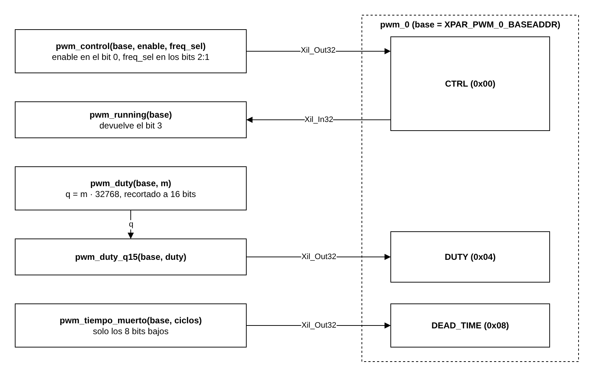

# Driver del PWM en C

# 1. Introducción

`pwm_driver.h` tiene las funciones que usa el programa en C para manejar el periférico PWM. Cada función escribe o lee uno de los registros del PWM con `Xil_Out32()` o `Xil_In32()`.

Los offsets y los campos son los mismos de la tabla de registros de `pwm_axi` (ver la documentación del PWM). La dirección base sale de `xparameters.h` (`XPAR_PWM_0_BASEADDR`) y no se escribe a mano, porque la asigna el Address Editor de Vivado.

---

# 2. Diagrama

*Figura 1: funciones del driver y registro que usa cada una.*

---

# 3. Constantes

| Constante | Valor | Descripción |
|-----------|-------|-------------|
| `PWM_REG_CTRL` | `0x00` | Registro de control y estado. |
| `PWM_REG_DUTY` | `0x04` | Registro de `duty_ref`. |
| `PWM_REG_DT` | `0x08` | Registro del tiempo muerto. |
| `PWM_CTRL_ENABLE` | `0x1` | Bit 0: `enable`. |
| `PWM_CTRL_FREQ_SHIFT`, `PWM_CTRL_FREQ_MASK` | `1`, `0x6` | Bits 2:1: `freq_sel`. |
| `PWM_CTRL_RUNNING` | `0x8` | Bit 3: `running` (solo lectura). |
| `PWM_FREQ_100KHZ`, `PWM_FREQ_80KHZ`, `PWM_FREQ_125KHZ` | 0, 1, 2 | Valores de `freq_sel`. |

---

# 4. Funciones

| Función | Registro | Qué hace |
|---------|----------|----------|
| `pwm_control(base, enable, freq_sel)` | CTRL | Arma `enable | (freq_sel << 1)` y lo escribe. Se escriben los dos campos juntos. |
| `pwm_running(base)` | CTRL | Lee el registro y devuelve el bit 3. |
| `pwm_duty(base, m)` | DUTY | Recibe `m` entre −1 y 1, lo multiplica por 32768, lo recorta a 16 bits con signo y llama a `pwm_duty_q15()`. |
| `pwm_duty_q15(base, duty)` | DUTY | Escribe `duty` ya en Q1.15. Los bits [31:16] van en 0. |
| `pwm_tiempo_muerto(base, ciclos)` | DEAD_TIME | Escribe los 8 bits bajos de `ciclos` (cada ciclo es de 10 ns). |

Todas son `static inline`, así que se pueden llamar desde la rutina de interrupción sin agregar llamadas.

En `pwm_duty()` el recorte a ±1 es solo para que el valor quepa en 16 bits. El límite real lo pone el hardware: `pwm_axi` satura `duty_ref` a ±`M_MAX` (≈ 0,95) y el tiempo muerto a un mínimo de `DT_MIN` (10 ciclos). Así el puente H queda protegido aunque el software escriba un valor fuera de rango. En el programa, el PR ya limita `m` a ±0,8 (`PR_M_MAX`), así que en operación normal no se llega al límite del hardware.

---

# 5. Uso en el programa

| Momento | Llamadas |
|---------|----------|
| Al iniciar (`control_isr_iniciar()`) | `pwm_control(base, 0, PWM_FREQ_100KHZ)`, `pwm_duty_q15(base, 0)`, `pwm_tiempo_muerto(base, 20)` |
| En cada interrupción (`rutina_control()`) | `pwm_duty(base, m)` y `pwm_control(base, activo o emulador, control_freq_sel)` |
| Cada segundo (`main()`) | `pwm_running(base)`, que se imprime como `run=` en la terminal |

---

# 6. Validación

Se probaron los registros desde C en la tarjeta. Con el analizador del osciloscopio se midieron las tres frecuencias (100, 80 y 125 kHz), el tiempo muerto de 200 ns y el apagado de las cuatro compuertas al escribir `enable = 0` (pruebas 1 y 2 del informe).

---

# Referencias

1. AMD, *Vitis Unified Software Platform Documentation* (UG1416). <https://docs.amd.com/v/u/en-US/ug1416-vitis-documentation>
2. AMD, *AXI Reference Guide* (UG1037). <https://docs.amd.com/v/u/en-US/ug1037-vivado-axi-reference-guide>
