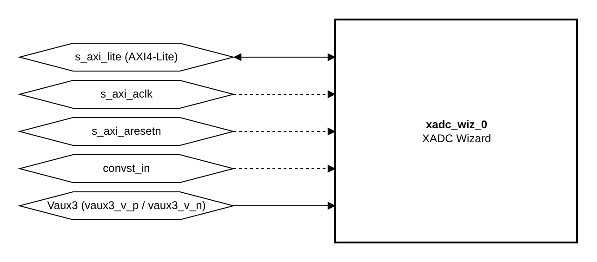
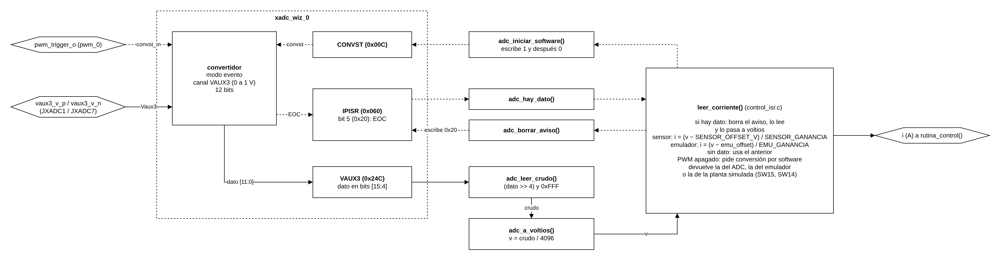

# Adquisición de la corriente con el XADC


# 1. Introducción

Este documento describe cómo se mide la corriente con el XADC de la Artix-7. Para el hardware se usa el IP XADC Wizard de Vivado con interfaz AXI4-Lite (`xadc_wiz_0`), y para el software el driver `adc_driver.h` y la función `leer_corriente()` de `control_isr.c`.

La conversión puede empezar de dos formas: con el pulso `pwm_trigger_o` del PWM o por software. El bit EOC avisa que hay una muestra nueva y el MicroBlaze V lee el dato por AXI.

El sensor de corriente y su acondicionamiento son parte de la etapa de potencia (EL4201). Aquí solo se describe la conversión de la tensión que llega al XADC.

---

# 2. Objetivos

## Objetivo general

Medir la corriente de la carga con el XADC de forma sincronizada con el PWM y entregarla en amperios a la rutina de control.

## Objetivos específicos

- Configurar el XADC en el canal VAUX3 con inicio de conversión externo.
- Iniciar la conversión con `pwm_trigger_o` y también por software.
- Detectar que hay una muestra nueva con el bit EOC.
- Pasar el dato de 12 bits a voltios y después a amperios.

---

# 3. Configuración del XADC Wizard

| Parámetro | Valor | Por qué |
|-----------|-------|---------|
| Interfaz | AXI4-Lite | El MicroBlaze V lee los registros por el bus. |
| Modo de temporización | Evento (`Event`) | Cada conversión empieza con un flanco de subida en `convst_in` o en el registro CONVST. |
| Canal | Uno solo, `VAUXP3/VAUXN3` | Es el canal que llega al conector JXADC de la Nexys 4. |
| `ENABLE_CONVST` | Sí | Crea la entrada `convst_in`, que se conecta a `pwm_trigger_o`. |
| Reloj `DCLK` | 100 MHz | El mismo reloj del sistema. |
| Alarmas | Desactivadas | No se usan. |

La entrada analógica es unipolar, de 0 a 1 V, y llega por JXADC1 (A13, `vaux3_v_p`) y JXADC7 (A14, `vaux3_v_n`).



*Figura 1: bloque de `xadc_wiz_0` en el Block Design.*

---

# 4. Diagrama



*Figura 2: XADC, registros usados y funciones del driver.*

Dentro de `xadc_wiz_0`, el convertidor recibe el disparo por `convst_in` (desde `pwm_trigger_o`) o por el registro CONVST. Al terminar la conversión deja el dato en el registro VAUX3 y marca EOC en IPISR.

A la derecha están las funciones de `adc_driver.h`. `leer_corriente()` las llama en cada interrupción: pregunta si hay dato, lo lee, borra el aviso y pasa el valor a voltios. Si el PWM está apagado, pide la siguiente conversión por software.

---

# 5. Registros usados

Los offsets son los del XADC Wizard con interfaz AXI. La dirección base es `XPAR_XADC_WIZ_0_BASEADDR`.

| Offset | Nombre en el driver | Uso |
|--------|---------------------|-----|
| `0x00C` | `ADC_REG_CONVST` | Escribir 1 y después 0 inicia una conversión. |
| `0x060` | `ADC_REG_IPISR` | Bandera EOC (`0x20`). Se queda en 1 hasta que se borra escribiendo 1. |
| `0x24C` | `ADC_REG_VAUX3` | Dato del canal VAUX3. Los 12 bits están en [15:4]. |

---

# 6. Driver `adc_driver.h`

| Función | Qué hace |
|---------|----------|
| `adc_iniciar_software(base)` | Escribe 1 y después 0 en CONVST. La conversión arranca con el flanco de subida. Si el registro se deja en 1, tampoco funciona el disparo con `pwm_trigger_o`. |
| `adc_hay_dato(base)` | Devuelve 1 si EOC está en 1 en IPISR. |
| `adc_borrar_aviso(base)` | Escribe `0x20` en IPISR para borrar EOC. |
| `adc_leer_crudo(base)` | Lee VAUX3 y devuelve `(dato >> 4) & 0xFFF`, de 0 a 4095. |
| `adc_a_voltios(crudo)` | Devuelve `crudo / 4096`, en voltios (de 0 a 1 V). |

Son funciones `static inline`, así que no agregan llamadas dentro de la rutina de interrupción.

---

# 7. Funcionamiento

## 7.1 Inicio de la conversión

Con el PWM corriendo, `pwm_trigger_o` da un pulso en cada valle de la portadora. El valle es el centro del pulso alto de cada pierna (conduce el transistor de arriba), así que con valores normales de `m` queda lejos de las conmutaciones; cerca de `M_MAX` el pulso de una pierna se vuelve corto y los flancos quedan más cerca del disparo. A 100 kHz hay cinco disparos por cada periodo de muestreo de 50 µs (cuatro a 80 kHz y 6,25 a 125 kHz). La rutina de interrupción lee la última conversión que terminó. La fase entre el Timer y el PWM depende de cuándo se habilitó el PWM, así que la muestra que se lee puede tener entre 0 y un periodo de conmutación de antigüedad (hasta 10 µs a 100 kHz), y a 125 kHz esa antigüedad cambia de una interrupción a otra.

Con el PWM apagado no hay disparos, entonces `leer_corriente()` pide la siguiente conversión por software al final de la lectura. El dato estará listo en la siguiente interrupción.

## 7.2 `leer_corriente()`

1. Si `adc_hay_dato()` da 1, se borra EOC, se lee el dato crudo y se pasa a voltios. Se borra antes de leer para que, si termina otra conversión en medio, su aviso no se pierda. También se guarda la lectura en mV para imprimirla y se incrementa `control_adc_nuevos`.
2. Si no hay dato nuevo, se usa la última corriente calculada y se incrementa `control_adc_sin_dato`.
3. Si el PWM está apagado, se pide una conversión por software.
4. Se devuelve la corriente del XADC, o la de la planta simulada si SW15 y SW14 están abajo.

## 7.3 Conversión a amperios

Con el sensor de la etapa de potencia (SW15 = 1):

```text
i = (v − SENSOR_OFFSET_V) / SENSOR_GANANCIA,   SENSOR_OFFSET_V = 0,5 V,   SENSOR_GANANCIA = 0,4 V/A
```

Con el emulador (SW14 = 1), JA1 y JA4 pasan por un filtro RC hasta un nodo que entra a JXADC1. La tensión de ese nodo tiene un offset más una parte proporcional a `m`, y se convierte así:

```text
i = (v − emu_offset) / EMU_GANANCIA,   EMU_GANANCIA = 0,137 V/A
```

`EMU_GANANCIA` se escogió para que un mismo `m` dé la misma corriente que la carga real (`Vdc · m / R = 18 · m / 5,0`). El offset se aprende solo: mientras el lazo está apagado `m = 0` y lo que se lee es el offset, así que se promedia con

```text
emu_offset = emu_offset + 0,01 · (v − emu_offset)
```

El valor inicial es 0,47 V.

---

# 8. Consideraciones de diseño

- El rango del XADC es de 0 a 1 V. La salida del sensor tiene que acondicionarse para quedar en ese rango; eso lo define PEDP.
- Un LSB equivale a 1 V / 4096 ≈ 0,24 mV.
- EOC se queda guardado en IPISR hasta que el software lo borra, así que no se pierde el aviso aunque la conversión termine mientras la ISR no está corriendo.
- Si en una interrupción no hay dato nuevo, el control usa el anterior y el contador `control_adc_sin_dato` lo deja ver en la terminal.
- La configuración del XADC (canal, modo evento, `convst_in`) queda fija en el Block Design; el programa no la cambia.

---

# 9. Validación

| Prueba | Resultado |
|--------|-----------|
| Tensión DC con los dos disparos | Se leyó la tensión con el inicio por software y con `pwm_trigger_o`. |
| Emulador RC con el lazo apagado (prueba 4 del informe) | `i = 0 ± 3 mA`, o sea que el offset se aprendió bien. |
| Emulador RC con el lazo cerrado (prueba 6 del informe) | La amplitud del seno medida con el osciloscopio en el nodo del RC coincide, con 4 a 7 mV de diferencia, con la que se calcula del ciclo de trabajo exportado. |

---

# Referencias

1. AMD, *XADC Wizard LogiCORE IP Product Guide* (PG091).
2. AMD, *MicroBlaze V Embedded Design Tutorial* (UG1711). <https://docs.amd.com/r/en-US/ug1711-microblaze-v-embedded-design>
3. AMD, *Vitis Unified Software Platform Documentation* (UG1416). <https://docs.amd.com/v/u/en-US/ug1416-vitis-documentation>
