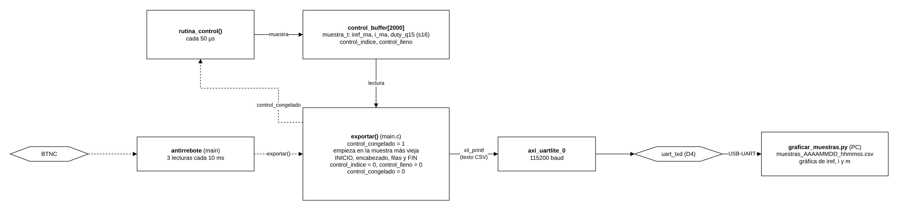
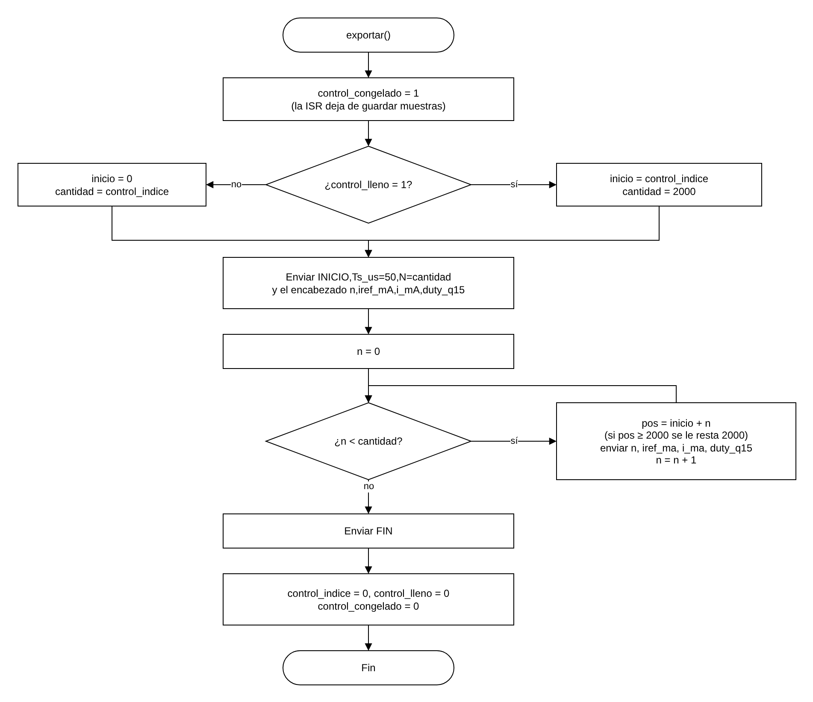

# Buffer circular y exportación por UART


# 1. Introducción

Este documento describe cómo se guardan las muestras del lazo de control y cómo se envían a la PC. La rutina de interrupción guarda cada muestra en un buffer circular. Al presionar BTNC, el lazo principal envía todo el buffer por la UART en formato CSV, sin detener el control.

El buffer está en `control_isr.c` y la exportación en `main.c`. Para la UART se usa el IP AXI UART Lite (`axi_uartlite_0`) a 115200 baud, 8 bits de datos, sin paridad, y se escribe con `xil_printf()`. En la PC, el script `graficar_muestras.py` recibe los datos (tiene su propio documento).

---

# 2. Objetivos

## Objetivo general

Guardar el histórico de muestras del lazo y exportarlo a la PC a pedido del usuario sin afectar la ejecución periódica del control.

## Objetivos específicos

- Guardar en cada interrupción la referencia, la corriente y el ciclo de trabajo.
- Mantener las últimas 2000 muestras en un buffer circular.
- Detectar BTNC con antirrebote y exportar una sola vez por cada presión.
- Enviar las muestras en orden, de la más vieja a la más nueva.

---

# 3. Diagrama



*Figura 1: camino de una muestra desde la rutina de interrupción hasta la PC.*

`rutina_control()` escribe una muestra en `control_buffer` cada 50 µs. Cuando el antirrebote detecta BTNC, `main` llama a `exportar()`, que pone `control_congelado = 1` para que la ISR deje de escribir, lee el buffer y lo envía con `xil_printf()` a `axi_uartlite_0`. La señal sale por `uart_txd` (pin D4) al puente USB-UART de la tarjeta y llega a la PC.

---

# 4. Buffer circular

Cada muestra es una estructura `muestra_t` de tres enteros con signo de 16 bits:

| Campo | Unidad | Contenido |
|-------|--------|-----------|
| `iref_ma` | mA | Referencia de corriente. |
| `i_ma` | mA | Corriente medida. |
| `duty_q15` | Q1.15 | `m · 32768`, el valor que se escribió al PWM. |

Se usan enteros y no `float` para que cada muestra ocupe 6 bytes. El buffer es `volatile` porque lo escribe la ISR y lo lee `main`. Con `CONTROL_N_BUFFER = 2000` el buffer ocupa 12 000 bytes y guarda 100 ms, o sea cinco ciclos de 50 Hz.

El buffer usa dos variables:

- `control_indice`: posición donde se escribe la siguiente muestra. Al llegar a 2000 vuelve a 0.
- `control_lleno`: se pone en 1 la primera vez que el índice da la vuelta. Desde ahí, la muestra más vieja es la que está en `control_indice`.

La escritura se hace después de actualizar el PWM, solo si `control_congelado = 0` (ver el diagrama de flujo de la ISR en el documento del control).

---

# 5. Exportación

## 5.1 Botón

`main` lee BTNC cada 10 ms. La variable `presionado` cuenta las lecturas seguidas con el botón presionado y la exportación empieza cuando llega a 3 (30 ms). `ya_exportado` evita que se vuelva a exportar mientras el botón siga presionado; las dos se ponen en 0 al soltarlo. Durante la exportación se enciende LD2.

## 5.2 `exportar()`



*Figura 2: diagrama de flujo de `exportar()`.*

1. Se pone `control_congelado = 1`. Desde la siguiente interrupción la ISR ya no escribe en el buffer, así que no cambia mientras se envía.
2. Se decide desde dónde empezar:
   - Si el buffer ya dio la vuelta (`control_lleno = 1`), se empieza en `control_indice` y se envían 2000 muestras.
   - Si no, se empieza en 0 y se envían `control_indice` muestras.
3. Se envía la línea `INICIO` con el periodo de muestreo y la cantidad, y después el encabezado.
4. Se envía una línea por muestra. La posición es `inicio + n` y, si pasa de 1999, se le resta 2000 para dar la vuelta.
5. Se envía `FIN`.
6. Se ponen en 0 `control_indice` y `control_lleno`, y `control_congelado` vuelve a 0. El buffer empieza de cero.

## 5.3 Formato

```text
INICIO,Ts_us=50,N=2000
n,iref_mA,i_mA,duty_q15
0,117,118,2192
1,115,113,2149
2,112,112,2092
...
1999,120,120,2242
FIN
```

Las filas del ejemplo son de una exportación real con 0,2 A y el lazo cerrado con el emulador. La línea `INICIO` trae `Ts_us` para que la PC pueda calcular el tiempo de cada muestra.

---

# 6. Por qué no afecta el lazo

- La UART se usa solo desde `main`. La rutina de interrupción no espera a la UART en ningún momento.
- Mientras `xil_printf()` espera a que la UART tenga espacio, la interrupción del Timer sigue entrando y el control sigue corriendo cada 50 µs.
- Con `control_congelado = 1` la ISR se salta la escritura del buffer, así que `exportar()` nunca lee una muestra a medio escribir.

Se midió con el pin de prueba: durante la exportación la ISR sigue cada 50 µs y dura 8,57 µs, menos que los ≈ 10,75 µs normales porque no guarda la muestra.

---

# 7. Consideraciones de diseño

- Las 2000 muestras que se exportan son seguidas y no les falta ninguna. Las muestras que ocurren mientras se exporta no se guardan, porque el buffer está congelado.
- La exportación dura unos 3 s: son unas 2000 líneas de unos 18 caracteres (≈ 36 KB) a 115 200 baud (≈ 11,5 KB/s).
- Mientras se exporta, `main` está dentro de `exportar()`. En cada línea se lee SW0 y, si se bajó, se apaga el lazo, así que se puede apagar aunque se esté exportando. Los demás switches se aplican cuando termina la exportación.
- Después de exportar el buffer queda vacío. Si se presiona BTNC enseguida, se envían solo las muestras que se guardaron desde entonces.

---

# 8. Validación

Se exportó el buffer con el lazo abierto y con el lazo cerrado, con las tres amplitudes. En todos los casos llegaron 2000 muestras con `n` de 0 a 1999 sin saltos, y `iref` cruza por cero cada 200 muestras (50 Hz). Los resultados completos están en el informe.

---

# Referencias

1. AMD, *MicroBlaze V Embedded Design Tutorial* (UG1711). <https://docs.amd.com/r/en-US/ug1711-microblaze-v-embedded-design>
2. AMD, *Vitis Unified Software Platform Documentation* (UG1416). <https://docs.amd.com/v/u/en-US/ug1416-vitis-documentation>
