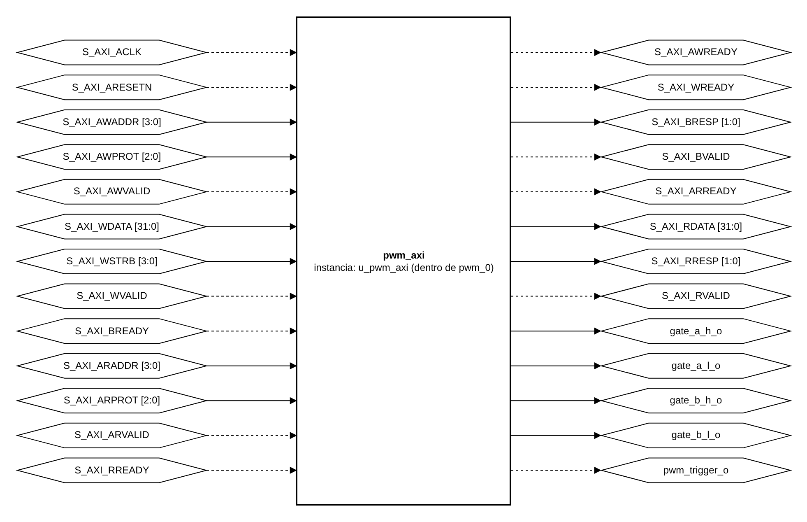
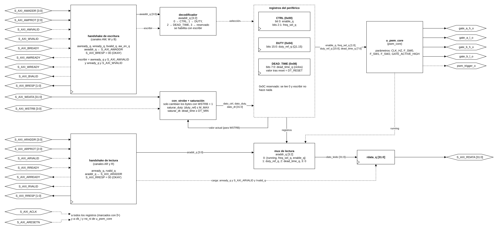
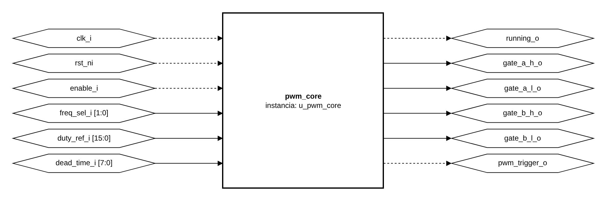
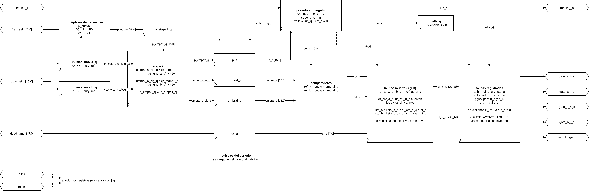
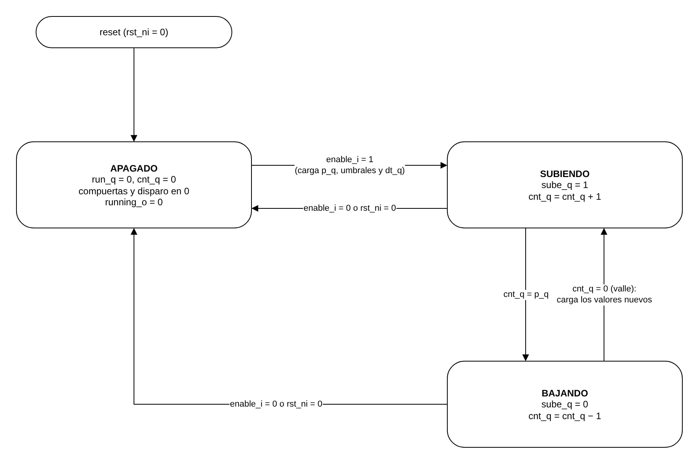

# Subsistema PWM


# 1. Introducción

Este periférico genera una modulación PWM unipolar con tiempo muerto para las cuatro compuertas del puente H. Además produce un pulso de disparo que sirve para sincronizar la lectura del ADC con la conmutación.

Este documento describe los módulos en SystemVerilog, sus registros y cómo el MicroBlaze V los configura. La etapa de potencia (puente H, drivers de compuerta y carga RL) y el controlador PR no se explican aquí.

El diseño está implementado en SystemVerilog, es sintetizable y se divide en dos módulos. Cada uno tiene su propio testbench autoverificable.

---

# 2. Objetivos del subsistema PWM

## Objetivo general

Diseñar un periférico PWM con interfaz AXI4-Lite que genere la modulación unipolar con tiempo muerto para un puente H y que el MicroBlaze V pueda configurar mediante registros.

## Objetivos específicos

- Generar una portadora triangular con al menos tres frecuencias de conmutación seleccionables.
- Implementar la modulación PWM unipolar con una referencia con signo.
- Insertar un tiempo muerto configurable entre los dos transistores de cada pierna.
- Generar el pulso `pwm_trigger_o` para sincronizar el ADC.
- Exponer registros de control, referencia y tiempo muerto mediante AXI4-Lite.
- Saturar los valores fuera de rango para proteger el puente H.
- Verificar el diseño con testbenches autoverificables.

---

# 3. Arquitectura general del subsistema

El subsistema PWM está compuesto por dos módulos.

| Módulo | Función principal |
|--------|-------------------|
| `pwm_axi` | Es el módulo superior. Implementa la interfaz AXI4-Lite, guarda los registros y satura los valores fuera de rango. |
| `pwm_core` | Es el núcleo del PWM. Genera la portadora, la modulación unipolar, el tiempo muerto y el disparo del ADC. |

La idea es separar claramente la comunicación con el procesador (`pwm_axi`) de la generación de las señales (`pwm_core`). El núcleo no sabe nada de AXI: solo recibe valores ya listos y los convierte en señales de compuerta.

Dentro de `pwm_core` hay varios bloques lógicos. No son módulos aparte, pero ayudan a entender cómo funciona.

| Bloque | Función |
|--------|---------|
| MUX de frecuencia | Escoge el medio periodo de la portadora según `freq_sel_i`. |
| Cálculo de umbrales | Convierte `duty_ref_i` en un umbral para cada pierna. |
| Registros del periodo | Guardan los valores que se usan durante todo el periodo. Se cargan solo en el valle. |
| Portadora triangular | Contador que sube y baja. |
| Comparadores | Comparan la portadora con cada umbral y dan la señal de cada pierna. |
| Tiempo muerto | Retrasa el encendido de cada transistor. |
| Salidas registradas | Entregan las cuatro compuertas y el disparo. |

---

# 4. Visión general del PWM

## Objetivo

Mostrar el PWM como un único periférico conectado entre el MicroBlaze V y el puente H.

## Descripción

El MicroBlaze V escribe en los registros del PWM por el bus AXI4-Lite. El periférico usa esos valores para generar cuatro señales de compuerta, que van hacia el circuito de accionamiento del puente H. También entrega un pulso de disparo hacia el ADC.



*Figura: puertos de `pwm_axi`.*

## Interfaces externas

### Entradas

| Señal | Descripción |
|-------|-------------|
| `S_AXI_ACLK` | Reloj principal del sistema (100 MHz). |
| `S_AXI_ARESETN` | Reinicio del subsistema, activo en bajo. |
| `S_AXI_AW*`, `S_AXI_W*`, `S_AXI_BREADY` | Canales de escritura del bus AXI4-Lite. |
| `S_AXI_AR*`, `S_AXI_RREADY` | Canales de lectura del bus AXI4-Lite. |

### Salidas

| Señal | Descripción |
|-------|-------------|
| `gate_a_h_o` | Compuerta del transistor de arriba de la pierna A. |
| `gate_a_l_o` | Compuerta del transistor de abajo de la pierna A. |
| `gate_b_h_o` | Compuerta del transistor de arriba de la pierna B. |
| `gate_b_l_o` | Compuerta del transistor de abajo de la pierna B. |
| `pwm_trigger_o` | Pulso de un ciclo para disparar la conversión del ADC. |
| `S_AXI_*READY`, `S_AXI_*VALID`, `S_AXI_*RESP`, `S_AXI_RDATA` | Respuestas del bus AXI4-Lite. |

---

# 5. Organización del periférico

## Objetivo

Mostrar cómo `pwm_axi` conecta el bus AXI, los registros y el núcleo.

## Organización interna

```
pwm_axi
│
├── Handshake de escritura (AW, W, B)
├── Decodificador de dirección
├── Registros (CTRL, DUTY, DEAD_TIME)
├── Handshake y mux de lectura (AR, R)
└── pwm_core
    ├── MUX de frecuencia
    ├── Cálculo de umbrales
    ├── Registros del periodo
    ├── Portadora triangular
    ├── Comparadores
    ├── Tiempo muerto
    └── Salidas registradas
```

Cada módulo realiza una tarea específica.

### `pwm_axi`

Se encarga de hablar con el procesador y de guardar la configuración.

### `pwm_core`

Se encarga únicamente de generar las señales PWM.

---

# 6. Descripción de los módulos

## 6.1 Módulo `pwm_axi.sv`

### 1. Introducción

`pwm_axi.sv` es el módulo superior del periférico. La parte AXI sigue la misma estructura del esclavo que genera Vivado con *Create and Package New IP*: usa los mismos nombres `S_AXI_*` y un reset `S_AXI_ARESETN` activo en bajo.

Su trabajo es recibir las lecturas y escrituras del MicroBlaze V, guardar los valores en registros, saturar los que estén fuera de rango y entregárselos a `pwm_core`.

---

### 2. Objetivo del módulo

Proporcionar al procesador una forma sencilla de configurar el PWM mediante registros de memoria mapeada.

Sus responsabilidades son:

- Atender las escrituras y lecturas del bus AXI4-Lite.
- Guardar `enable`, `freq_sel`, `duty_ref` y `dead_time`.
- Saturar `duty_ref` y `dead_time`.
- Respetar `WSTRB` para escribir solo los bytes indicados.
- Instanciar `pwm_core` y conectarlo a los registros.
- Devolver el bit `running` al procesador.

---

### 3. Diagrama del módulo



*Figura: estructura interna de `pwm_axi`.*

En el diagrama, el handshake de escritura genera la señal `escribir` cuando llegan juntos AW y W. El decodificador usa `awaddr_q[3:2]` para escoger cuál registro se actualiza. El dato pasa antes por el bloque de `WSTRB` y saturación. Para leer, el mux escoge el registro según `araddr_q[3:2]` y el resultado se guarda en `rdata_q`.

---

### 4. Mapa de registros

| Offset | Registro | Bits | Acceso | Descripción |
|--------|----------|------|--------|-------------|
| `0x00` | Control/Estado | [0] `enable` | R/W | Habilita la generación PWM. |
| | | [2:1] `freq_sel` | R/W | Selecciona la frecuencia de conmutación. |
| | | [3] `running` | RO | Indica que el generador está activo. |
| | | [31:4] | | Reservado, lee 0. |
| `0x04` | Duty/Referencia | [15:0] `duty_ref` | R/W | Referencia de modulación en Q1.15 con signo. |
| | | [31:16] | | Reservado, lee 0. |
| `0x08` | Tiempo muerto | [7:0] `dead_time` | R/W | Tiempo muerto en ciclos de reloj. |
| | | [31:8] | | Reservado, lee 0. |
| `0x0C` | Reservado | | | Lee 0. Escribirlo no hace nada. |

Valores de `freq_sel`:

| `freq_sel` | Frecuencia de conmutación |
|------------|---------------------------|
| `00` | 100 kHz |
| `01` | 80 kHz |
| `10` | 125 kHz |
| `11` | Se toma como `00` |

Valores después de un reset: `enable = 0`, `freq_sel = 00`, `duty_ref = 0` y `dead_time = 20`.

El periférico solo genera la modulación unipolar, así que no tiene un campo de selección de modulación.

---

### 5. Entradas y salidas

#### Entradas

| Señal | Descripción |
|-------|-------------|
| `S_AXI_ACLK` | Reloj del sistema. |
| `S_AXI_ARESETN` | Reinicio activo en bajo. |
| `S_AXI_AWADDR`, `S_AXI_AWVALID` | Dirección de escritura y su validación. |
| `S_AXI_WDATA`, `S_AXI_WSTRB`, `S_AXI_WVALID` | Dato de escritura, bytes válidos y su validación. |
| `S_AXI_BREADY` | El maestro acepta la respuesta de escritura. |
| `S_AXI_ARADDR`, `S_AXI_ARVALID` | Dirección de lectura y su validación. |
| `S_AXI_RREADY` | El maestro acepta el dato leído. |

#### Salidas

| Señal | Descripción |
|-------|-------------|
| `S_AXI_AWREADY`, `S_AXI_WREADY` | El periférico aceptó la dirección y el dato. |
| `S_AXI_BVALID`, `S_AXI_BRESP` | Respuesta de escritura (siempre OKAY). |
| `S_AXI_ARREADY` | El periférico aceptó la dirección de lectura. |
| `S_AXI_RVALID`, `S_AXI_RDATA`, `S_AXI_RRESP` | Dato leído y su respuesta (siempre OKAY). |
| `gate_a_h_o`, `gate_a_l_o`, `gate_b_h_o`, `gate_b_l_o` | Señales de compuerta que vienen de `pwm_core`. |
| `pwm_trigger_o` | Disparo del ADC que viene de `pwm_core`. |

---

### 6. Funcionamiento general

#### Escritura

1. El maestro pone la dirección y el dato, y activa `AWVALID` y `WVALID`.
2. El periférico espera a tener los dos y los acepta en el mismo ciclo con `AWREADY` y `WREADY`.
3. Se genera `escribir`, y el decodificador escoge el registro según los bits [3:2] de la dirección.
4. El dato se mezcla con el valor anterior usando `WSTRB`: solo cambian los bytes con su bit en 1.
5. Si el registro es `duty_ref` o `dead_time`, el valor pasa por la saturación antes de guardarse.
6. Se activa `BVALID` y se mantiene hasta que el maestro da `BREADY`.

El bit `running` no se guarda porque es de solo lectura. Si el procesador lo escribe, no pasa nada.

#### Lectura

1. El maestro pone la dirección y activa `ARVALID`.
2. El periférico guarda la dirección y responde con `ARREADY`.
3. El mux escoge el registro según los bits [3:2] de la dirección.
4. El dato se guarda en `rdata_q` y se activa `RVALID` hasta que el maestro da `RREADY`.

---

### 7. Saturación

`pwm_axi` protege al puente H limitando los valores antes de guardarlos.

| Registro | Regla | Valor |
|----------|-------|-------|
| `duty_ref` | Se limita a `-M_MAX ... +M_MAX` | `M_MAX = 31129` (≈ 0,95 en Q1.15) |
| `dead_time` | No puede ser menor que `DT_MIN` | `DT_MIN = 10` ciclos (100 ns) |

Por ejemplo, si el procesador escribe `0x7FFF` en `duty_ref`, el registro guarda `31129`. Si escribe `0` en `dead_time`, el registro guarda `10`. Al leer el registro se obtiene el valor ya saturado.

---

### 8. Consideraciones de diseño

- Esta parte del módulo sigue la estructura del esclavo AXI4-Lite de Vivado, lo que facilita empaquetarlo como IP.
- Las respuestas `BRESP` y `RRESP` siempre son OKAY, incluso al acceder al registro reservado `0x0C`.
- La dirección es de 4 bits, así que solo existen cuatro registros de 32 bits. Una dirección fuera de ese rango no genera error: el Block Design le da 4 KB a `pwm_0` y el periférico solo mira los bits [3:2], así que los registros se repiten (por ejemplo, base + `0x14` es `duty_ref`).
- La saturación está en hardware y no depende de que el software la haga bien.

---

### 9. Validación del módulo

La validación de `pwm_axi` se realiza mediante `tb_pwm_axi.sv`. El testbench hace de maestro AXI4-Lite, igual que lo haría el MicroBlaze V.

Las pruebas principales verifican:

- Valores de los registros después de un reset.
- Lectura y escritura de cada registro.
- Que `running` no se pueda escribir.
- Saturación de `duty_ref` y de `dead_time`.
- Uso de `WSTRB`.
- Escrituras con AW y W en ciclos distintos (en los dos órdenes).
- Respuesta del registro reservado.
- Que el PWM arranque y se apague desde los registros, y que el periodo medido coincida con el esperado.
- Que `pwm_trigger_o` caiga en el valle (la mitad del pulso alto).

El detalle del testbench y sus resultados está en `DOCUMENTACION_TB_PWM_AXI.md`.

---

## 6.2 Módulo `pwm_core.sv`

### 1. Introducción

`pwm_core.sv` es el núcleo del PWM. No sabe nada de AXI: recibe `enable`, `freq_sel`, `duty_ref` y `dead_time` ya listos y saturados, y genera las cuatro señales de compuerta y el disparo del ADC.

---

### 2. Objetivo del módulo

Generar la modulación PWM unipolar con tiempo muerto para el puente H.

Sus responsabilidades son:

- Generar la portadora triangular.
- Comparar la portadora con la referencia de cada pierna.
- Insertar el tiempo muerto.
- Generar `pwm_trigger_o`.
- Apagar las compuertas cuando `enable_i` o el reset lo piden.

---

### 3. Diagrama del módulo



*Figura: puertos de `pwm_core`.*



*Figura: estructura interna de `pwm_core`.*

En el diagrama, `duty_ref_i` pasa por dos etapas registradas para calcular los umbrales. Los umbrales, el medio periodo y el tiempo muerto se copian en los registros del periodo solo cuando la portadora llega al valle (`cnt_q = 0`). Después los comparadores usan `cnt_q` y los umbrales para dar la señal de cada pierna, que pasa por el tiempo muerto y llega a las salidas.

---

### 4. Entradas y salidas

#### Entradas

| Señal | Descripción |
|-------|-------------|
| `clk_i` | Reloj principal (100 MHz). |
| `rst_ni` | Reinicio síncrono, activo en bajo. |
| `enable_i` | Habilita la generación PWM. |
| `freq_sel_i` | Selecciona la frecuencia de conmutación. |
| `duty_ref_i` | Referencia en Q1.15 con signo, ya saturada. |
| `dead_time_i` | Tiempo muerto en ciclos de reloj. |

#### Salidas

| Señal | Descripción |
|-------|-------------|
| `running_o` | Indica que el generador está activo. |
| `gate_a_h_o`, `gate_a_l_o` | Compuertas de la pierna A (arriba y abajo). |
| `gate_b_h_o`, `gate_b_l_o` | Compuertas de la pierna B (arriba y abajo). |
| `pwm_trigger_o` | Pulso de un ciclo en cada valle de la portadora. |

---

### 5. Funcionamiento general

#### 5.1 Portadora triangular

Un contador (`cnt_q`) sube de 0 hasta `P` y después baja de `P` hasta 0. Eso forma la portadora triangular. Un periodo completo dura `2·P` ciclos de reloj, así que la frecuencia de conmutación de cada transistor es:

```
f_sw = f_clk / (2·P)
```

Con el reloj de 100 MHz, `freq_sel` escoge `P` así:

| `freq_sel` | `f_sw` | `P` | Periodo de la portadora |
|------------|--------|-----|-------------------------|
| `00` | 100 kHz | 500 | 1000 ciclos (10 µs) |
| `01` | 80 kHz | 625 | 1250 ciclos (12,5 µs) |
| `10` | 125 kHz | 400 | 800 ciclos (8 µs) |
| `11` | 100 kHz | 500 | Se toma como `00` |

Cuando el contador llega a 0 se dice que está en el **valle**.

#### 5.2 Cálculo de los umbrales

La portadora va de 0 a `P`, y la referencia `m` (`duty_ref_i`) va de -1 a +1. Para compararlas hay que pasar `m` a la misma escala. La señal de la pierna A está en alto mientras `cnt_q` sea menor que su umbral:

```
umbral_a = P · (1 + m) / 2
umbral_b = P · (1 - m) / 2
```

Como `m` está en Q1.15, `(1 + m) / 2` se calcula como `(m + 32768) / 65536`. La división entre 65536 es un corrimiento de 16 bits.

Este cálculo se hace en **dos etapas registradas** porque la suma, la multiplicación y la comparación juntas no caben en un ciclo de 10 ns:

1. Etapa 1: se calculan `1 + m` y `1 - m`, y se guarda el medio periodo.
2. Etapa 2: se multiplica por `P` y se desplaza 16 bits.

El cálculo corre todo el tiempo. Lo importante es **cuándo se usa el resultado**: solo se copia a los registros del periodo (`p_q`, `umbral_a`, `umbral_b`, `dt_q`) en el valle. Así, si el procesador cambia `duty_ref`, `freq_sel` o `dead_time` a mitad de un periodo, ese periodo termina con los valores viejos y no se corta ningún pulso. Como el cálculo tarda dos ciclos, un cambio de `duty_ref` o `freq_sel` se aplica en el siguiente valle, o a lo sumo en el siguiente a ese. `dead_time` no pasa por esas etapas y se aplica en el primer valle.

#### 5.3 Modulación unipolar

En la modulación unipolar, las dos piernas del puente H se comparan con la **misma portadora**, pero con referencias opuestas: la pierna A con `+m` y la pierna B con `-m`.

```
ref_a = (cnt_q < umbral_a)
ref_b = (cnt_q < umbral_b)
```

Cuando `ref` vale 1 conduce el transistor de arriba de la pierna, y cuando vale 0 conduce el de abajo. Como cada pierna cambia de estado por separado, la tensión entre las dos salidas del puente toma tres niveles: `+Vdc`, `0` y `-Vdc`.

Hay una diferencia importante entre dos frecuencias:

| Frecuencia | Valor con `freq_sel = 00` |
|------------|---------------------------|
| Conmutación de cada transistor (`f_sw`) | 100 kHz |
| Componente principal de la tensión entre salidas (`2·f_sw`) | 200 kHz |

Con `m = 0` las dos piernas trabajan al 50 %.

#### 5.4 Tiempo muerto

Si los dos transistores de una pierna se encienden a la vez hay un cortocircuito. Para evitarlo, `pwm_core` espera un tiempo (`dead_time`) entre apagar un transistor y encender el otro.

Cada pierna tiene un contador que cuenta cuántos ciclos lleva su `ref` sin cambiar:

- Si `ref` cambia, el contador vuelve a 0 y **las dos** compuertas de esa pierna se apagan.
- Cuando el contador llega a `dt_q`, la señal `listo` se activa y se enciende el transistor que corresponde.
- Una vez que `listo` está activo, se queda así hasta el siguiente cambio de `ref`. Por eso un cambio de `dead_time` no corta un pulso que ya empezó.

Las compuertas quedan así:

```
x_h = ref_q  &  listo
x_l = !ref_q &  listo        (x = a, b)
```

Un ciclo de reloj dura 10 ns. El valor al reset (`20`) equivale a 200 ns, el mínimo (`10`) a 100 ns y el máximo (`255`) a 2,55 µs.

#### 5.5 Disparo del ADC

`pwm_trigger_o` es un pulso de un ciclo que sale en cada valle de la portadora. Pasa por dos registros (`valle_q` y `trig`), igual que las compuertas, así que sale dos ciclos después de que el contador llega a 0 y queda alineado con ellas. En el valle se está en la mitad del pulso alto de las dos piernas (conduce el transistor de arriba). Con valores normales de `duty_ref` eso queda lejos de los flancos de conmutación, que es un buen momento para muestrear la corriente; cerca de `M_MAX` el pulso de una pierna se vuelve corto y los flancos quedan más cerca del disparo.

Hay un disparo por periodo de la portadora, o sea cada 1000, 1250 u 800 ciclos según `freq_sel`.

#### 5.6 Apagado y reset

Con `enable_i = 0` o `rst_ni = 0`:

- El contador se queda en 0 y `running_o` baja.
- Los registros del tiempo muerto se ponen en cero.
- Las cuatro compuertas y el disparo se apagan en el siguiente ciclo.

Si el driver del puente H es activo en bajo, el parámetro `GATE_ACTIVE_HIGH = 0` invierte las cuatro salidas.

---

### 6. Consideraciones de diseño

- El tiempo muerto se resta del ancho de cada pulso. Si `duty_ref` está cerca de `M_MAX` y `dead_time` es grande, el pulso corto de una pierna puede quedar muy angosto o desaparecer. Hay que escoger `dead_time` y el rango de `duty_ref` en conjunto con la parte de potencia.
- Los valores nuevos se cargan solo en el valle, así no hay pulsos cortados a medias.
- Las salidas están registradas, así que no tienen glitches por la lógica combinacional.
- El módulo no tiene un registro de estado aparte, pero `run_q` y `sube_q` funcionan como una máquina de tres estados:



*Figura: estados de la portadora de `pwm_core`.*

  Con `enable_i = 0` o en reset la portadora queda APAGADA. Al habilitar se cargan los valores y empieza a SUBIR; al llegar a `p_q` pasa a BAJAR, y en el valle (`cnt_q = 0`) carga los valores nuevos y vuelve a subir.

---

### 7. Validación del módulo

La validación de `pwm_core` se realiza mediante `tb_pwm_core.sv`.

Las pruebas principales verifican:

- Periodo de la portadora para cada valor de `freq_sel`.
- Ancho de los pulsos para varios valores de `duty_ref` (0, ±0,5 y ±`M_MAX`).
- Varios tiempos muertos (10, 20, 50 y 255 ciclos).
- Que un cambio de `duty_ref` o `freq_sel` a mitad de periodo solo se aplique en el siguiente valle.
- El pulso de `pwm_trigger_o`.
- Apagado con `enable_i` a mitad de periodo y encendido posterior.
- Reset a mitad de periodo.

Además, durante toda la simulación el testbench vigila tres cosas:

- Que nunca estén encendidos los dos transistores de una misma pierna.
- Que siempre se respete el tiempo muerto entre uno y otro.
- Que `pwm_trigger_o` dure un solo ciclo.

---

# 7. Flujo de comunicación del subsistema

El funcionamiento del PWM puede dividirse en tres procesos.

## Proceso de configuración

1. El procesador escribe `dead_time` en `0x08`.
2. Escribe `duty_ref` en `0x04`.
3. Escribe `enable = 1` y `freq_sel` en `0x00`.
4. `pwm_axi` guarda los valores, aplicando la saturación.
5. `pwm_core` empieza a generar las compuertas y activa `running`.

## Proceso de operación

1. La portadora sube y baja de forma continua.
2. En cada valle, `pwm_core` carga los valores nuevos de `duty_ref`, `freq_sel` y `dead_time`.
3. Los comparadores y el tiempo muerto producen las cuatro compuertas.
4. En cada valle sale también `pwm_trigger_o`, que dispara el ADC.

En el lazo de control, el procesador actualiza `duty_ref` en cada periodo de muestreo.

## Proceso de lectura

1. El procesador lee el registro `0x00`.
2. El mux de lectura entrega `{running, freq_sel, enable}`.
3. El procesador revisa `running` para saber si el generador está activo.

---

# 8. Interfaces internas del subsistema

## Interfaz entre `pwm_axi` y `pwm_core`

| Señal | Dirección | Descripción |
|-------|-----------|-------------|
| `enable_q` → `enable_i` | AXI → Core | Habilita la generación. |
| `freq_sel_q` → `freq_sel_i` | AXI → Core | Frecuencia de conmutación. |
| `duty_ref_q` → `duty_ref_i` | AXI → Core | Referencia Q1.15 ya saturada. |
| `dead_time_q` → `dead_time_i` | AXI → Core | Tiempo muerto ya saturado. |
| `running_o` → `running` | Core → AXI | Estado del generador. |
| `gate_*_o` | Core → salida | Compuertas del puente H. |
| `pwm_trigger_o` | Core → salida | Disparo del ADC. |

---

# 9. Parámetros de configuración

El diseño depende de algunos parámetros configurables.

## Frecuencias

| Parámetro | Valor | Descripción |
|-----------|-------|-------------|
| `CLK_HZ` | 100 000 000 | Frecuencia del reloj del sistema. |
| `F_SW0` | 100 000 | Frecuencia para `freq_sel = 00`. |
| `F_SW1` | 80 000 | Frecuencia para `freq_sel = 01`. |
| `F_SW2` | 125 000 | Frecuencia para `freq_sel = 10`. |

## Protecciones

| Parámetro | Valor | Descripción |
|-----------|-------|-------------|
| `M_MAX` | 31129 | Límite de `|duty_ref|` en Q1.15 (≈ 0,95). |
| `DT_RESET` | 20 | Tiempo muerto después de un reset (200 ns). |
| `DT_MIN` | 10 | Tiempo muerto mínimo permitido (100 ns). |

## Polaridad de las compuertas

| Parámetro | Valor | Descripción |
|-----------|-------|-------------|
| `GATE_ACTIVE_HIGH` | 1 | Con 0 se invierten las cuatro salidas (driver activo en bajo). |

## Tamaño de los datos

| Dato | Formato |
|------|---------|
| `duty_ref` | 16 bits, Q1.15 con signo |
| `dead_time` | 8 bits sin signo |
| `freq_sel` | 2 bits |
| Contador de la portadora | 16 bits |

---

# 10. Integración con el MicroBlaze V

El PWM se implementa como un periférico accesible mediante memoria mapeada, conectado al MicroBlaze V por AXI4-Lite. La dirección base la asigna el Address Editor del Block Design de Vivado, y los offsets son los del mapa de registros de la sección 6.1.

## Escritura

El procesador escribe en `dead_time`, `duty_ref` y `CTRL` para configurar y arrancar el PWM.

## Lectura

El procesador lee `CTRL` para consultar `running`, o cualquier otro registro para comprobar el valor guardado.

En el programa no se escribe a los registros directamente: se usan las funciones de `pwm_driver.h` con la dirección `XPAR_PWM_0_BASEADDR` de `xparameters.h` (ver `DOCUMENTACION_PWM_DRIVER.md`).

Esta organización permite reutilizar la misma interfaz que usan los otros periféricos del sistema. La salida `pwm_trigger_o` se conecta al disparo del ADC/XADC y las cuatro compuertas van a los pines que llegan al circuito de accionamiento del puente H.

---

