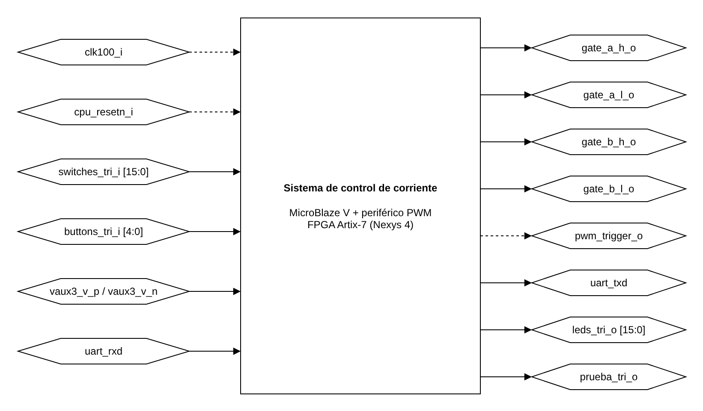
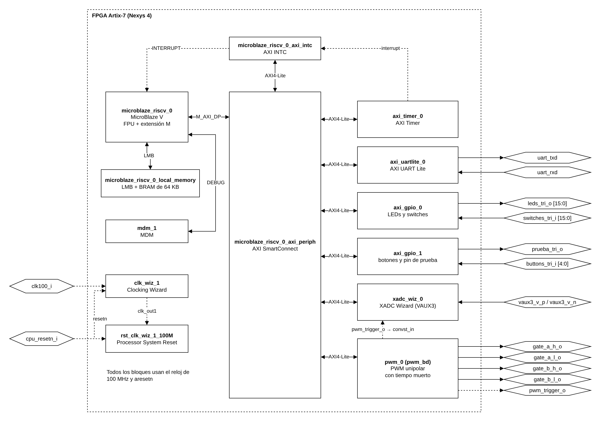
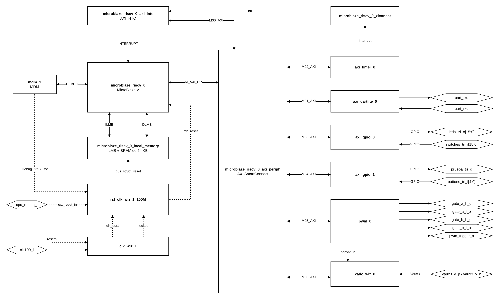
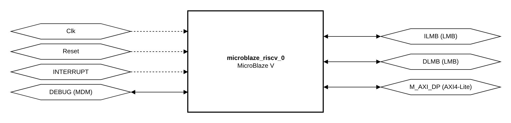
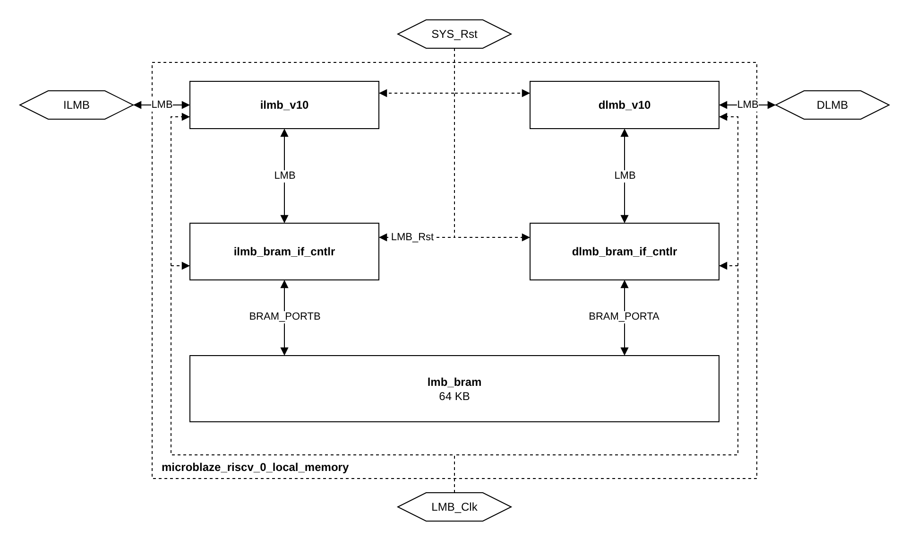
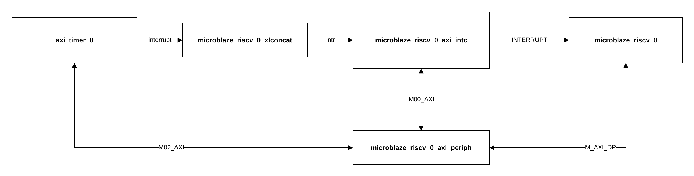
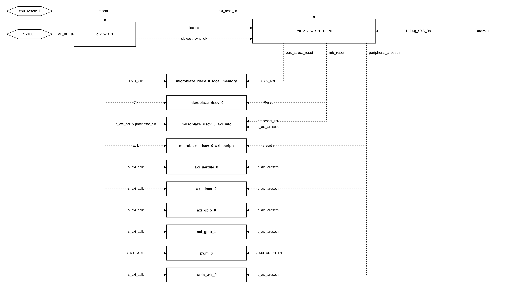

# Sistema MicroBlaze V

# 1. Introducción

Este documento describe el hardware del sistema embebido: el MicroBlaze V, su memoria, el bus AXI4-Lite, los periféricos, la interrupción del lazo, el reloj, el reset y los pines de la Nexys 4. Todo está en un Block Design de Vivado (`sistema_microblaze`), que se guarda en el repositorio como el script `FPGA/BLOCK_DESIGN/sistema_microblaze.tcl`.

| Archivo | Qué es |
|---------|--------|
| `FPGA/BLOCK_DESIGN/sistema_microblaze.tcl` | Script generado por Vivado 2025.2 que crea el Block Design completo. |
| `FPGA/DESIGN/pwm_bd.v` | Envoltura en Verilog que permite meter el PWM al Block Design. |
| `FPGA/CONSTRAINTS/nexys4_inversor.xdc` | Pines de la Nexys 4. |

El diseño usa IP de AMD para el procesador, la memoria, la interconexión, el temporizador, la UART, los GPIO y el ADC. El único bloque propio es el PWM (`pwm_0`). El documento sigue los niveles de la metodología de diseño modular. El periférico PWM y el XADC tienen su propio documento; aquí solo se explica cómo se conectan al sistema.

---

# 2. Objetivos

## Objetivo general

Integrar en la Artix-7 de la Nexys 4 un MicroBlaze V a 100 MHz con los periféricos que necesita el lazo de control de corriente.

## Objetivos específicos

- Configurar el MicroBlaze V con FPU, extensión M, memoria local y depuración.
- Conectar por AXI4-Lite el Timer, la UART, los GPIO, el XADC y el PWM.
- Llevar la interrupción del AXI Timer al procesador.
- Generar el reloj de 100 MHz y los resets del sistema.
- Asignar los pines de la tarjeta.

---

# 3. Primer nivel

*Figura 1: el sistema como un solo bloque.*

## Objetivo

Medir la corriente de la carga, calcular el controlador PR cada 50 µs y generar las señales de compuerta del puente H, con la configuración desde los switches y la exportación de las muestras por UART.

## Entradas

| Señal | Ancho | Origen |
|-------|-------|--------|
| `clk100_i` | 1 bit | Oscilador de 100 MHz de la tarjeta |
| `cpu_resetn_i` | 1 bit | Botón CPU RESET (activo en bajo) |
| `switches_tri_i` | 16 bits | Switches SW0 a SW15 |
| `buttons_tri_i` | 5 bits | Botones BTNC, BTNU, BTNL, BTNR y BTND |
| `vaux3_v_p` / `vaux3_v_n` | analógica | Sensor de corriente, por el conector JXADC |
| `uart_rxd` | 1 bit | Puente USB-UART |

## Salidas

| Señal | Ancho | Destino |
|-------|-------|---------|
| `gate_a_h_o`, `gate_a_l_o`, `gate_b_h_o`, `gate_b_l_o` | 1 bit cada una | Drivers del puente H (Pmod JA) |
| `pwm_trigger_o` | 1 bit | Pmod JA, para medir con el osciloscopio |
| `prueba_tri_o` | 1 bit | Pin de prueba del lazo (JA8) |
| `leds_tri_o` | 16 bits | LEDs LD0 a LD15 |
| `uart_txd` | 1 bit | Puente USB-UART |

## Explicación general

El sistema recibe la tensión del sensor y la convierte en corriente. Con esa corriente y la referencia de 50 Hz calcula el PR y genera la modulación unipolar del puente H. Los switches escogen la amplitud, la frecuencia de conmutación y el modo, y los LEDs muestran el estado. Al presionar BTNC, las últimas muestras se envían a la PC por la UART.

---

# 4. Segundo nivel

*Figura 2: bloques generales dentro de la FPGA.*

| Bloque | Objetivo | Entradas | Salidas |
|--------|----------|----------|---------|
| `microblaze_riscv_0` | Ejecutar el programa en C. | Instrucciones y datos (LMB), interrupción, depuración. | Accesos a los periféricos (`M_AXI_DP`). |
| `microblaze_riscv_0_local_memory` | Guardar el programa y los datos. | Accesos LMB del procesador. | Instrucciones y datos. |
| `mdm_1` | Cargar y depurar el programa desde Vitis. | — | Bus de depuración y reset del sistema. |
| `clk_wiz_1` y `rst_clk_wiz_1_100M` | Dar el reloj de 100 MHz y los resets sincronizados. | `clk100_i`, `cpu_resetn_i`. | Reloj y resets de todos los bloques. |
| `microblaze_riscv_0_axi_periph` | Repartir los accesos del procesador entre los periféricos. | `M_AXI_DP`. | Siete buses AXI4-Lite. |
| `microblaze_riscv_0_axi_intc` | Llevar la interrupción del Timer al procesador. | Interrupción del Timer. | `INTERRUPT`. |
| `axi_timer_0` | Marcar el periodo de muestreo de 50 µs. | Bus AXI. | Interrupción. |
| `axi_uartlite_0` | Enviar las muestras a la PC. | Bus AXI, `uart_rxd`. | `uart_txd`. |
| `axi_gpio_0` | Leer los switches y escribir los LEDs. | Bus AXI, switches. | LEDs. |
| `axi_gpio_1` | Leer los botones y manejar el pin de prueba. | Bus AXI, botones. | `prueba_tri_o`. |
| `xadc_wiz_0` | Convertir la tensión del sensor. | Bus AXI, `vaux3`, disparo del PWM. | Dato por el bus. |
| `pwm_0` | Generar las compuertas del puente H y el disparo del ADC. | Bus AXI. | Compuertas y `pwm_trigger_o`. |

## Explicación del conjunto

El MicroBlaze V ejecuta el programa desde su memoria local y llega a todos los periféricos por un solo puerto AXI y el interconectador. El AXI Timer pide una interrupción cada 50 µs, y en ella el procesador lee el XADC, calcula el PR y escribe el PWM. El PWM conecta `pwm_trigger_o` al disparo del XADC para que la conversión quede sincronizada con la conmutación. Todos los bloques usan el mismo reloj de 100 MHz, así que no hay cruces entre dominios de reloj.

---

# 5. Tercer nivel

*Figura 3: Block Design con las conexiones de datos y de control.*

Las líneas continuas son buses de datos (LMB, AXI, GPIO, entrada analógica) y las discontinuas son de control (reloj, resets, interrupciones, disparo y `locked`). El reloj `clk_out1` y el reset `peripheral_aresetn` llegan a todos los bloques; para no llenar la figura, esas líneas se muestran en la figura de reloj y reset (sección 6.6). La memoria local se muestra como un solo bloque; su estructura interna está en la sección 6.2. Cada bloque es una instancia del Block Design y se describe en la sección 6. Para los IPs de Vivado más simples (Timer, UART, GPIO y MDM) basta con la tabla de puertos de su sección, porque su estructura interna es la del IP.

Al encender, `clk_wiz_1` estabiliza el reloj y `rst_clk_wiz_1_100M` libera los resets en orden. El procesador arranca desde la memoria local, configura los periféricos por AXI y arranca el Timer. Desde ahí, cada interrupción recorre el camino Timer → concat → controlador de interrupciones → procesador, y la rutina de control usa el bus AXI para hablar con el XADC y el PWM.

---

# 6. Cuarto nivel: módulos

## 6.1 `microblaze_riscv_0`

*Figura 4: bloque de `microblaze_riscv_0`.*

**Objetivo.** Ejecutar el programa de control en C.

| Entradas | Salidas |
|----------|---------|
| `Clk`, `Reset`, `INTERRUPT`, `DEBUG` | `M_AXI_DP`, `ILMB`, `DLMB` |

**Configuración.**

| Parámetro | Valor | Por qué |
|-----------|-------|---------|
| Frecuencia | 100 MHz | Es el reloj de todo el sistema. |
| FPU (`C_USE_FPU`) | Sí | El PR se calcula en `float`. |
| Multiplicación y división (`C_USE_MULDIV`) | Sí (extensión M) | Para no hacerlas por software. |
| Bus de datos AXI (`C_D_AXI`) | Sí | Para llegar a los periféricos. |
| LMB de instrucciones y datos | Sí | Memoria local de un ciclo. |
| Depuración (`C_DEBUG_ENABLED`) | Sí | Para cargar el programa desde Vitis. |
| Caché | No | Ver la sección 6.2. |

**Relación con otros módulos.** Lee instrucciones y datos de la memoria local, llega a los periféricos por `microblaze_riscv_0_axi_periph`, recibe la interrupción de `microblaze_riscv_0_axi_intc` y se depura con `mdm_1`.

## 6.2 `microblaze_riscv_0_local_memory`

*Figura 5: estructura interna de la memoria local.*

**Objetivo.** Guardar el programa y los datos en BRAM, con acceso en un ciclo.

| Entradas | Salidas |
|----------|---------|
| `ILMB`, `DLMB`, `LMB_Clk`, `SYS_Rst` | — (responde por `ILMB` y `DLMB`) |

**Funcionamiento.** El procesador tiene dos buses LMB, uno para instrucciones (`ilmb_v10`) y otro para datos (`dlmb_v10`). Cada uno pasa por su controlador de BRAM y llega a un puerto distinto de la misma `lmb_bram`, que es de doble puerto: el B para instrucciones y el A para datos. Así se puede leer una instrucción y un dato en el mismo ciclo. `lmb_bram` es un `blk_mem_gen` configurado como *True Dual Port RAM*, y los controladores no usan ECC (`C_ECC = 0`).

**Decisión: 64 KB, sin caché y versión 2025.2.** Se usaron 64 KB de memoria local en lugar de 32 KB, no se usó caché de instrucciones y se trabajó con Vivado/Vitis 2025.2 en lugar de 2025.1.

- Se usaron 64 KB para dejar espacio al programa, a la biblioteca de punto flotante y al buffer de 12 000 bytes.
- Todo el programa está en la memoria local. La caché del MicroBlaze sirve para la memoria a la que se llega por el bus AXI, así que aquí no tendría efecto.
- Se usó Vivado y Vitis 2025.2, que es la versión instalada en las computadoras del equipo.

El profesor indicó que estos cambios están bien mientras queden documentados.

## 6.3 `microblaze_riscv_0_axi_periph`

**Objetivo.** Repartir los accesos de `M_AXI_DP` entre los siete periféricos según la dirección.

| Entradas | Salidas |
|----------|---------|
| `S00_AXI`, `aclk`, `aresetn` | `M00_AXI` a `M06_AXI` |

**Mapa de direcciones.**

| Puerto | Esclavo | Dirección base | Rango |
|--------|---------|----------------|-------|
| — | Memoria local (`dlmb_bram_if_cntlr`) | `0x0000_0000` | 64 KB |
| `M00_AXI` | `microblaze_riscv_0_axi_intc` | `0x4120_0000` | 64 KB |
| `M01_AXI` | `axi_uartlite_0` | `0x4060_0000` | 64 KB |
| `M02_AXI` | `axi_timer_0` | `0x41C0_0000` | 64 KB |
| `M03_AXI` | `axi_gpio_0` | `0x4000_0000` | 64 KB |
| `M04_AXI` | `axi_gpio_1` | `0x4001_0000` | 64 KB |
| `M05_AXI` | `pwm_0` | `0x0001_0000` | 4 KB |
| `M06_AXI` | `xadc_wiz_0` | `0x44A0_0000` | 64 KB |

Esas direcciones son del espacio de datos del procesador. En el espacio de instrucciones solo está la memoria local (`ilmb_bram_if_cntlr`), en `0x0000_0000` con 64 KB. El PWM queda justo después de la memoria local.

Las direcciones las asigna el Address Editor de Vivado. En C nunca se escriben a mano: se usan las macros de `xparameters.h`.

## 6.4 `microblaze_riscv_0_axi_intc` y `microblaze_riscv_0_xlconcat`

*Figura 6: camino de la interrupción del AXI Timer.*

**Objetivo.** Llevar la interrupción del AXI Timer al procesador.

| Módulo | Entradas | Salidas |
|--------|----------|---------|
| `microblaze_riscv_0_xlconcat` | `In0 [0:0]` | `dout [0:0]` |
| `microblaze_riscv_0_axi_intc` | `s_axi`, `s_axi_aclk`, `s_axi_aresetn`, `processor_clk`, `processor_rst`, `intr [0:0]` | `interrupt` |

**Funcionamiento.** La salida `interrupt` del Timer entra al concat, que arma el vector `intr` del controlador. El controlador avisa al procesador por `INTERRUPT`. Está configurado con interrupción rápida (`C_HAS_FAST = 1`). En el programa la interrupción se conecta con el driver de Vitis (`XSetupInterruptSystem()`), que llama a `XTmrCtr_InterruptHandler()` y este a `rutina_control()`. El software configura el controlador por `M00_AXI`.

**Decisión.** Con una sola fuente de interrupción, el concat y el controlador parecen de más. Se dejaron porque el driver de interrupciones de Vitis (`XSetupInterruptSystem()`) trabaja con el controlador, y porque permiten agregar otra fuente sin cambiar la estructura.

## 6.5 `mdm_1`

**Objetivo.** Conectar el procesador con el depurador de Vitis por JTAG.

| Entradas | Salidas |
|----------|---------|
| — (JTAG interno de la FPGA) | `MBDEBUG_0`, `Debug_SYS_Rst` |

`MBDEBUG_0` va al puerto `DEBUG` del procesador. `Debug_SYS_Rst` le pide un reset al bloque de reset cuando el depurador lo necesita, por ejemplo al cargar el programa.

## 6.6 `clk_wiz_1` y `rst_clk_wiz_1_100M`

*Figura 7: distribución del reloj y de los resets.*

**Objetivo.** Dar un reloj estable de 100 MHz y resets sincronizados con él.

| Módulo | Entradas | Salidas |
|--------|----------|---------|
| `clk_wiz_1` | `clk_in1`, `resetn` | `clk_out1`, `locked` |
| `rst_clk_wiz_1_100M` | `slowest_sync_clk`, `ext_reset_in`, `dcm_locked`, `mb_debug_sys_rst` | `mb_reset`, `bus_struct_reset`, `peripheral_aresetn` |

**Funcionamiento.** `clk100_i` entra al `clk_wiz_1` (100 MHz de entrada y de salida, reset activo en bajo), que entrega `clk_out1` a todos los bloques. Cuando el reloj está estable, `locked` sube y le avisa al bloque de reset. El botón CPU RESET (`cpu_resetn_i`) reinicia el `clk_wiz_1` y entra a `ext_reset_in`. El bloque de reset entrega tres resets:

| Reset | Va a |
|-------|------|
| `mb_reset` | `Reset` del procesador y `processor_rst` del controlador de interrupciones. |
| `bus_struct_reset` | `SYS_Rst` de la memoria local. |
| `peripheral_aresetn` | `aresetn` de todos los periféricos AXI, incluido el PWM (`S_AXI_ARESETN`). |

## 6.7 `axi_timer_0`

**Objetivo.** Generar la interrupción periódica del lazo de control.

| Entradas | Salidas |
|----------|---------|
| `S_AXI`, `s_axi_aclk`, `s_axi_aresetn` | `interrupt` |

En el Block Design se deja con la configuración por defecto. El periodo lo fija el software: el contador 0 cuenta hacia abajo con recarga automática desde 4998, porque el Timer tarda `TLR + 2` ciclos por periodo (100 · 50 − 2 = 4998 para 50 µs). El programa también lee este contador para medir la latencia y la duración de la rutina de interrupción.

## 6.8 `axi_uartlite_0`

**Objetivo.** Enviar mensajes y muestras a la PC.

| Entradas | Salidas |
|----------|---------|
| `S_AXI`, `s_axi_aclk`, `s_axi_aresetn`, `rx` (`uart_rxd`) | `tx` (`uart_txd`) |

Configuración: 115200 baud, 8 bits de datos y sin paridad. Su interrupción no se usa, porque el programa escribe con `xil_printf()` desde el lazo principal.

## 6.9 `axi_gpio_0` y `axi_gpio_1`

**Objetivo.** Dar acceso a los switches, botones, LEDs y al pin de prueba.

| Módulo | Canal 1 (`GPIO`) | Canal 2 (`GPIO2`) |
|--------|------------------|-------------------|
| `axi_gpio_0` | 16 salidas: `leds_tri_o` | 16 entradas: `switches_tri_i` |
| `axi_gpio_1` | 5 entradas: `buttons_tri_i` | 1 salida: `prueba_tri_o` (JA8) |

El pin de prueba está en un GPIO para que la rutina de interrupción lo pueda subir y bajar con una sola escritura (`Xil_Out32`), sin tocar los LEDs.

## 6.10 `xadc_wiz_0`

**Objetivo.** Convertir la tensión del sensor de corriente.

| Entradas | Salidas |
|----------|---------|
| `s_axi_lite`, `s_axi_aclk`, `s_axi_aresetn`, `convst_in`, `Vaux3` | — (el dato se lee por el bus) |

Está en modo evento, con el canal VAUX3 y la entrada `convst_in` conectada a `pwm_trigger_o`. El bloque, los registros y el driver están en el documento del ADC.

## 6.11 `pwm_0`

**Objetivo.** Generar las cuatro compuertas del puente H y el disparo del ADC.

| Entradas | Salidas |
|----------|---------|
| `S_AXI`, `S_AXI_ACLK`, `S_AXI_ARESETN` | `gate_a_h_o`, `gate_a_l_o`, `gate_b_h_o`, `gate_b_l_o`, `pwm_trigger_o` |

`pwm_0` se crea en el script con `create_bd_cell -type module -reference pwm_bd`. El PWM está en SystemVerilog, y Vivado no deja usar un módulo en SystemVerilog como tope de una referencia a módulo (*Add Module*). Por eso se hizo `pwm_bd.v`, en Verilog, que solo instancia `pwm_axi` como `u_pwm_axi` y conecta cada puerto con el del mismo nombre. No tiene lógica propia.

Para que Vivado lo reconozca como un esclavo AXI4-Lite, los puertos llevan atributos de Verilog (`(* ... *)`):

| Atributo | Dónde se usa | Qué indica |
|----------|--------------|------------|
| `X_INTERFACE_INFO = "xilinx.com:signal:clock:1.0 S_AXI_ACLK CLK"` | `S_AXI_ACLK` | Es un reloj. |
| `X_INTERFACE_PARAMETER = "ASSOCIATED_BUSIF S_AXI, ASSOCIATED_RESET S_AXI_ARESETN"` | `S_AXI_ACLK` | El reloj es de la interfaz `S_AXI` y su reset es `S_AXI_ARESETN`. |
| `X_INTERFACE_INFO = "xilinx.com:signal:reset:1.0 S_AXI_ARESETN RST"` | `S_AXI_ARESETN` | Es un reset. |
| `X_INTERFACE_PARAMETER = "POLARITY ACTIVE_LOW"` | `S_AXI_ARESETN` | El reset es activo en bajo. |
| `X_INTERFACE_INFO = "xilinx.com:interface:aximm:1.0 S_AXI ..."` | Cada señal `S_AXI_*` | La señal es parte de la interfaz `S_AXI`. |
| `X_INTERFACE_PARAMETER = "PROTOCOL AXI4LITE, DATA_WIDTH 32, ADDR_WIDTH 4"` | `S_AXI_AWADDR` | AXI4-Lite, datos de 32 bits y dirección de 4 bits. |

Con estos atributos el bloque aparece con un solo puerto `S_AXI` y se conecta al interconectador como cualquier otro periférico.

**Consideraciones.**

- `u_pwm_axi` se instancia sin parámetros, así que el PWM usa los valores por defecto de `pwm_axi` (`CLK_HZ` = 100 MHz, las tres frecuencias, `M_MAX`, `DT_RESET` y `DT_MIN`). Para cambiar alguno hay que editar `pwm_axi.sv`.
- Si se agrega o se cambia de nombre un puerto de `pwm_axi`, hay que cambiar también `pwm_bd.v`.

El diseño interno (`pwm_axi` y `pwm_core`) está en el documento del PWM.

---

# 7. Pines

| Puerto | Pin | Conector o elemento |
|--------|-----|---------------------|
| `clk100_i` | E3 | Oscilador de 100 MHz |
| `cpu_resetn_i` | C12 | Botón CPU RESET |
| `uart_rxd` / `uart_txd` | C4 / D4 | Puente USB-UART |
| `leds_tri_o[15:0]` | T8 … P2 | LD0 a LD15 |
| `switches_tri_i[15:0]` | U9 … P4 | SW0 a SW15 |
| `buttons_tri_i[4:0]` | E16, F15, T16, R10, V10 | BTNC, BTNU, BTNL, BTNR, BTND |
| `gate_a_h_o` | B13 | JA1 |
| `gate_a_l_o` | F14 | JA2 |
| `gate_b_h_o` | D17 | JA3 |
| `gate_b_l_o` | E17 | JA4 |
| `pwm_trigger_o` | G13 | JA7 |
| `prueba_tri_o` | C17 | JA8 |
| `vaux3_v_p` / `vaux3_v_n` | A13 / A14 | JXADC1 / JXADC7 |

La lista completa está en `FPGA/CONSTRAINTS/nexys4_inversor.xdc`. Los nombres del `.xdc` son iguales a los puertos de `sistema_microblaze_wrapper`.

---

# 8. Script del Block Design

El Block Design no se sube como proyecto de Vivado, sino como el script `sistema_microblaze.tcl`, generado por Vivado 2025.2. Al correrlo hace esto, en orden:

1. Revisa que la versión de Vivado sea la 2025.2.
2. Si no hay un proyecto abierto, crea uno para la `xc7a100tcsg324-1`.
3. Crea el diseño `sistema_microblaze`. Si ya existe uno con ese nombre, se detiene con un error.
4. Revisa que todos los IP existan en el catálogo y que el módulo `pwm_bd` esté en las fuentes del proyecto.
5. Crea la memoria local como bloque jerárquico y después el resto de los bloques y sus conexiones.
6. Asigna las direcciones.
7. Valida el diseño con `validate_bd_design` y lo guarda.

Si falla alguna de las revisiones de los pasos 1 y 4, el script termina sin crear el diseño.

| IP | Versión | Bloque |
|----|---------|--------|
| `microblaze_riscv` | 1.0 | `microblaze_riscv_0` |
| `smartconnect` | 1.0 | `microblaze_riscv_0_axi_periph` |
| `axi_intc` | 4.1 | `microblaze_riscv_0_axi_intc` |
| `ilconcat` (`inline_hdl`) | 1.0 | `microblaze_riscv_0_xlconcat` |
| `mdm_riscv` | 1.0 | `mdm_1` |
| `clk_wiz` | 6.0 | `clk_wiz_1` |
| `proc_sys_reset` | 5.0 | `rst_clk_wiz_1_100M` |
| `axi_uartlite` | 2.0 | `axi_uartlite_0` |
| `axi_timer` | 2.0 | `axi_timer_0` |
| `axi_gpio` | 2.0 | `axi_gpio_0`, `axi_gpio_1` |
| `xadc_wiz` | 3.3 | `xadc_wiz_0` |
| `lmb_v10` | 3.0 | `dlmb_v10`, `ilmb_v10` |
| `lmb_bram_if_cntlr` | 4.0 | `dlmb_bram_if_cntlr`, `ilmb_bram_if_cntlr` |
| `blk_mem_gen` | 8.4 | `lmb_bram` |
| Módulo `pwm_bd` | — | `pwm_0` |

Para reconstruir el diseño:

1. Crear un proyecto para la `xc7a100tcsg324-1` y agregar las fuentes de `FPGA/DESIGN` (incluido `pwm_bd.v`) y la restricción `FPGA/CONSTRAINTS/nexys4_inversor.xdc`. Las fuentes de `pwm_bd` tienen que estar antes de correr el script. `pwm_axi_ooc.xdc` no se agrega: solo sirve para la simulación post-implementación del PWM.
2. En la consola Tcl, correr `source FPGA/BLOCK_DESIGN/sistema_microblaze.tcl`.
3. Crear el wrapper (*Create HDL Wrapper*), generar el bitstream y exportar el hardware (`.xsa`) para Vitis.

---

# 9. Validación y recursos

| Resultado | Valor | Fuente |
|-----------|-------|--------|
| WNS / WHS del sistema implementado | 0,392 ns / 0,030 ns | `docs/informe/reportes/timing_sistema.rpt` (2 de noviembre de 2026) |
| LUT | 6482 de 63 400 (10,22 %) | `docs/informe/reportes/utilizacion_sistema.rpt` |
| FF | 4871 de 126 800 (3,84 %) | |
| BRAM | 16 de 135 (11,85 %) | |
| DSP | 8 de 240 (3,33 %) | |

El timing cierra a 100 MHz. Las 16 BRAM son los 64 KB de la memoria local. Los reportes son de la implementación del 2 de noviembre.

En la tarjeta, el sistema completo corrió con el lazo cada 50,0 µs, el PWM en las tres frecuencias y la exportación por UART (pruebas 1 a 5 del informe).

---

# Referencias

1. AMD, *MicroBlaze V Embedded Design Tutorial* (UG1711). <https://docs.amd.com/r/en-US/ug1711-microblaze-v-embedded-design>
2. AMD, *MicroBlaze Processor Reference Guide* (UG984). <https://docs.amd.com/r/en-US/ug984-vivado-microblaze-ref>
3. AMD, *AXI Reference Guide* (UG1037). <https://docs.amd.com/v/u/en-US/ug1037-vivado-axi-reference-guide>
4. AMD, *Vivado Design Suite User Guide: Creating and Packaging Custom IP* (UG1118). <https://docs.amd.com/r/en-US/ug1118-vivado-creating-packaging-custom-ip>
5. AMD, *Vitis Unified Software Platform Documentation* (UG1416). <https://docs.amd.com/v/u/en-US/ug1416-vitis-documentation>
