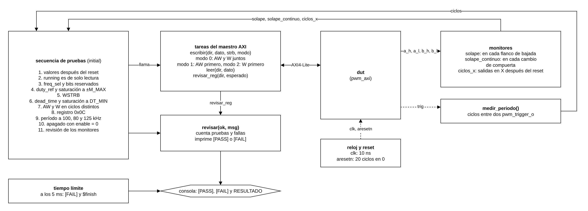

# Verificación del PWM por AXI4-Lite

# 1. Introducción

`tb_pwm_axi.sv` verifica el periférico PWM completo (`pwm_axi` con `pwm_core` adentro) desde el bus AXI4-Lite, igual que lo usa el MicroBlaze V. El testbench hace de maestro AXI, escribe y lee los registros, y revisa las compuertas y el disparo.

Es autoverificable: cada prueba imprime `[PASS]` o `[FAIL]` y al final se imprime cuántas pruebas pasaron y el resultado. El mismo testbench se usa en la simulación RTL y en la simulación post-implementación temporizada.

---

# 2. Diagrama

*Figura 1: estructura de `tb_pwm_axi`.*

La secuencia de pruebas llama a las tareas del maestro AXI, que manejan los cinco canales del bus hacia el `dut`. Los monitores y `medir_periodo()` observan las salidas del `dut` todo el tiempo. Cada resultado pasa por `revisar()`, que cuenta las pruebas y las fallas.

---

# 3. Partes del testbench

| Parte | Función |
|-------|---------|
| Reloj y reset | Reloj de 10 ns (100 MHz). `aresetn` está en 0 durante 20 ciclos, porque en la post-implementación el reset global de la FPGA dura los primeros 100 ns. |
| `escribir(dir, dato, strb, modo)` | Hace una escritura completa: AW, W y espera la respuesta B. Con `modo` se escoge el orden: `0` AW y W juntos, `1` AW 3 ciclos antes que W, `2` W 3 ciclos antes que AW. |
| `leer(dir, dato)` | Hace una lectura completa: AR y espera R. |
| `revisar_reg(dir, esperado, msg)` | Lee un registro y lo compara con el valor esperado. |
| `medir_periodo(ciclos)` | Cuenta los ciclos entre dos pulsos de `pwm_trigger_o`. |
| `revisar(ok, msg)` | Imprime `[PASS]` o `[FAIL]` y lleva la cuenta. |
| Posición del disparo | Cada vez que sale `pwm_trigger_o` se revisa que estén encendidos los dos transistores de arriba y apagados los de abajo (con `m = 0`). `medir_centro()` cuenta cuántos ciclos lleva `a_h` en 1 cuando sale el disparo y cuántos le faltan. |
| Monitores | `solape` revisa en cada flanco de bajada que no estén encendidos los dos transistores de una misma pierna. `solape_continuo` revisa lo mismo cada vez que cambia una compuerta, para detectar solapes entre flancos en la post-implementación. `ciclos_x` cuenta los ciclos con alguna salida en X después del reset. |
| Tiempo límite | Si la simulación llega a 5 ms (por ejemplo, porque un READY nunca llega), imprime `[FAIL]` y termina. |

---

# 4. Pruebas

| # | Prueba | Qué se revisa |
|---|--------|---------------|
| 1 | Valores después del reset | CTRL = 0, DUTY = 0, DEAD_TIME = 20, 0x0C = 0 y `RRESP = OKAY`. |
| 2 | `running` es de solo lectura | Escribir el bit 3 no lo cambia. `BRESP = OKAY`. |
| 3 | `freq_sel` y bits reservados | Se lee lo que se escribió y los bits reservados leen 0. |
| 4 | `duty_ref` | ±0,5 se guardan igual. +`M_MAX` se acepta. `0x7FFF` se satura a +`M_MAX` y `0x8000` a −`M_MAX`. Los bits [31:16] se ignoran. |
| 5 | `WSTRB` | Con `0001` solo cambia el byte bajo. Con `0000` no cambia nada. |
| 6 | `dead_time` | 0 y 5 se saturan a `DT_MIN` = 10. 200 se acepta. Los bits [31:8] se ignoran. |
| 7 | AW y W en ciclos distintos | La escritura funciona en los dos órdenes. |
| 8 | Registro 0x0C | Responde OKAY, sigue leyendo 0 y no cambia los otros registros. |
| 9 | Arranque desde los registros | Con `enable = 1`, `running` se lee en 1. El periodo medido es de 1000, 1250 y 800 ciclos para 100, 80 y 125 kHz. |
| 9b | Disparo en el valle | A 100 kHz, `m = 0` y 20 ciclos de tiempo muerto, `a_h` lleva 20 ciclos menos antes del disparo que después, porque el tiempo muerto solo atrasa el encendido. Eso confirma que el disparo cae en la mitad del pulso alto. |
| 10 | Apagado | Con `enable = 0` se apagan las cuatro compuertas, `running` se lee en 0 y en 2000 ciclos no hay pulsos ni disparos. |
| 11 | Monitores | No hubo solape, ni en los flancos ni entre ellos, las salidas nunca quedaron en X y, con `m = 0`, el disparo siempre cayó con las dos compuertas de arriba encendidas. |

En total son 37 pruebas.

---

# 5. Simulación post-implementación temporizada

Para esta simulación `pwm_axi` se implementa solo, como módulo superior, con la restricción `pwm_axi_ooc.xdc`, que define el reloj de 100 MHz en `S_AXI_ACLK`. Esa restricción no se usa en el proyecto del sistema completo.

| Resultado | Valor | Fuente |
|-----------|-------|--------|
| Simulación post-implementación temporizada | 35 pruebas, 0 fallas (versión anterior del testbench, sin la prueba del disparo) | `docs/informe/reportes/resultado_tb_pwm_axi_postimpl.log` (2 de noviembre de 2026) |
| WNS / WHS de `pwm_axi` implementado | 3,760 ns / 0,171 ns | `docs/informe/reportes/timing_pwm_axi_impl.rpt` |

En la post-implementación el tiempo muerto se comprueba solo como "sin solape": `tb_pwm_axi` no mide el ancho de cada tiempo muerto (eso lo hace `tb_pwm_core` en RTL).

---

# Referencias

1. AMD, *AXI Reference Guide* (UG1037). <https://docs.amd.com/v/u/en-US/ug1037-vivado-axi-reference-guide>
