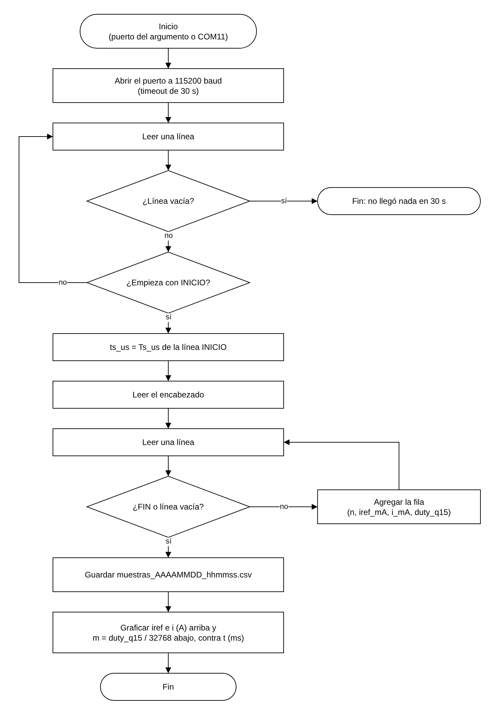

# Script `graficar_muestras.py`


# 1. Introducción

`graficar_muestras.py` corre en la PC. Recibe por el puerto serie las muestras que envía la Nexys 4 al presionar BTNC, las guarda en un archivo CSV y las grafica.

El formato de lo que envía la tarjeta está en el documento del buffer y la exportación por UART.

## Objetivos

- Recibir la exportación completa y revisar que no falte ninguna muestra.
- Guardar los datos en un CSV sin modificarlos.
- Graficar la referencia, la corriente y el índice de modulación.

---

# 2. Uso

Necesita Python 3 con `pyserial` y `matplotlib`:

```text
pip install pyserial matplotlib
```

Se corre indicando el puerto COM de la tarjeta (si no se indica, usa `COM11`):

```text
python graficar_muestras.py COM11
```

Cuando aparece `Esperando la exportacion...`, se presiona BTNC en la tarjeta. Antes hay que cerrar cualquier otra terminal que tenga abierto el mismo puerto.

---

# 3. Diagrama de flujo



*Figura 1: diagrama de flujo de `graficar_muestras.py`.*

## Funcionamiento

1. Se abre el puerto a 115200 baud con un tiempo límite de 30 s por línea.
2. Se leen líneas hasta encontrar la que empieza con `INICIO`. Las líneas anteriores (por ejemplo, las que la tarjeta imprime cada segundo) se ignoran. Si en 30 s no llega nada, el script termina con un mensaje; con la tarjeta encendida esto casi no pasa, porque imprime una línea cada segundo.
3. De la línea `INICIO` se toman `Ts_us`, el periodo de muestreo, y `N`, la cantidad de muestras.
4. Se lee el encabezado.
5. Se leen las filas y se guardan como listas de enteros hasta que llega `FIN` o una línea vacía. Después se revisa que hayan llegado `N` filas con `n` de 0 a `N − 1`; si no, se imprime un aviso.
6. Se guardan las filas en `muestras_AAAAMMDD_hhmmss.csv`, con la fecha y la hora en el nombre para no sobreescribir exportaciones anteriores.
7. Se grafica:
   - arriba, la referencia y la corriente en amperios (`iref_mA / 1000` e `i_mA / 1000`);
   - abajo, el índice de modulación `m = duty_q15 / 32768`;
   - en el eje horizontal, el tiempo `t = n · Ts_us / 1000`, en milisegundos.

---

# 4. Salida

El CSV tiene las mismas columnas que envía la tarjeta:

```text
n,iref_mA,i_mA,duty_q15
0,117,118,2192
1,115,113,2149
...
```

---

# 5. Consideraciones

- El CSV guarda solo el encabezado y las filas. `Ts_us` no queda en el archivo; se usa 50 µs.
- Si la línea se corta a mitad de la transferencia, el script guarda lo que llegó y avisa que faltan muestras.

---

# 6. Validación

Se usó para recibir todas las exportaciones de las pruebas en la tarjeta. En cada una llegaron las 2000 muestras y se generó el CSV y la gráfica.

---

# Referencias

1. pySerial, documentación oficial. <https://pyserial.readthedocs.io>
2. Matplotlib, documentación oficial. <https://matplotlib.org/stable/>
