<h1 align="center">
  Documento de diseño <br>
  Control de corriente en un inversor monofásico mediante un regulador PR discreto sobre MicroBlaze V
</h1>

<p align="center">
  EL3313 Taller de Diseño Digital — Proyecto 4 — II Semestre 2026 <br>
  Mariana Fallas Fallas · Justin Garita Serrano · Abner López Méndez · Jordi Segura Chinchilla
</p>

---

## Contenido

1. [Alcance](#1-alcance)
2. [Idea general de la solución](#2-idea-general-de-la-solución)
3. [Parámetros de diseño](#3-parámetros-de-diseño)
4. [Arquitectura del sistema](#4-arquitectura-del-sistema)
5. [Módulos del Block Design](#5-módulos-del-block-design)
6. [Periférico PWM](#6-periférico-pwm)
7. [Adquisición de la corriente (XADC)](#7-adquisición-de-la-corriente-xadc)
8. [Software de control](#8-software-de-control)
9. [Interfaz con PEDP](#9-interfaz-con-pedp)
10. [Estrategia de integración con la etapa de potencia](#10-estrategia-de-integración-con-la-etapa-de-potencia)
11. [Plan de validación](#11-plan-de-validación)
12. [Decisiones de diseño](#12-decisiones-de-diseño)
13. [Plan de trabajo](#13-plan-de-trabajo)
14. [Referencias](#14-referencias)

---

## 1. Alcance

El proyecto regula la corriente de un inversor monofásico en puente H con un regulador PR discreto que se ejecuta en un **MicroBlaze V** (procesador RISC-V de 32 bits de AMD) [3], [4] sobre la Nexys 4 (Artix-7 xc7a100t). El procesador corre la ley de control en C, sin sistema operativo, y los periféricos en hardware generan el PWM, adquieren la corriente y se comunican con la PC.

Este documento cubre la **parte digital** (Taller):

| Incluye | Lo diseña PEDP |
|---|---|
| Arquitectura del sistema embebido y Block Design | Puente H, drivers de compuerta y semiconductores |
| Periférico PWM personalizado (SystemVerilog + AXI4-Lite) | Dimensionamiento de la carga RL |
| Adquisición con el XADC y su sincronización con el PWM | Sintonización y discretización del PR |
| Software de control, buffer y exportación por UART | Sensor de corriente y su acondicionamiento |
| Estrategia de validación de la parte digital | Ensayos con la etapa de potencia |

El puente H se trata como un bloque externo: recibe las cuatro señales de compuerta de la FPGA y aplica la tensión sobre la carga. La corriente se mide con un sensor y una etapa de acondicionamiento que la lleva al rango de la entrada analógica del XADC (0 a 1 V).

### 1.1 Objetivos

**General.** Diseñar un sistema embebido sobre MicroBlaze V que regule la corriente de un inversor monofásico mediante un PR discreto, un periférico PWM propio y muestreo sincronizado con la conmutación.

**Específicos.**

| Objetivo | Cómo se comprueba |
|---|---|
| Integrar el MicroBlaze V con sus periféricos en un Block Design de Vivado a 100 MHz | Implementación con WNS y WHS positivos a 100 MHz |
| Diseñar un PWM unipolar con interfaz AXI4-Lite, tres frecuencias de conmutación y tiempo muerto configurable | Periodo de 1000, 1250 y 800 ciclos; tiempo muerto de 100 ns a 2,55 µs sin solape en ninguna pierna |
| Sincronizar el inicio de conversión del XADC con la portadora del PWM | `pwm_trigger_o` en el valle de la portadora, un pulso por periodo, y una muestra nueva del XADC en cada interrupción |
| Ejecutar el PR en una rutina de interrupción periódica | Periodo de 50 µs medido en el pin JA8 y duración de la ISR menor que 50 µs |
| Guardar las muestras en un buffer circular y exportarlas por UART sin afectar el lazo | 2000 muestras recibidas en la PC con `n` de 0 a 1999 y la ISR cada 50 µs durante la exportación |
| Verificar el PWM con testbenches autoverificables | Todas las pruebas `[PASS]` en simulación RTL y post-implementación temporizada |

---

## 2. Idea general de la solución

El sistema es un lazo cerrado que se repite cada periodo de control $T_s = 50\ \mu\text{s}$:

1. **Base de tiempo.** El AXI Timer genera una interrupción cada 50 µs a través del AXI INTC.
2. **Generación del PWM.** El periférico PWM produce las cuatro señales de compuerta con modulación unipolar y tiempo muerto. El índice de modulación lo fija el registro `duty_ref`.
3. **Puente H (externo).** Aplica $+V_{dc}$, $0$ o $-V_{dc}$ sobre la carga RL.
4. **Medición.** El sensor y el acondicionamiento llevan la corriente a la entrada VAUX3 del XADC.
5. **Muestreo sincronizado.** El PWM emite `pwm_trigger_o` en cada valle de la portadora y ese pulso inicia la conversión del XADC. Así la muestra se toma siempre en el mismo punto de la conmutación.
6. **Cálculo del control.** En la interrupción, el MicroBlaze V lee la última muestra, la compara con la referencia de 50 Hz, calcula el PR y escribe el nuevo `duty_ref`.
7. **Registro y exportación.** Cada muestra se guarda en un buffer circular. Al presionar BTNC, el lazo principal envía el buffer por UART a la PC sin detener la interrupción.

### 2.1 Secuencia de un periodo de control

| Instante | Qué pasa | Quién lo hace |
|---|---|---|
| Valle de la portadora (cada $1/f_{sw}$) | `pwm_trigger_o` inicia una conversión del XADC; se cargan los valores nuevos de `duty_ref`, `freq_sel` y `dead_time` | PWM y XADC |
| ≈ 1 µs después del valle | La conversión termina y se levanta el aviso EOC | XADC |
| Cada 50 µs | Interrupción del Timer | AXI Timer y AXI INTC |
| Dentro de la ISR | Leer la muestra, revisar la protección, calcular la referencia y el PR, escribir `duty_ref`, guardar la muestra | Software |
| Siguiente valle, o el que sigue | Se aplica el `duty_ref` nuevo | PWM |

A 100 kHz caben 5 periodos de conmutación en cada periodo de control (4 a 80 kHz y 6,25 a 125 kHz). La ISR siempre usa la conversión más reciente, que tiene como mucho un periodo de conmutación de antigüedad.

---

## 3. Parámetros de diseño

La carga y la alimentación vienen del diseño de potencia de PEDP.

| Parámetro | Valor |
|---|---|
| Reloj del sistema | 100 MHz |
| Carga | $R \approx 5{,}0\ \Omega$ (4,7 Ω más 0,3 Ω de las bobinas), $L \approx 197\ \mu\text{H}$ ($\tau = L/R \approx 39{,}4\ \mu\text{s}$) |
| Alimentación del puente | $V_{dc} = 18$ V |
| Frecuencia de conmutación | 100 kHz nominal; 80 y 125 kHz seleccionables |
| Tiempo muerto | 200 ns después del reset, mínimo 100 ns |
| Referencia | Sinusoide de 50 Hz; 0,2 / 0,5 / 1,0 A pico |
| Periodo de control | $T_s = 50\ \mu\text{s}$ (20 kHz) |

A 50 Hz la reactancia de la carga es de unos 62 mΩ, frente a 5 Ω de resistencia, así que la carga es casi resistiva. La tensión pico necesaria es $V_1 = I_{pico}\,|Z| \approx I_{pico}\,R$ y el índice de modulación es $m = V_1/V_{dc}$:

| $I_{pico}$ | $V_1$ | $m$ con 18 V |
|---|---|---|
| 0,2 A | 1,0 V | 0,056 |
| 0,5 A | 2,5 V | 0,139 |
| 1,0 A | 5,0 V | 0,278 |

Lo que esto implica para la parte digital:

- **Saturación.** El índice más alto en régimen es 0,278. El software limita $|m|$ a 0,8 y el PWM, como respaldo, satura en hardware a 0,95. Queda margen para que el PR corrija el tiempo muerto y los transitorios.
- **Resolución.** A 100 kHz la portadora tiene 500 pasos por semiperiodo (≈ 9 bits). Con 18 V cada paso son unos 36 mV; a 0,2 A la amplitud cubre unos 28 pasos.
- **Tiempo muerto.** Los 200 ns de tiempo muerto le quitan a la salida unos $2\,t_{muerto}\,f_{sw}\,V_{dc} \approx 0{,}7$ V. A 0,2 A solo se necesita 1 V, así que en lazo abierto la corriente sale mucho menor que la referencia; en lazo cerrado el PR lo compensa.
- **Retardo.** $\tau$ es del mismo orden que $T_s$ (39 µs frente a 50 µs), así que la planta responde en uno o dos periodos de control. Entre que se toma la muestra y se aplica el nuevo `duty_ref` pasa hasta un periodo de conmutación (antigüedad de la muestra), más la duración de la ISR, más la espera hasta el valle en que se aplica (el siguiente o el que sigue). Con el retenedor, el retardo total se acota en $\approx 1{,}5\,T_s = 75\ \mu\text{s}$ para el análisis de estabilidad del PR.

---

## 4. Arquitectura del sistema

La arquitectura se describe por niveles, siguiendo la metodología de diseño modular [12]: el sistema como un solo bloque, sus bloques generales, el diagrama modular y el desarrollo de cada módulo.

### 4.1 Primer nivel

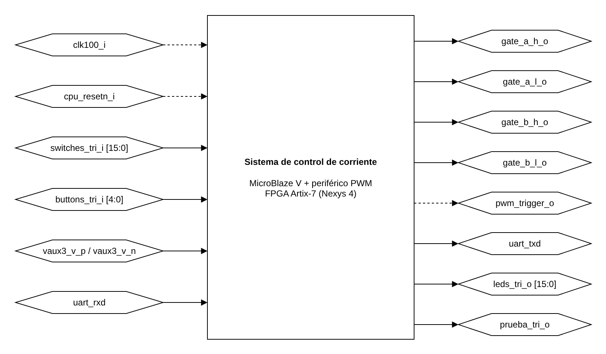

*Figura 1: el sistema como un solo bloque, con sus entradas y salidas.*

**Objetivo.** Medir la corriente de la carga, calcular el controlador PR cada 50 µs y generar las señales de compuerta del puente H, con la configuración desde los switches y la exportación de las muestras por UART.

| | Señal | Descripción |
|---|---|---|
| Entradas | `clk100_i`, `cpu_resetn_i` | Reloj de 100 MHz y botón CPU RESET (activo en bajo) |
| | `switches_tri_i [15:0]` | Habilitación del lazo, `freq_sel`, amplitud de la referencia, fuente de la corriente y modo de lazo abierto |
| | `buttons_tri_i [4:0]` | BTNC inicia la exportación |
| | `vaux3_v_p`, `vaux3_v_n` | Tensión proporcional a la corriente de la carga (0 a 1 V), JXADC1 y JXADC7 |
| | `uart_rxd` | Recepción de la UART (no se usa) |
| Salidas | `gate_a_h_o`, `gate_a_l_o`, `gate_b_h_o`, `gate_b_l_o` | Compuertas del puente H (JA1 a JA4) |
| | `pwm_trigger_o` | Disparo de la conversión; también sale a JA7 para medirlo |
| | `uart_txd` | Exportación de las muestras a la PC |
| | `leds_tri_o [15:0]` | Lazo habilitado, falla, exportando, modo emulador y lazo abierto |
| | `prueba_tri_o` | Pin de prueba (JA8), en 1 mientras corre la ISR |

**Explicación general.** El sistema recibe la tensión del sensor y la convierte en corriente. Con esa corriente y la referencia de 50 Hz calcula el PR y genera la modulación unipolar del puente H. Los switches escogen la amplitud, la frecuencia de conmutación y el modo, y los LEDs muestran el estado. Al presionar BTNC, las últimas muestras se envían a la PC por la UART.

### 4.2 Segundo nivel

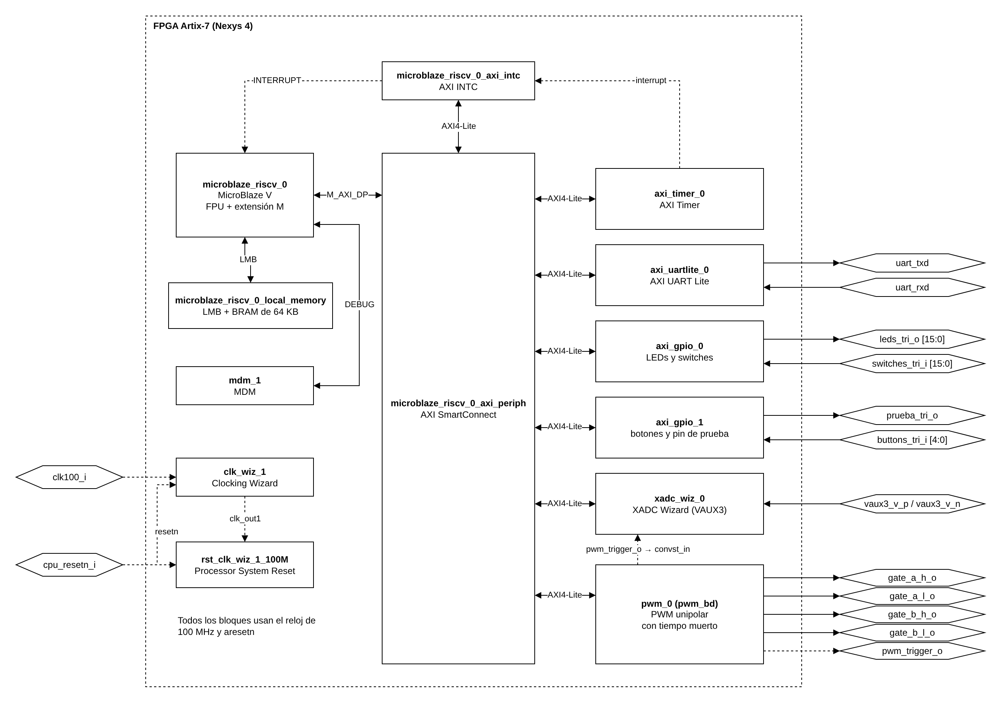

*Figura 2: bloques generales dentro de la FPGA.*

| Bloque | Tipo | Objetivo | Entradas | Salidas |
|---|---|---|---|---|
| `microblaze_riscv_0` | IP de AMD | Ejecutar el programa en C | Instrucciones y datos (LMB), interrupción, depuración | Accesos a los periféricos (`M_AXI_DP`) |
| `microblaze_riscv_0_local_memory` | IP de AMD | Guardar el programa y los datos en 64 KB de BRAM | Accesos LMB del procesador | Instrucciones y datos |
| `mdm_1` | IP de AMD | Cargar y depurar el programa desde Vitis | JTAG interno | Bus de depuración y pedido de reset |
| `clk_wiz_1` y `rst_clk_wiz_1_100M` | IP de AMD | Dar el reloj de 100 MHz y los resets sincronizados | `clk100_i`, `cpu_resetn_i` | Reloj y resets de todos los bloques |
| `microblaze_riscv_0_axi_periph` | IP de AMD (SmartConnect) | Repartir los accesos del procesador entre los periféricos | `M_AXI_DP` | Siete buses AXI4-Lite |
| `microblaze_riscv_0_axi_intc` | IP de AMD | Llevar la interrupción del Timer al procesador | Interrupción del Timer | `INTERRUPT` |
| `axi_timer_0` | IP de AMD | Marcar el periodo de control de 50 µs | Bus AXI | Interrupción |
| `axi_uartlite_0` | IP de AMD | Enviar las muestras a la PC a 115 200 baudios | Bus AXI, `uart_rxd` | `uart_txd` |
| `axi_gpio_0` | IP de AMD | Leer los switches y escribir los LEDs | Bus AXI, switches | LEDs |
| `axi_gpio_1` | IP de AMD | Leer los botones y manejar el pin de prueba | Bus AXI, botones | `prueba_tri_o` |
| `xadc_wiz_0` | IP de AMD | Convertir la tensión del sensor | Bus AXI, `vaux3`, `pwm_trigger_o` | Dato y aviso EOC por el bus |
| `pwm_0` | **Personalizado** | Generar las compuertas del puente H y el disparo del ADC | Bus AXI | Compuertas y `pwm_trigger_o` |

**Explicación de cada bloque.**

- `microblaze_riscv_0` y su memoria local forman la parte que ejecuta el programa: el lazo principal y la rutina de interrupción.
- `microblaze_riscv_0_axi_periph` es el único camino del procesador hacia los periféricos; cada uno queda en su propio rango de direcciones.
- `axi_timer_0` y `microblaze_riscv_0_axi_intc` dan la base de tiempo del lazo. Sin ellos el periodo de control dependería de cuánto tarda el programa.
- `pwm_0` es el actuador: convierte el índice de modulación en las cuatro compuertas y marca el instante de muestreo.
- `xadc_wiz_0` es el sensor del lado digital: convierte la tensión del acondicionamiento en un dato de 12 bits.
- `axi_uartlite_0` y los dos `axi_gpio` son la interfaz con el usuario y con la PC.
- `mdm_1`, `clk_wiz_1` y `rst_clk_wiz_1_100M` no participan en el control, pero sin ellos el sistema no arranca ni se puede programar.

**Explicación del conjunto.** El MicroBlaze V ejecuta el programa desde su memoria local y llega a todos los periféricos por un solo puerto AXI y el interconectador. El AXI Timer pide una interrupción cada 50 µs, y en ella el procesador lee el XADC, calcula el PR y escribe el PWM. El PWM conecta `pwm_trigger_o` al disparo del XADC para que la conversión quede sincronizada con la conmutación. Todos los bloques usan el mismo reloj de 100 MHz, así que no hay cruces entre dominios de reloj.

### 4.3 Tercer nivel

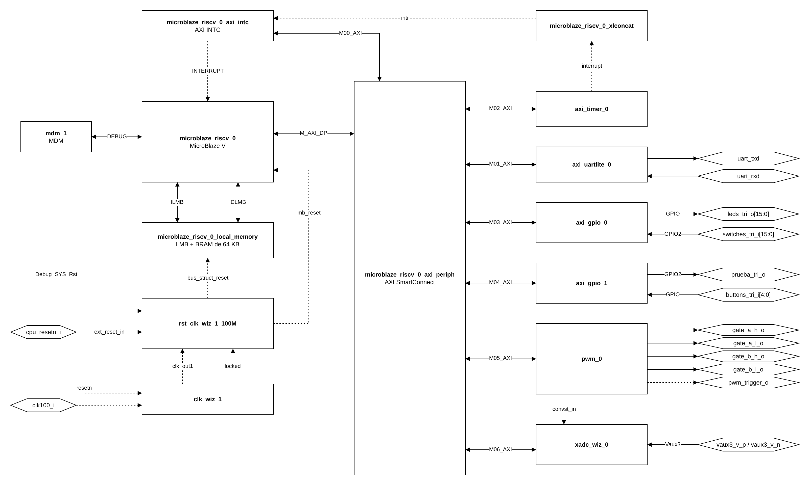

*Figura 3: Block Design con las conexiones de datos (continuas) y de control (discontinuas).*

El reloj `clk_out1` y el reset `peripheral_aresetn` llegan a todos los bloques; para no llenar la figura, esas líneas se muestran en la figura 9 de la sección 5.6.

| Línea | Tipo | Origen | Destino |
|---|---|---|---|
| `ILMB`, `DLMB` | Datos | `microblaze_riscv_0` | `microblaze_riscv_0_local_memory` |
| `M_AXI_DP` | Datos | `microblaze_riscv_0` | `microblaze_riscv_0_axi_periph` |
| `M00_AXI` a `M06_AXI` | Datos | `microblaze_riscv_0_axi_periph` | INTC, UART, Timer, GPIO, PWM y XADC |
| `GPIO`, `GPIO2` | Datos | Switches y botones / `axi_gpio_*` | `axi_gpio_*` / LEDs y pin de prueba |
| `gate_*_o` | Datos | `pwm_0` | Puente H |
| `Vaux3` | Datos (analógica) | Sensor | `xadc_wiz_0` |
| `interrupt` → `intr` → `INTERRUPT` | Control | `axi_timer_0` | `microblaze_riscv_0`, pasando por el concat y el INTC |
| `pwm_trigger_o` → `convst_in` | Control | `pwm_0` | `xadc_wiz_0` y JA7 |
| `DEBUG`, `Debug_SYS_Rst` | Control | `mdm_1` | Procesador y bloque de reset |
| `clk_out1` | Control | `clk_wiz_1` | Todos los bloques |
| `locked` | Control | `clk_wiz_1` | `rst_clk_wiz_1_100M` |
| `mb_reset`, `bus_struct_reset` | Control | `rst_clk_wiz_1_100M` | Procesador y memoria local |

El objetivo, las entradas, las salidas y el funcionamiento de cada bloque de la figura 3 están en las secciones 5 a 7 (tabla de la sección 4.4).

**Funcionamiento del conjunto.** Al encender, `clk_wiz_1` estabiliza el reloj y `rst_clk_wiz_1_100M` libera los resets en orden. El procesador arranca desde la memoria local, configura los periféricos por AXI y pone en marcha el Timer. Desde ahí, cada interrupción recorre el camino Timer → concat → controlador de interrupciones → procesador, y la rutina de control usa el bus AXI para leer el XADC y escribir el PWM. El XADC no espera al procesador: convierte cada vez que el PWM pasa por el valle y deja el dato listo para la siguiente interrupción.

### 4.4 Cuarto nivel

El cuarto nivel es el desarrollo de cada módulo del tercer nivel: su bloque, objetivo, entradas, salidas, relación con los otros módulos, funcionamiento y diseño interno. Está en las secciones 5 a 8:

| Módulo | Sección |
|---|---|
| `microblaze_riscv_0` | 5.1 |
| `microblaze_riscv_0_local_memory` | 5.2 |
| `microblaze_riscv_0_axi_periph` y mapa de direcciones | 5.3 |
| `microblaze_riscv_0_axi_intc` y `microblaze_riscv_0_xlconcat` | 5.4 |
| `mdm_1` | 5.5 |
| `clk_wiz_1` y `rst_clk_wiz_1_100M` | 5.6 |
| `axi_timer_0` | 5.7 |
| `axi_uartlite_0` | 5.8 |
| `axi_gpio_0` y `axi_gpio_1` | 5.9 |
| `pwm_0`: `pwm_bd`, `pwm_axi` y `pwm_core` | 6 |
| `xadc_wiz_0` y su driver | 7 |
| Software que corre en el procesador y script de la PC | 8 |

La jerarquía del Block Design es:

```text
sistema_microblaze (Block Design de Vivado)
├── microblaze_riscv_0                 MicroBlaze V (FPU + extensión M)
├── microblaze_riscv_0_local_memory    LMB + 64 KB de BRAM
├── microblaze_riscv_0_axi_intc        AXI INTC
├── microblaze_riscv_0_xlconcat        Vector de interrupciones
├── microblaze_riscv_0_axi_periph      AXI SmartConnect
├── mdm_1                              Depuración
├── clk_wiz_1 / rst_clk_wiz_1_100M     Reloj y reset
├── axi_timer_0                        Interrupción del lazo
├── axi_uartlite_0                     Exportación
├── axi_gpio_0 / axi_gpio_1            LEDs, switches, botones y pin de prueba
├── xadc_wiz_0                         XADC con interfaz AXI4-Lite (VAUX3)
└── pwm_0 (pwm_bd)                     Envoltura en Verilog
    └── u_pwm_axi (pwm_axi)            Interfaz AXI4-Lite, registros y saturación
        └── u_pwm_core (pwm_core)      Portadora, umbrales, tiempo muerto y pwm_trigger_o
```

El Block Design se guarda en el repositorio como el script `FPGA/BLOCK_DESIGN/sistema_microblaze.tcl`, generado por Vivado, y los pines en `FPGA/CONSTRAINTS/nexys4_inversor.xdc`.

---

## 5. Módulos del Block Design

Los bloques de esta sección son IP de AMD. Para los más simples (MDM, Timer, UART y GPIO) basta con sus puertos y su configuración, porque su estructura interna es la del IP.

### 5.1 `microblaze_riscv_0`

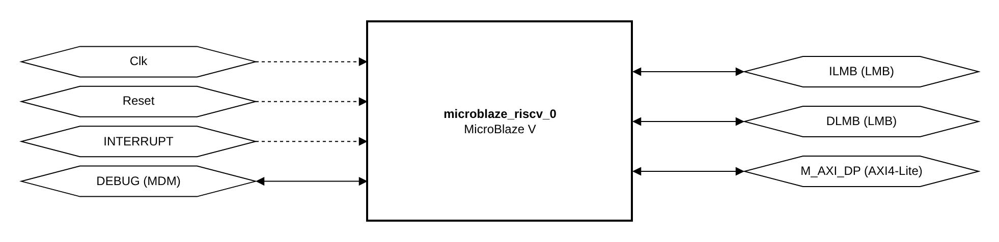

*Figura 4: bloque de `microblaze_riscv_0`.*

**Objetivo.** Ejecutar el programa de control en C.

| Entradas | Salidas |
|---|---|
| `Clk`, `Reset`, `INTERRUPT`, `DEBUG` | `M_AXI_DP`, `ILMB`, `DLMB` |

**Relación con otros módulos.** Lee instrucciones y datos de la memoria local, llega a los periféricos por `microblaze_riscv_0_axi_periph`, recibe la interrupción de `microblaze_riscv_0_axi_intc` y se depura con `mdm_1`.

**Funcionamiento.** Después del reset arranca en `0x0000_0000`: lee las instrucciones por `ILMB` y los datos por `DLMB`, los dos de la memoria local. Todo acceso a una dirección fuera de la memoria local sale por `M_AXI_DP`. Cuando `INTERRUPT` sube, termina la instrucción en curso y salta al manejador de interrupciones.

**Configuración.**

| Parámetro | Valor | Razón |
|---|---|---|
| Frecuencia | 100 MHz | Reloj de todo el sistema |
| FPU y extensión M | Sí | El PR y la referencia se calculan en `float`; la multiplicación y la división no se hacen por software |
| Bus de datos | AXI4-Lite maestro (`M_AXI_DP`) | Para llegar a los periféricos |
| LMB de instrucciones y datos | Sí | Memoria local de un ciclo |
| Caché | No | Todo el programa está en la memoria local, donde la caché no actúa (sección 5.2) |
| Depuración | MDM | Carga del programa desde Vitis |
| Interrupción | AXI Timer → concat → AXI INTC → `INTERRUPT` | Única fuente de interrupción |

### 5.2 `microblaze_riscv_0_local_memory`

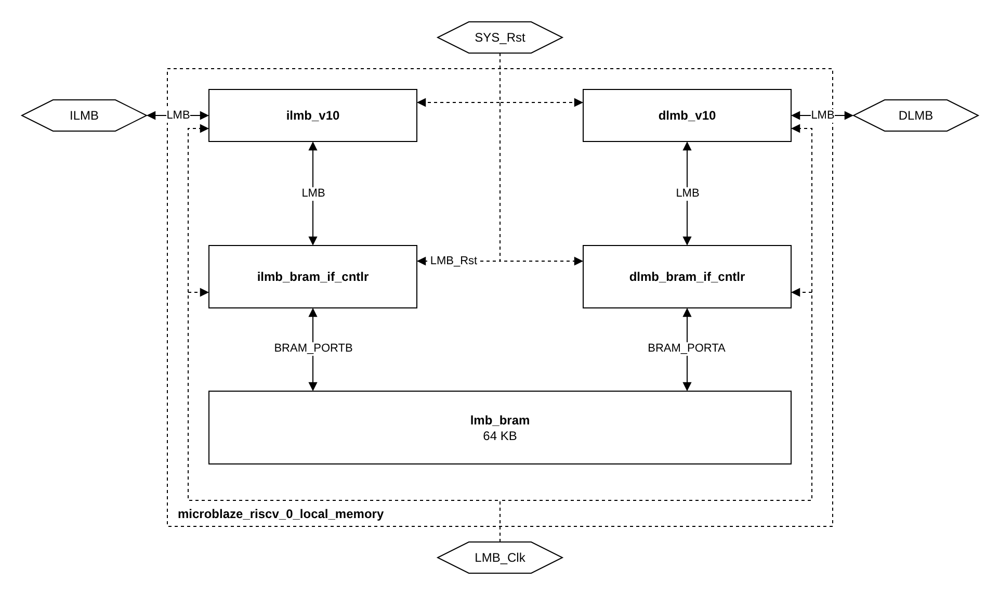

*Figura 5: estructura interna de la memoria local.*

**Objetivo.** Guardar el programa y los datos en BRAM, con acceso en un ciclo.

| Entradas | Salidas |
|---|---|
| `ILMB`, `DLMB`, `LMB_Clk`, `SYS_Rst` | Instrucciones y datos, por los mismos `ILMB` y `DLMB` |

**Funcionamiento.** El procesador tiene dos buses LMB, uno para instrucciones (`ilmb_v10`) y otro para datos (`dlmb_v10`). Cada uno pasa por su controlador de BRAM y llega a un puerto distinto de la misma `lmb_bram`, que es de doble puerto: el B para instrucciones y el A para datos. Así se puede leer una instrucción y un dato en el mismo ciclo.

**Relación con otros módulos.** Solo la usa `microblaze_riscv_0`. Su reset es `bus_struct_reset`, de `rst_clk_wiz_1_100M`.

**Diseño.** `lmb_bram` es un `blk_mem_gen` configurado como *True Dual Port RAM* de 64 KB (16 BRAM de 36 Kb), sin ECC. Se escogieron 64 KB porque el programa, la biblioteca de punto flotante y el buffer de 12 000 bytes no caben en 32 KB. No se usa caché de instrucciones: la caché del MicroBlaze sirve para la memoria a la que se llega por AXI y aquí todo el programa está en la memoria local.

### 5.3 `microblaze_riscv_0_axi_periph`

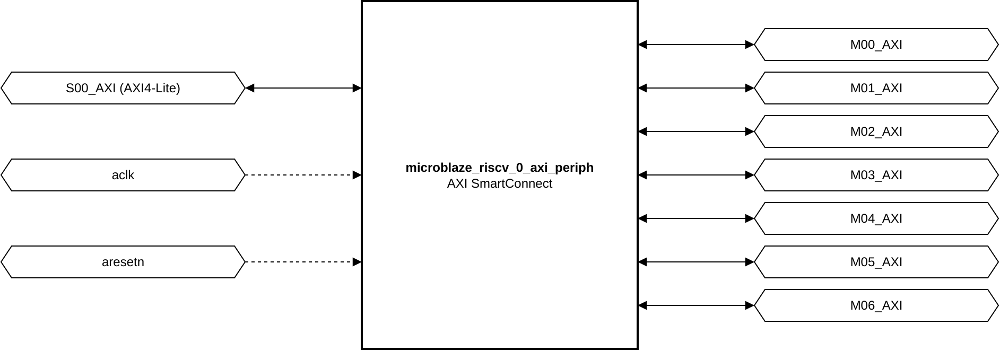

*Figura 6: bloque de `microblaze_riscv_0_axi_periph`.*

**Objetivo.** Repartir los accesos de `M_AXI_DP` entre los siete periféricos según la dirección.

| Entradas | Salidas |
|---|---|
| `S00_AXI`, `aclk`, `aresetn` | `M00_AXI` a `M06_AXI` |

**Relación con otros módulos.** Recibe `M_AXI_DP` del procesador y tiene un puerto maestro hacia cada periférico.

**Funcionamiento.** Compara la dirección de cada lectura o escritura con el mapa y pasa la transacción al puerto `Mxx_AXI` que corresponde; la respuesta vuelve por el mismo camino. Como hay un solo maestro, no tiene que arbitrar entre accesos.

**Mapa de direcciones.** Las direcciones las asigna el Address Editor de Vivado; en C se toman de `xparameters.h` y nunca se escriben a mano.

| Puerto | Esclavo | Dirección base | Rango |
|---|---|---|---|
| — | Memoria local (`dlmb_bram_if_cntlr`) | `0x0000_0000` | 64 KB |
| `M05_AXI` | `pwm_0` | `0x0001_0000` | 4 KB |
| `M03_AXI` | `axi_gpio_0` | `0x4000_0000` | 64 KB |
| `M04_AXI` | `axi_gpio_1` | `0x4001_0000` | 64 KB |
| `M01_AXI` | `axi_uartlite_0` | `0x4060_0000` | 64 KB |
| `M00_AXI` | `microblaze_riscv_0_axi_intc` | `0x4120_0000` | 64 KB |
| `M02_AXI` | `axi_timer_0` | `0x41C0_0000` | 64 KB |
| `M06_AXI` | `xadc_wiz_0` | `0x44A0_0000` | 64 KB |

En el espacio de instrucciones solo está la memoria local (`ilmb_bram_if_cntlr`), en `0x0000_0000` con 64 KB.

### 5.4 `microblaze_riscv_0_axi_intc` y `microblaze_riscv_0_xlconcat`

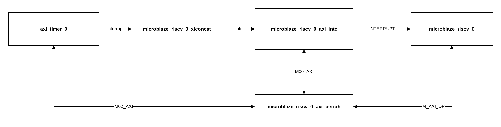

*Figura 7: camino de la interrupción del AXI Timer.*

**Objetivo.** Llevar la interrupción del AXI Timer al procesador.

| Módulo | Entradas | Salidas |
|---|---|---|
| `microblaze_riscv_0_xlconcat` | `In0 [0:0]` | `dout [0:0]` |
| `microblaze_riscv_0_axi_intc` | `s_axi`, `s_axi_aclk`, `s_axi_aresetn`, `processor_clk`, `processor_rst`, `intr [0:0]` | `interrupt` |

**Relación con otros módulos.** Reciben la interrupción de `axi_timer_0` y se la pasan a `microblaze_riscv_0`. El controlador se configura por `M00_AXI` y su reset de procesador es `mb_reset`.

**Funcionamiento.** La salida `interrupt` del Timer entra al concat, que arma el vector `intr` del controlador. El controlador avisa al procesador por `INTERRUPT`, con interrupción rápida (`C_HAS_FAST = 1`). En el programa la interrupción se conecta con el driver de Vitis (`XSetupInterruptSystem()`), que registra `XTmrCtr_InterruptHandler()`; este llama a `rutina_control()` en cada interrupción. El software configura el controlador por `M00_AXI`.

**Diseño.** Con una sola fuente de interrupción, el concat y el controlador parecen de más. Se dejaron porque el driver de interrupciones de Vitis trabaja con el controlador y porque permiten agregar otra fuente sin cambiar la estructura.

### 5.5 `mdm_1`

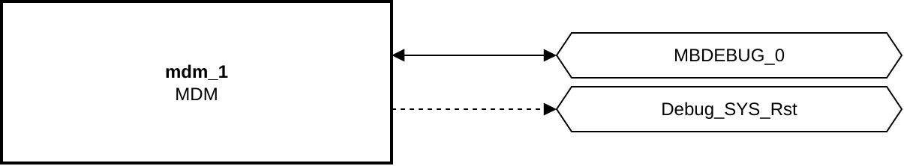

*Figura 8: bloque de `mdm_1`.*

**Objetivo.** Conectar el procesador con el depurador de Vitis por JTAG.

| Entradas | Salidas |
|---|---|
| JTAG interno de la FPGA | `MBDEBUG_0`, `Debug_SYS_Rst` |

**Relación con otros módulos.** `MBDEBUG_0` va al puerto `DEBUG` del procesador. `Debug_SYS_Rst` le pide un reset al bloque de reset cuando el depurador lo necesita, como al cargar el programa.

**Funcionamiento.** Vitis se conecta por el cable USB-JTAG de la tarjeta; el MDM traduce esos comandos para detener el procesador, escribir el programa en la memoria local y arrancarlo. En operación normal no interviene.

### 5.6 `clk_wiz_1` y `rst_clk_wiz_1_100M`

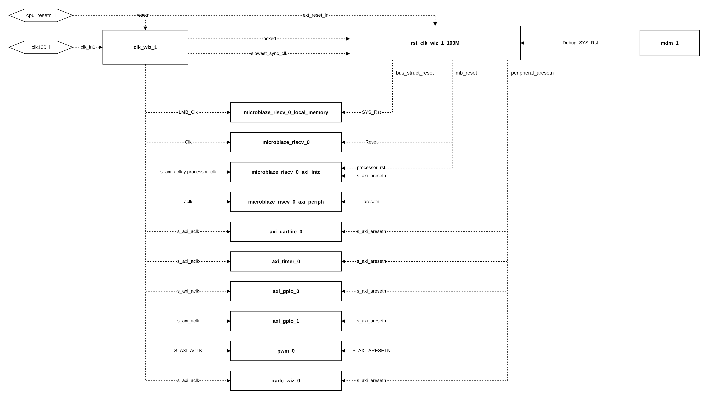

*Figura 9: distribución del reloj y de los resets.*

**Objetivo.** Dar un reloj estable de 100 MHz y resets sincronizados con él.

| Módulo | Entradas | Salidas |
|---|---|---|
| `clk_wiz_1` | `clk_in1`, `resetn` | `clk_out1`, `locked` |
| `rst_clk_wiz_1_100M` | `slowest_sync_clk`, `ext_reset_in`, `dcm_locked`, `mb_debug_sys_rst` | `mb_reset`, `bus_struct_reset`, `peripheral_aresetn` |

**Relación con otros módulos.** Le dan reloj y reset a todos los bloques del sistema. Reciben `cpu_resetn_i` de la tarjeta y `Debug_SYS_Rst` de `mdm_1`.

**Funcionamiento.** `clk100_i` entra al `clk_wiz_1`, que entrega `clk_out1` de 100 MHz a todos los bloques. Cuando el reloj está estable, `locked` sube y le avisa al bloque de reset. El botón CPU RESET (`cpu_resetn_i`, activo en bajo) reinicia el `clk_wiz_1` y entra a `ext_reset_in`. El bloque de reset entrega tres resets síncronos:

| Reset | Va a |
|---|---|
| `mb_reset` | `Reset` del procesador y `processor_rst` del controlador de interrupciones |
| `bus_struct_reset` | `SYS_Rst` de la memoria local |
| `peripheral_aresetn` | `aresetn` de todos los periféricos AXI, incluido el PWM (`S_AXI_ARESETN`), activo en bajo |

### 5.7 `axi_timer_0`

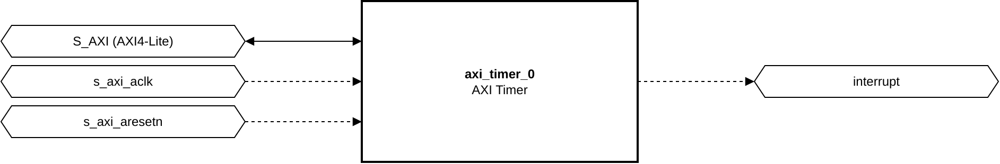

*Figura 10: bloque de `axi_timer_0`.*

**Objetivo.** Generar la interrupción periódica del lazo de control.

| Entradas | Salidas |
|---|---|
| `S_AXI`, `s_axi_aclk`, `s_axi_aresetn` | `interrupt` |

**Relación con otros módulos.** Su `interrupt` va al concat y de ahí al controlador de interrupciones. El procesador lo configura y lo lee por `M02_AXI`.

**Funcionamiento.** El periodo lo fija el software [9]: el contador 0 cuenta hacia abajo con recarga automática desde `TIMER_CARGA` = 4998, porque el Timer tarda `TLR + 2` ciclos por periodo ($100 \cdot 50 - 2 = 4998$ para 50 µs). El programa también lee este contador para medir la latencia y la duración de la rutina de interrupción.

| Función del driver (`xtmrctr`) | Uso |
|---|---|
| `XTmrCtr_Initialize()` | Inicia el driver con `XPAR_AXI_TIMER_0_BASEADDR` |
| `XTmrCtr_SetOptions()` | Contador 0 con interrupción, recarga automática y cuenta hacia abajo |
| `XTmrCtr_SetResetValue()` | Carga `TIMER_CARGA` = 4998 |
| `XTmrCtr_SetHandler()` | Registra `rutina_control()` |
| `XTmrCtr_Start()` | Arranca el contador |
| `XTmrCtr_GetValue()` | Lee el contador al entrar y al salir de la ISR |

### 5.8 `axi_uartlite_0`

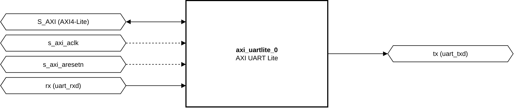

*Figura 11: bloque de `axi_uartlite_0`.*

**Objetivo.** Enviar mensajes y muestras a la PC.

| Entradas | Salidas |
|---|---|
| `S_AXI`, `s_axi_aclk`, `s_axi_aresetn`, `rx` (`uart_rxd`) | `tx` (`uart_txd`) |

**Relación con otros módulos.** El procesador escribe en él por `M01_AXI`; `tx` va al puente USB-UART de la tarjeta.

**Funcionamiento.** Tiene una FIFO de transmisión de 16 bytes. `xil_printf()` revisa el registro de estado y escribe cada carácter en la FIFO cuando hay espacio; la UART lo saca en serie por `tx`. Esa espera solo ocurre en el lazo principal, así que la interrupción del Timer sigue entrando.

**Configuración.** 115 200 baudios, 8 bits de datos y sin paridad. Su interrupción no se usa.

### 5.9 `axi_gpio_0` y `axi_gpio_1`

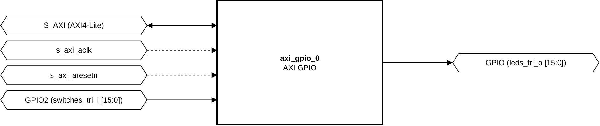

*Figura 12: bloque de `axi_gpio_0`.*

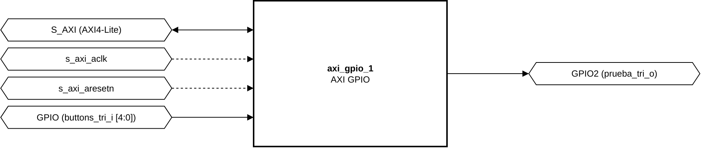

*Figura 13: bloque de `axi_gpio_1`.*

**Objetivo.** Dar acceso a los switches, botones, LEDs y al pin de prueba.

| Módulo | Canal 1 (`GPIO`) | Canal 2 (`GPIO2`) |
|---|---|---|
| `axi_gpio_0` | 16 salidas: `leds_tri_o` | 16 entradas: `switches_tri_i` |
| `axi_gpio_1` | 5 entradas: `buttons_tri_i` | 1 salida: `prueba_tri_o` (JA8) |

**Relación con otros módulos.** El procesador los lee y escribe por `M03_AXI` y `M04_AXI`. `main.c` usa los LEDs, los switches y los botones; la ISR usa solo el pin de prueba.

**Funcionamiento.** `main.c` usa el driver de Vitis: `XGpio_DiscreteRead()` para los switches y los botones y `XGpio_DiscreteWrite()` para los LEDs. La ISR escribe directo el registro de datos del canal 2 de `axi_gpio_1` (offset `0x08`) con `Xil_Out32()`.

**Diseño.** El pin de prueba está en un canal aparte para que la rutina de interrupción lo pueda subir y bajar con una sola escritura (`Xil_Out32`), sin tocar los LEDs.

### 5.10 Pines y conexiones externas

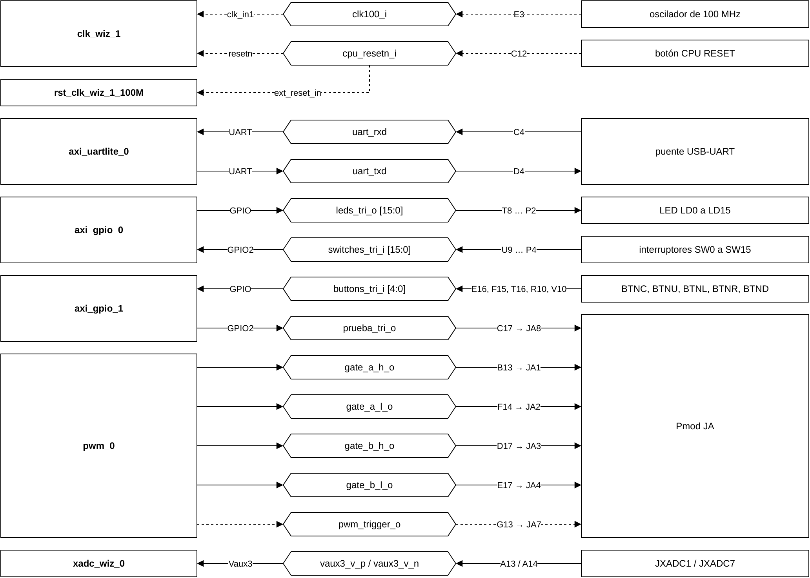

*Figura 14: conexión de los puertos del Block Design con los pines y los conectores de la Nexys 4.*

| Puerto | Pin | Conector o elemento |
|---|---|---|
| `clk100_i` | E3 | Oscilador de 100 MHz |
| `cpu_resetn_i` | C12 | Botón CPU RESET |
| `uart_rxd` / `uart_txd` | C4 / D4 | Puente USB-UART |
| `leds_tri_o[15:0]` | T8 … P2 | LD0 a LD15 |
| `switches_tri_i[15:0]` | U9 … P4 | SW0 a SW15 |
| `buttons_tri_i[4:0]` | E16, F15, T16, R10, V10 | BTNC, BTNU, BTNL, BTNR, BTND |
| `gate_a_h_o`, `gate_a_l_o`, `gate_b_h_o`, `gate_b_l_o` | B13, F14, D17, E17 | JA1 a JA4 |
| `pwm_trigger_o` | G13 | JA7 |
| `prueba_tri_o` | C17 | JA8 |
| `vaux3_v_p` / `vaux3_v_n` | A13 / A14 | JXADC1 / JXADC7 |

Del Pmod JA, JA1 a JA4 van a HIN y LIN de los dos IR2110; VDD de los drivers se alimenta con los 3,3 V del mismo Pmod y VSS con su tierra (sección 9). JA7 y JA8 se usan para medir con el osciloscopio.

---

## 6. Periférico PWM

El periférico `pwm_0` tiene tres niveles: `pwm_bd` (envoltura para el Block Design), `pwm_axi` (bus y registros) y `pwm_core` (generación de las señales). El núcleo no conoce el protocolo AXI: recibe valores ya listos y los convierte en señales de compuerta. El RTL separa la lógica secuencial (`always_ff`) de la combinacional (`always_comb`), como en [1] y [2].

### 6.1 `pwm_0` (`pwm_bd`)

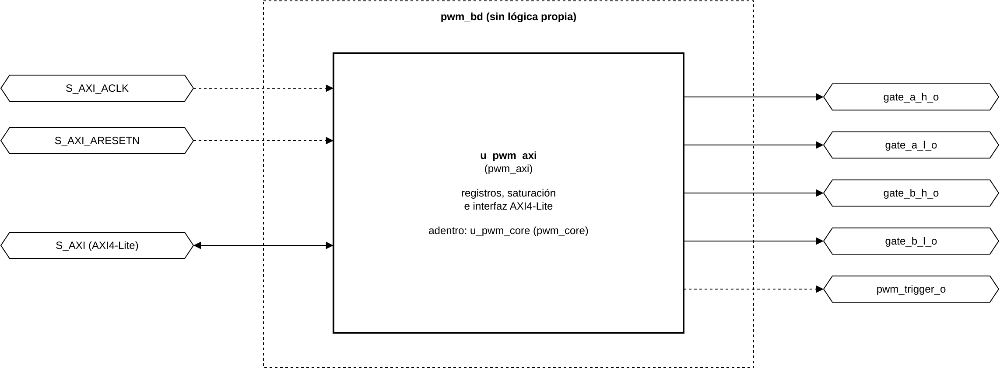

*Figura 15: `pwm_bd` y su instancia de `pwm_axi`.*

**Objetivo.** Integrar el PWM en el Block Design como un esclavo AXI4-Lite.

| Entradas | Salidas |
|---|---|
| `S_AXI`, `S_AXI_ACLK`, `S_AXI_ARESETN` | `gate_a_h_o`, `gate_a_l_o`, `gate_b_h_o`, `gate_b_l_o`, `pwm_trigger_o` |

**Diseño.** Vivado no acepta un módulo en SystemVerilog como módulo superior de un *module reference* [5]. Por eso `pwm_bd.v`, en Verilog, solo instancia `pwm_axi` como `u_pwm_axi` y conecta cada puerto con el del mismo nombre; no tiene lógica propia. Sus puertos llevan los atributos `X_INTERFACE_INFO` y `X_INTERFACE_PARAMETER` para que Vivado reconozca la interfaz `S_AXI` (AXI4-Lite, datos de 32 bits y dirección de 4 bits), su reloj y su reset activo en bajo. Así el bloque se conecta al interconectador como cualquier otro periférico y cada cambio del RTL se ve en el Block Design sin reempaquetar un IP.

### 6.2 `pwm_axi`

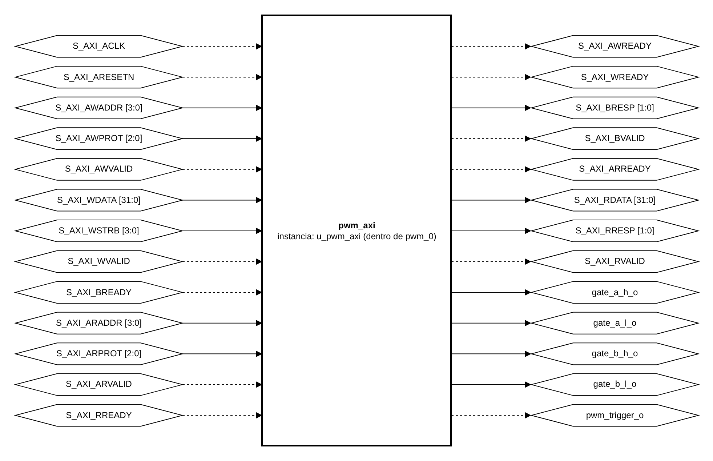

*Figura 16: bloque de `pwm_axi` con sus puertos.*

**Objetivo.** Darle al procesador una forma de configurar el PWM con registros: atender el bus AXI4-Lite, guardar `enable`, `freq_sel`, `duty_ref` y `dead_time`, saturar los dos últimos y entregárselos a `pwm_core`.

| Entradas | Descripción |
|---|---|
| `S_AXI_ACLK`, `S_AXI_ARESETN` | Reloj de 100 MHz y reset síncrono activo en bajo |
| `S_AXI_AWADDR [3:0]`, `S_AXI_AWVALID` | Dirección de escritura |
| `S_AXI_WDATA [31:0]`, `S_AXI_WSTRB [3:0]`, `S_AXI_WVALID` | Dato de escritura y bytes válidos |
| `S_AXI_BREADY` | El maestro acepta la respuesta de escritura |
| `S_AXI_ARADDR [3:0]`, `S_AXI_ARVALID` | Dirección de lectura |
| `S_AXI_RREADY` | El maestro acepta el dato leído |

| Salidas | Descripción |
|---|---|
| `S_AXI_AWREADY`, `S_AXI_WREADY` | Se aceptaron la dirección y el dato |
| `S_AXI_BVALID`, `S_AXI_BRESP [1:0]` | Respuesta de escritura (siempre OKAY) |
| `S_AXI_ARREADY` | Se aceptó la dirección de lectura |
| `S_AXI_RVALID`, `S_AXI_RDATA [31:0]`, `S_AXI_RRESP [1:0]` | Dato leído y su respuesta (siempre OKAY) |
| `gate_a_h_o`, `gate_a_l_o`, `gate_b_h_o`, `gate_b_l_o`, `pwm_trigger_o` | Vienen de `pwm_core` |

`S_AXI_AWPROT` y `S_AXI_ARPROT` existen por la interfaz AXI4-Lite, pero no se usan.

**Relación con otros módulos.** Recibe las transacciones del procesador por `microblaze_riscv_0_axi_periph` y entrega a `pwm_core` cuatro señales: `enable`, `freq_sel` y los valores ya saturados de `duty_ref` y `dead_time`. De `pwm_core` solo lee `running`.


*Figura 17: estructura interna de `pwm_axi`.*

**Funcionamiento.** La interfaz sigue el protocolo AXI4-Lite [6] y la estructura del esclavo que genera Vivado con *Create and Package New IP*.

- **Escritura.** El periférico espera a tener AW y W, sin importar cuál llega primero, y los acepta en el mismo ciclo; con eso genera `escribir`. El decodificador usa `awaddr_q[3:2]` para escoger el registro. El dato se mezcla con el valor anterior según `WSTRB` (solo cambian los bytes con su bit en 1) y, si el registro es `duty_ref` o `dead_time`, pasa por la saturación antes de guardarse. `BVALID` se mantiene hasta que llega `BREADY`.
- **Lectura.** El periférico guarda la dirección y responde con `ARREADY`. El mux escoge el registro según `araddr_q[3:2]`, el resultado se guarda en `rdata_q` y `RVALID` se mantiene hasta que llega `RREADY`.
- **`running`.** No se guarda: es la salida `running_o` de `pwm_core`. Una escritura al bit 3 no lo cambia.

**Registros.** Dirección base `0x0001_0000`. Los registros se repiten dentro de los 4 KB del rango, porque solo se decodifican los bits [3:2] de la dirección.

| Offset | Bits | Campo | Acceso | Tras reset | Descripción |
|---|---|---|---|---|---|
| `0x00` (CTRL) | 0 | `enable` | R/W | 0 | Habilita el PWM |
| | [2:1] | `freq_sel` | R/W | `00` | Frecuencia de conmutación (sección 6.3) |
| | 3 | `running` | RO | 0 | El PWM está generando; una escritura no lo cambia |
| | [31:4] | — | — | 0 | Reservado, lee 0 |
| `0x04` (DUTY) | [15:0] | `duty_ref` | R/W | 0 | Índice de modulación en Q1.15 con signo, saturado a ±0,95 |
| | [31:16] | — | — | 0 | Reservado, lee 0 |
| `0x08` (DEAD_TIME) | [7:0] | `dead_time` | R/W | 20 | Tiempo muerto en ciclos de 10 ns, mínimo 10 |
| | [31:8] | — | — | 0 | Reservado, lee 0 |
| `0x0C` | [31:0] | — | — | 0 | Reservado; escribirlo no hace nada |

Todas las respuestas son OKAY, también en el registro reservado. El periférico solo genera la modulación unipolar, así que no tiene un campo de selección de modulación.

**Diseño de la saturación.**

| Registro | Regla | Valor |
|---|---|---|
| `duty_ref` | Se limita a `-M_MAX ... +M_MAX` | `M_MAX` = 31129 (≈ 0,95 en Q1.15) |
| `dead_time` | No puede ser menor que `DT_MIN` | `DT_MIN` = 10 ciclos (100 ns) |

Si el procesador escribe `0x7FFF` en `duty_ref`, el registro guarda 31129; si escribe 0 en `dead_time`, guarda 10. Al leer se obtiene el valor ya saturado. Con ±0,95 el umbral nunca llega a los extremos de la portadora. En operación normal el software limita $m$ a ±0,8, y con ese valor el pulso más angosto es varias veces más largo que el tiempo muerto.

### 6.3 `pwm_core`

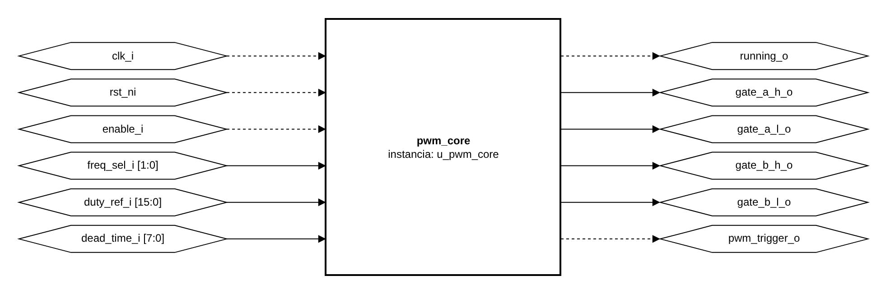

*Figura 18: bloque de `pwm_core` con sus puertos.*

**Objetivo.** Generar la modulación PWM unipolar con tiempo muerto para el puente H y el disparo del ADC.

| Entradas | Descripción |
|---|---|
| `clk_i`, `rst_ni` | Reloj de 100 MHz y reset síncrono activo en bajo |
| `enable_i` | Habilita la generación |
| `freq_sel_i [1:0]` | Frecuencia de conmutación |
| `duty_ref_i [15:0]` | Referencia en Q1.15 con signo, ya saturada |
| `dead_time_i [7:0]` | Tiempo muerto en ciclos de reloj, ya saturado |

| Salidas | Descripción |
|---|---|
| `running_o` | El generador está activo |
| `gate_a_h_o`, `gate_a_l_o` | Compuertas de la pierna A (arriba, abajo) |
| `gate_b_h_o`, `gate_b_l_o` | Compuertas de la pierna B (arriba, abajo) |
| `pwm_trigger_o` | Pulso de un ciclo en cada valle de la portadora |

**Relación con otros módulos.** Recibe la configuración de `pwm_axi`, le devuelve `running_o` y entrega las compuertas al puente H y `pwm_trigger_o` a `convst_in` del XADC.

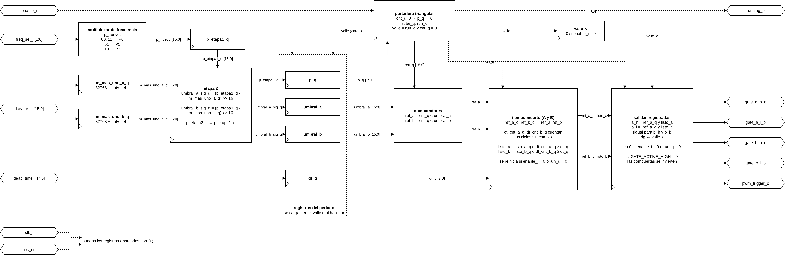

*Figura 19: estructura interna de `pwm_core`.*

**Funcionamiento.** `duty_ref_i` pasa por dos etapas registradas para calcular los umbrales. Los umbrales, el medio periodo y el tiempo muerto se copian en los registros del periodo solo cuando la portadora llega al valle (`cnt_q = 0`) o al habilitar. Los comparadores usan `cnt_q` y los umbrales para dar la referencia de cada pierna, que pasa por el tiempo muerto y llega a las salidas registradas.

**Portadora y frecuencias.** Un contador `cnt_q` de 16 bits sube de 0 a $P$ y baja de $P$ a 0, y forma la portadora triangular. $P = f_{clk}/(2 f_{sw})$ y el periodo de la portadora es de $2P$ ciclos:

| `freq_sel` | $f_{sw}$ | $P$ | Periodo |
|---|---|---|---|
| `00` | 100 kHz | 500 | 1000 ciclos (10 µs) |
| `01` | 80 kHz | 625 | 1250 ciclos (12,5 µs) |
| `10` | 125 kHz | 400 | 800 ciclos (8 µs) |
| `11` | 100 kHz | 500 | Se toma como `00` |

Las tres frecuencias dan un número entero de ciclos, así que son exactas. Todas se calculan a partir del parámetro `CLK_HZ`. La resolución va de 400 a 625 pasos por semiperiodo.

**Modulación unipolar.** Las dos piernas se comparan con la misma portadora, pero con referencias opuestas [11]:

$$d_A = \frac{1 + m}{2}, \qquad d_B = \frac{1 - m}{2}, \qquad \bar v_{AB} = V_{dc}\,(d_A - d_B) = V_{dc}\,m$$

La pierna A está arriba mientras $cnt < P\,(1+m)/2$, y la B mientras $cnt < P\,(1-m)/2$. Con $m$ en Q1.15, $(1+m)/2$ es $(m + 32768)/65536$: una suma, una multiplicación por $P$ y un corrimiento de 16 bits. Como la suma, la multiplicación y la comparación juntas no caben en un ciclo de 10 ns, el cálculo se hace en dos etapas registradas: en la primera se calculan $1+m$ y $1-m$ y en la segunda se multiplica por $P$ y se corre 16 bits. Cada transistor conmuta a $f_{sw}$, pero la tensión entre las salidas del puente tiene tres niveles y su componente principal está en $2 f_{sw}$ (200 kHz con 100 kHz).

**Actualización en el valle.** `duty_ref`, `freq_sel` y `dead_time` se copian a los registros del periodo solo en el valle. Un cambio a mitad de periodo nunca corta un pulso. Como el cálculo de los umbrales tarda dos ciclos, un cambio de `duty_ref` o `freq_sel` se aplica en el siguiente valle o en el que sigue; `dead_time` se aplica en el primero.

**Tiempo muerto.** Cada pierna tiene un contador que cuenta los ciclos desde el último cambio de su referencia:

- Si la referencia cambia, el contador vuelve a 0 y las dos compuertas de la pierna se apagan.
- Cuando el contador llega a `dt_q`, la señal `listo_a` (o `listo_b`) se activa y se enciende la compuerta que corresponde ($x_h = \text{ref} \land \text{listo}$, $x_l = \lnot\text{ref} \land \text{listo}$).
- `listo_a_q` y `listo_b_q` guardan ese valor hasta el siguiente cambio de la referencia, así que un cambio de `dead_time` no corta un pulso que ya empezó.

El tiempo muerto solo retrasa el encendido. Es de 20 ciclos después del reset (200 ns), mínimo 10 (100 ns) y máximo 255 (2,55 µs).

**`pwm_trigger_o`.** Es un pulso de un ciclo en cada valle de la portadora. Pasa por los mismos dos registros que las compuertas (`valle_q` y `trig`), así que sale alineado con ellas. En el valle la referencia de las dos piernas está en alto: es el centro del pulso alto de la referencia, lejos de los flancos de conmutación con valores normales de $m$. Respecto al pulso de la compuerta, el disparo queda medio tiempo muerto antes del centro, porque el tiempo muerto solo atrasa el encendido. Además, en el centro del pulso la corriente pasa por su valor promedio del periodo de conmutación, así que la muestra no queda afectada por el rizado.

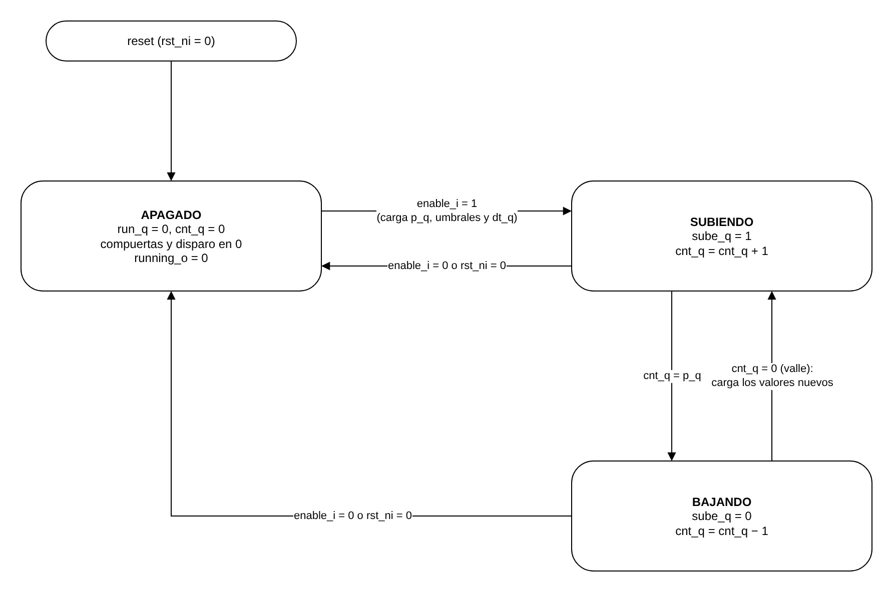

*Figura 20: estados de la portadora en `pwm_core`.*

**Estados y estado seguro.**

- Los estados no son una enumeración: salen de los registros `run_q` (0 en APAGADO) y `sube_q` (1 en SUBIENDO, 0 en BAJANDO). Al habilitar se cargan los valores y la portadora empieza a subir; al llegar a `p_q` pasa a bajar, y en el valle carga los valores nuevos y vuelve a subir.
- Con `enable_i = 0` o en reset, el contador se queda en 0, `running_o` baja, los contadores del tiempo muerto se ponen en cero y las cuatro compuertas y el disparo se apagan en el siguiente ciclo.
- Las salidas están registradas, así que no tienen glitches de la lógica combinacional.
- `GATE_ACTIVE_HIGH = 1` deja las compuertas activas en alto. Si los drivers fueran activos en bajo, bastaría con poner `GATE_ACTIVE_HIGH = 0` para invertir las cuatro salidas.

### 6.4 Parámetros

| Parámetro | Valor | Uso |
|---|---|---|
| `CLK_HZ` | 100 000 000 | Todas las cuentas se calculan desde aquí |
| `F_SW0`, `F_SW1`, `F_SW2` | 100 000, 80 000, 125 000 | Frecuencias de `freq_sel` |
| `M_MAX` | 31129 | Límite de `duty_ref` (0,95) |
| `DT_RESET`, `DT_MIN` | 20, 10 | Tiempo muerto después del reset y mínimo |
| `GATE_ACTIVE_HIGH` | 1 | Polaridad de las compuertas |

`u_pwm_axi` se instancia en `pwm_bd` sin parámetros, así que el sistema usa estos valores por defecto.

---

## 7. Adquisición de la corriente (XADC)

### 7.1 `xadc_wiz_0`

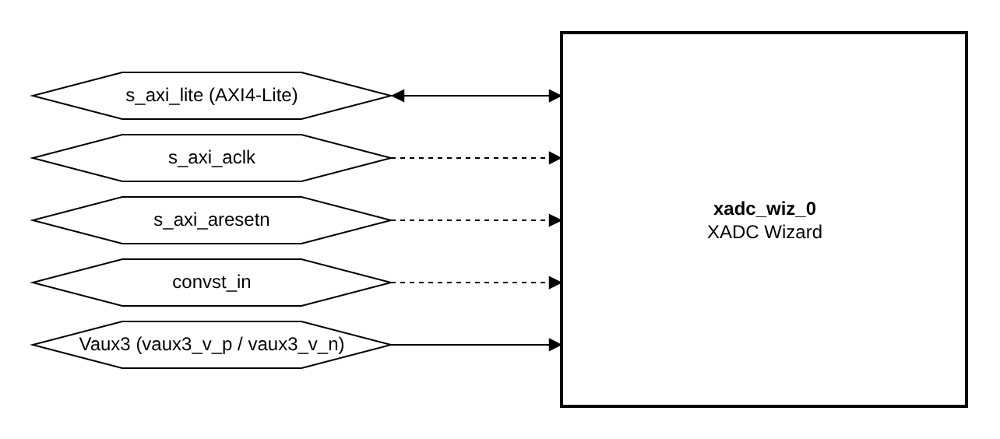

*Figura 21: bloque de `xadc_wiz_0` en el Block Design.*

**Objetivo.** Convertir la tensión del sensor de corriente y dejar el dato listo para la rutina de interrupción.

| Entradas | Salidas |
|---|---|
| `s_axi_lite`, `s_axi_aclk`, `s_axi_aresetn`, `convst_in`, `Vaux3` (`vaux3_v_p` / `vaux3_v_n`) | Dato y aviso EOC, que se leen por el bus |

**Relación con otros módulos.** `convst_in` está conectado a `pwm_trigger_o` del PWM, y el procesador lee el dato por `M06_AXI`.

**Configuración.** Se usa el XADC Wizard [7], [8] con su propia interfaz AXI4-Lite.

| Parámetro | Valor | Razón |
|---|---|---|
| Modo | Evento | Cada conversión empieza con un flanco de subida en `convst_in` o en el registro CONVST |
| Canal | Uno solo, VAUX3 | Es el par de JXADC1 y JXADC7 |
| `ENABLE_CONVST` | Sí | Crea la entrada `convst_in` |
| Entrada | Unipolar, de 0 a 1 V | Rango del XADC |
| Reloj | 100 MHz | El mismo del sistema |
| Alarmas | Desactivadas | No se usan |

**Funcionamiento.** Cada flanco de subida en `convst_in` o en CONVST inicia una conversión de VAUX3, que tarda alrededor de 1 µs. Al terminar, el dato queda en el registro VAUX3 y el bit EOC sube en IPISR hasta que el software lo borra. La conversión arranca de dos formas:

- **Por hardware:** con `pwm_trigger_o` en `convst_in`.
- **Por software:** escribiendo 1 y después 0 en el registro CONVST (la conversión arranca con el flanco de subida).

### 7.2 Registros y driver

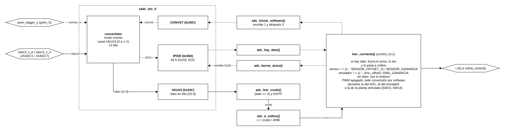

*Figura 22: XADC, registros usados y funciones del driver.*

| Registro | Offset | Uso |
|---|---|---|
| CONVST | `0x00C` | Inicio de conversión por software |
| IPISR | `0x060` | Bit EOC (`0x20`): hay una muestra nueva; se queda en 1 hasta que se borra escribiendo 1 |
| VAUX3 | `0x24C` | Dato de 12 bits en [15:4] |

Las funciones de `adc_driver.h` son `static inline`, así que no agregan llamadas dentro de la rutina de interrupción. La dirección base es `XPAR_XADC_WIZ_0_BASEADDR`.

| Función | Qué hace |
|---|---|
| `adc_iniciar_software(base)` | Escribe 1 y después 0 en CONVST. Si el registro se queda en 1, el disparo con `pwm_trigger_o` deja de funcionar |
| `adc_hay_dato(base)` | Devuelve 1 si EOC está en 1 |
| `adc_borrar_aviso(base)` | Escribe `0x20` en IPISR para borrar EOC |
| `adc_leer_crudo(base)` | Lee VAUX3 y devuelve `(dato >> 4) & 0xFFF`, de 0 a 4095 |
| `adc_a_voltios(crudo)` | Devuelve `crudo / 4096`, en voltios; un LSB son 0,24 mV |

### 7.3 Uso en la ISR

La función `leer_corriente()` de `control_isr.c` se llama en cada interrupción:

1. Si hay dato nuevo, se borra EOC, se lee el dato y se pasa a voltios. Se borra antes de leer para que, si termina otra conversión en medio, su aviso no se pierda.
2. Si no hay dato nuevo, se usa la última corriente calculada y se incrementa `control_adc_sin_dato`.
3. Si el PWM está apagado, no hay disparos, así que se pide la siguiente conversión por software. El dato estará listo en la siguiente interrupción.
4. Se devuelve la corriente del XADC (sensor o emulador) o la de la planta simulada, según los switches.

Como se explicó en la sección 2.1, la muestra que se lee puede tener entre 0 y un periodo de conmutación de antigüedad.

### 7.4 Conversión a amperios

El sensor es un ACS712, cuya salida está centrada en unos 2,5 V con corriente cero. Para el XADC esa salida se lleva al rango de 0 a 1 V con la etapa de acondicionamiento de PEDP, de forma que la corriente cero quede cerca de 0,5 V. En el software:

$$i = \frac{v_{adc} - V_{off}}{G}$$

$V_{off}$ y $G$ son constantes de `control_isr.h` (`SENSOR_OFFSET_V` y `SENSOR_GANANCIA`). $V_{off}$ se mide con el PWM apagado y corriente cero, leyendo los mV que imprime la terminal; $G$ se obtiene con una corriente continua conocida. $G$ es la sensibilidad del ACS712 multiplicada por la ganancia de la etapa de acondicionamiento. Con el XADC de 0 a 1 V, la corriente máxima que se puede medir es $V_{off}/G$ hacia un lado y $(1 - V_{off})/G$ hacia el otro; al calibrar, ese rango tiene que cubrir los 1,5 A de la protección.

### 7.5 Emulador para pruebas sin potencia

Para cerrar el lazo en la tarjeta sin el puente H, JA1 y JA4 pasan por un filtro RC hasta un nodo que entra a JXADC1. La tensión de ese nodo es un offset más una parte proporcional a $m$. Con SW14 = 1 el software la convierte en una corriente equivalente:

$$i = \frac{v_{adc} - v_{off,emu}}{G_{emu}}, \qquad G_{emu} = 0{,}137\ \text{V/A}$$

$G_{emu}$ se escogió para que un mismo $m$ dé la misma corriente que la carga real ($V_{dc}\,m/R$). El offset se aprende mientras el lazo está apagado, porque entonces $m = 0$ y lo que se lee es solo el offset: $v_{off,emu} \leftarrow v_{off,emu} + 0{,}01\,(v_{adc} - v_{off,emu})$, con un valor inicial de 0,47 V.

---

## 8. Software de control

### 8.1 Organización


*Figura 23: módulos del software y periféricos que usa cada uno.*

La aplicación se compila en Vitis [10] sobre la plataforma exportada del Block Design.

| Archivo | Contenido |
|---|---|
| `main.c` | Inicialización, lectura de switches y botones, LEDs y exportación |
| `control_isr.c/.h` | ISR, referencia, protección, buffer y variables compartidas (`volatile`) |
| `control_pr.c/.h` | Ecuación en diferencias del PR |
| `pwm_driver.h` | Offsets y funciones de acceso al PWM (sección 8.7) |
| `adc_driver.h` | Offsets y funciones de acceso al XADC (sección 7.2) |

`main.c` y la ISR no se llaman entre sí durante la operación: se comunican con variables `volatile`, para que el compilador las lea de memoria cada vez.

| Variable | La escribe | Uso |
|---|---|---|
| `control_habilitado` | `main` | SW0 |
| `control_amplitud`, `control_freq_sel` | `main` | Amplitud de la referencia y `freq_sel` |
| `control_usar_adc`, `control_emulador` | `main` | Fuente de la corriente (SW15, SW14) |
| `control_lazo_abierto`, `control_m_constante`, `control_m_fijo` | `main` | Modo de lazo abierto (SW13, SW12) y valor de $m$ |
| `control_congelado` | `main` | 1 mientras se exporta |
| `control_falla` | ISR (la borra `main`) | 1 si hubo sobrecorriente |
| `control_buffer`, `control_indice`, `control_lleno` | ISR (los reinicia `main`) | Buffer circular |
| `control_isr_max`, `control_lat_min`, `control_lat_max` | ISR | Tiempos medidos |

### 8.2 Programa principal (`main.c`)

**Objetivo.** Iniciar los periféricos y atender las tareas lentas: switches, botón, LEDs, exportación e impresión de tiempos.

**Entradas:** switches y botones (por los GPIO), `control_falla` y los tiempos medidos. **Salidas:** variables de configuración, LEDs y texto por la UART.

**Relación con otros módulos.** Llama una vez a `control_isr_iniciar()` y después solo se comunica con la ISR por las variables compartidas. Usa los GPIO y la UART.


*Figura 24: diagrama de flujo de `main.c`.*

1. Se inician los GPIO, con el canal de los LEDs como salida, y se llama a `control_isr_iniciar()`: llena la tabla del seno, pone el PR en cero, deja el PWM apagado con `duty_ref = 0`, 100 kHz y 200 ns de tiempo muerto, y configura el Timer con recarga automática de 50 µs y su interrupción conectada al INTC.
2. Cada 10 ms se leen los switches y los botones, se actualizan las variables compartidas y los LEDs (al subir SW0 se reinician los tiempos medidos), y se exporta si se presionó BTNC (antirrebote de 30 ms, una exportación por cada presión).
3. Cada segundo se imprimen el número de interrupciones, la duración máxima y la latencia de la ISR, `running` y los contadores del XADC.

### 8.3 Rutina de interrupción (`rutina_control()`, cada 50 µs)

**Objetivo.** Hacer siempre la misma secuencia en cada periodo de control.

**Entradas:** muestra del XADC y variables de configuración. **Salidas:** `duty_ref` y el control del PWM, la muestra en el buffer, `control_falla` y los tiempos medidos.

**Relación con otros módulos.** La llama el driver del Timer en cada interrupción. Usa `adc_driver.h`, `control_pr.c` y `pwm_driver.h`, y escribe el pin de prueba del `axi_gpio_1`.


*Figura 25: diagrama de flujo de `rutina_control()`.*

1. Leer el Timer y poner en 1 el pin de prueba.
2. Leer la corriente (XADC, emulador o planta simulada).
3. Protección: si $|i|$ supera `CONTROL_I_MAX` (1,5 A), marcar falla. En el modo emulador solo se revisa con el lazo activo, porque al entrar al modo el XADC lee 0 V y eso parecería una sobrecorriente.
4. Referencia: $i_{ref} = A \sin(2\pi\,50\,n T_s)$, tomada de una tabla de 400 puntos (un ciclo de 50 Hz). La tabla se llena al iniciar, así que en la ISR no se calcula ningún seno.
5. Con el lazo activo, calcular el PR o, en lazo abierto (SW13 = 1), tomar $m$ de los switches; con el lazo apagado, $m = 0$.
6. Escribir `duty_ref` y el registro de control del PWM. Así una falla apaga el PWM en la misma interrupción.
7. Guardar la muestra en el buffer, si no se está exportando.
8. Poner en 0 el pin de prueba, leer otra vez el Timer (`t_salida`) y guardar la duración y la latencia:

```text
latencia = TIMER_CARGA − t_entrada
duracion = t_entrada − t_salida
```

La ISR no usa la UART ni tiene esperas.

**Planta simulada.** Con SW15 = 0 y SW14 = 0 la corriente sale de un modelo discreto de la carga RL, para probar el lazo sin hardware externo:

$$i[k+1] = a\,i[k] + (1-a)\,\frac{V_{dc}\,m[k-1]}{R}, \qquad a = e^{-R T_s / L}$$

con $R = 5{,}0\ \Omega$, $L = 197\ \mu\text{H}$ y $V_{dc} = 18$ V. Se usa $m[k-1]$ por el retardo de una muestra entre la medición y la aplicación del nuevo índice de modulación. El modelo simplifica el retardo a una muestra; no incluye la espera hasta el valle ni el retenedor de la sección 3.

### 8.4 Estados del control

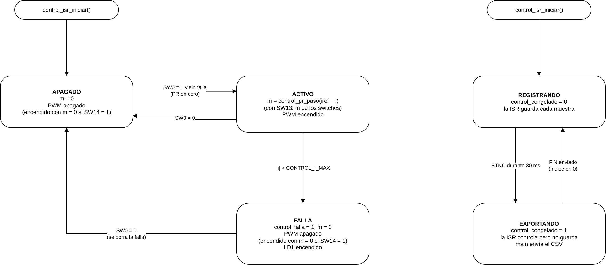

*Figura 26: estados del lazo de control y de la exportación.*

El programa no tiene una variable de estado explícita, pero se comporta como las dos máquinas de la figura 26.

- **APAGADO**: $m = 0$ y PWM apagado. Es el estado después de iniciar.
- **ACTIVO**: con SW0 = 1 y sin falla. Al entrar se ponen en cero los estados del PR. Con SW13 = 1 no se usa el PR: $m$ es un seno de 50 Hz con amplitud fija, o constante con SW12.
- **FALLA**: si la corriente supera el límite. El PWM se apaga en la misma interrupción y LD1 se enciende. Solo se sale bajando SW0.

En el modo emulador el PWM queda encendido con $m = 0$ en APAGADO y en FALLA, porque el RC necesita la conmutación para dar el offset. Por eso ese modo no se usa con el puente H conectado.

La máquina de la exportación tiene dos estados: en REGISTRANDO la ISR guarda cada muestra, y en EXPORTANDO (`control_congelado = 1`) sigue controlando pero no guarda muestras.

### 8.5 Controlador PR (`control_pr.c`)

**Objetivo.** Calcular un paso del PR y devolver el índice de modulación.

**Entrada:** el error $e[n] = i_{ref} - i$ en amperios. **Salida:** $m[n]$.

**Relación con otros módulos.** La llama `rutina_control()` en cada interrupción con el lazo activo, y `control_pr_reiniciar()` pone sus estados en cero al habilitar.

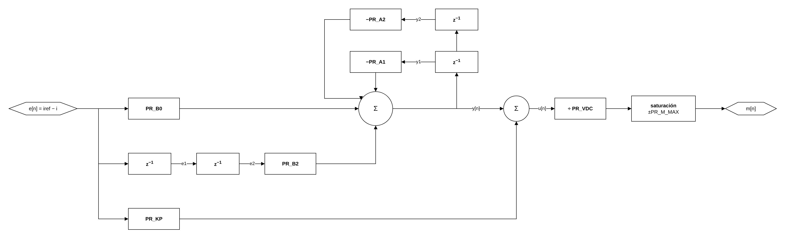

*Figura 27: estructura de `control_pr_paso()`.*

PEDP definió el PR ideal

$$C(s) = K_p + \frac{K_r\,s}{s^2 + \omega_0^2}, \qquad K_p = 2;\quad K_r = 3000;\quad \omega_0 = 2\pi \cdot 50\ \text{rad/s}$$

y lo discretizó con Tustin y *prewarping* a 50 Hz [13] con $T_s = 50\ \mu\text{s}$:

$$y[n] = b_0\,e[n] + b_2\,e[n-2] - a_1\,y[n-1] - a_2\,y[n-2]$$

$$u[n] = K_p\,e[n] + y[n], \qquad m[n] = \text{sat}_{\pm 0{,}8}\!\left(\frac{u[n]}{V_{dc}}\right)$$

con $b_0 = -b_2 = 0{,}0750$, $a_1 = -2\cos(\omega_0 T_s) = -1{,}99975$ y $a_2 = 1$. Los polos de la parte resonante quedan sobre el círculo unitario a 50 Hz, por eso la ganancia a esa frecuencia es muy alta y el error en régimen tiende a cero. Los estados $e[n-1]$, $e[n-2]$, $y[n-1]$ y $y[n-2]$ se guardan en la estructura `control_pr_t`, y `control_pr_reiniciar()` los pone en cero. El PR se calcula en `float` y está en una sola función (`control_pr_paso`): si cambian los coeficientes, solo cambian las constantes.

### 8.6 Buffer circular y exportación por UART

**Objetivo.** Guardar el histórico de muestras y enviarlo a la PC al presionar BTNC sin afectar el lazo.

**Entradas:** $i_{ref}$, $i$ y $m$ de cada interrupción, y BTNC. **Salidas:** el CSV por `uart_txd`.

**Relación con otros módulos.** El buffer lo escribe `rutina_control()` y lo lee `exportar()`, de `main.c`; la exportación sale por `axi_uartlite_0` hacia `graficar_muestras.py`.

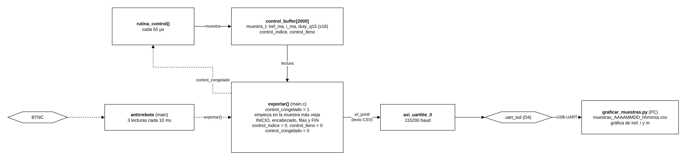

*Figura 28: camino de una muestra desde la ISR hasta la PC.*

| Parámetro | Valor |
|---|---|
| Tamaño | 2000 muestras = 100 ms = 5 ciclos de 50 Hz |
| Cada muestra (`muestra_t`) | `iref_ma`, `i_ma` (mA) y `duty_q15`, 16 bits con signo cada uno (12 000 bytes en total) |
| UART | 115 200 baudios, 8N1 |
| Formato | CSV: línea `INICIO` con $T_s$ y $N$, encabezado, una muestra por línea y `FIN` |

`control_indice` es la posición donde se escribe la siguiente muestra y vuelve a 0 al llegar a 2000; `control_lleno` se pone en 1 la primera vez que el índice da la vuelta. Desde ahí, la muestra más vieja es la que está en `control_indice`.

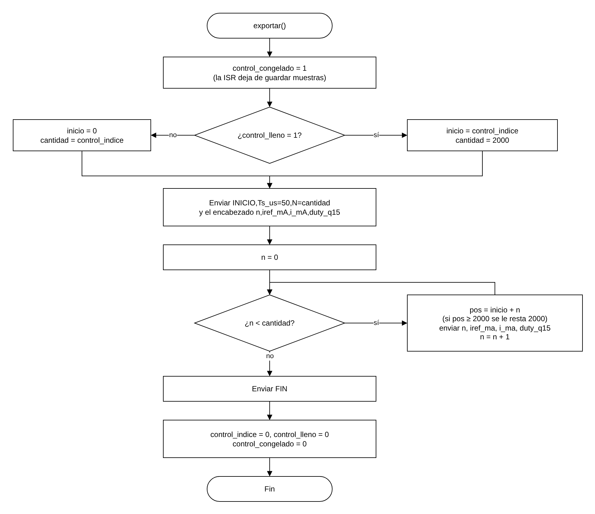

*Figura 29: diagrama de flujo de `exportar()`.*

Al presionar BTNC, el lazo principal pone `control_congelado = 1`, recorre el buffer de la muestra más vieja a la más nueva y lo envía con `xil_printf()`. Mientras tanto la ISR sigue controlando cada 50 µs, pero no guarda muestras, así que lo que se exporta es un bloque continuo que no cambia mientras se envía. Al terminar, el buffer se vacía y `control_congelado` vuelve a 0. La exportación dura unos 3,5 s (unas 2000 líneas de unos 20 caracteres a 115 200 baudios) y durante ella se sigue leyendo SW0, así que el lazo se puede apagar.

### 8.7 Driver del PWM (`pwm_driver.h`)

**Objetivo.** Dar al programa funciones para manejar los registros del PWM sin escribir offsets a mano.

**Entradas:** la dirección base y los valores que pide el programa ($m$, `enable`, `freq_sel`, ciclos de tiempo muerto). **Salidas:** escrituras y lecturas AXI a los registros de `pwm_0`.

**Relación con otros módulos.** Lo usan `control_isr_iniciar()`, `rutina_control()` y `main.c`.

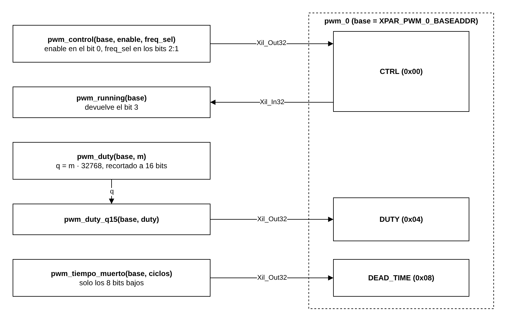

*Figura 30: funciones del driver y registro que usa cada una.*

| Función | Registro | Qué hace |
|---|---|---|
| `pwm_control(base, enable, freq_sel)` | CTRL | Escribe `enable \| (freq_sel << 1)` |
| `pwm_running(base)` | CTRL | Devuelve el bit 3 |
| `pwm_duty(base, m)` | DUTY | Multiplica $m$ por 32768, lo recorta a 16 bits con signo y llama a `pwm_duty_q15()` |
| `pwm_duty_q15(base, duty)` | DUTY | Escribe `duty` ya en Q1.15 |
| `pwm_tiempo_muerto(base, ciclos)` | DEAD_TIME | Escribe los 8 bits bajos de `ciclos` |

La dirección base es `XPAR_PWM_0_BASEADDR` y los offsets son los de la tabla de la sección 6.2. Todas las funciones son `static inline` y usan `Xil_Out32()` o `Xil_In32()`. El recorte de `pwm_duty()` es solo para que el valor quepa en 16 bits: el límite real lo pone la saturación en hardware.

| Momento | Llamadas |
|---|---|
| Al iniciar | `pwm_control(base, 0, PWM_FREQ_100KHZ)`, `pwm_duty_q15(base, 0)`, `pwm_tiempo_muerto(base, 20)` |
| En cada interrupción | `pwm_duty(base, m)` y `pwm_control(base, ...)` |
| Cada segundo | `pwm_running(base)`, que se imprime como `run=` |

### 8.8 Interfaz de usuario

| Control | Función |
|---|---|
| SW0 | Habilita el lazo (al bajarlo se borra la falla) |
| SW2..SW1 | `freq_sel` |
| SW4..SW3 | Amplitud: `00` = 0,2 A, `01` = 0,5 A, `1x` = 1,0 A pico |
| SW15 | 1 = corriente del XADC, 0 = planta simulada en software |
| SW14 | Modo emulador RC (solo sin la etapa de potencia) |
| SW13 | Lazo abierto: la amplitud de $m$ sale de SW4..SW3 (0,1 / 0,25 / 0,5) y no del PR |
| SW12 | Con SW13, $m$ constante en lugar de un seno de 50 Hz |
| BTNC | Exportar |
| LD0 / LD1 / LD2 / LD3 / LD4 | Lazo habilitado / falla / exportando / modo emulador / lazo abierto |
| JA8 | Pin de prueba, en 1 mientras corre la ISR |

### 8.9 Script de la PC (`graficar_muestras.py`)

**Objetivo.** Recibir la exportación, revisar que no falte ninguna muestra, guardarla en CSV y graficarla.

**Entrada:** las líneas que llegan por el puerto serie. **Salidas:** el archivo `muestras_AAAAMMDD_hhmmss.csv` y la gráfica.

**Relación con otros módulos.** Recibe lo que envía `exportar()` por `axi_uartlite_0` y el puente USB-UART.

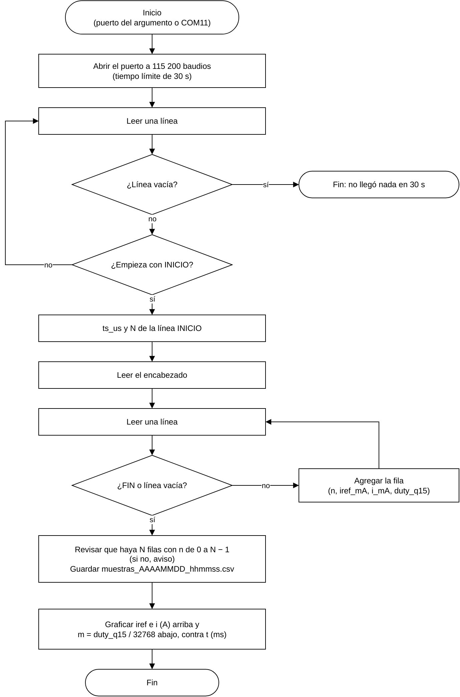

*Figura 31: diagrama de flujo de `graficar_muestras.py`.*

El script abre el puerto a 115 200 baudios y descarta las líneas hasta encontrar `INICIO`, de donde toma $T_s$ y $N$. Después lee el encabezado y las filas hasta `FIN`, y revisa que hayan llegado $N$ filas con `n` de 0 a $N-1$; si no, avisa. Guarda el encabezado y las filas de datos, y grafica arriba la referencia y la corriente en amperios y abajo `m = duty_q15 / 32768`, contra el tiempo en milisegundos. Usa `pyserial` y `matplotlib`.

---

## 9. Interfaz con PEDP

| Dato | Valor usado en la parte digital |
|---|---|
| Frecuencia de conmutación | 100 kHz nominal; 80 y 125 kHz seleccionables |
| Periodo de control | 50 µs |
| Instante de muestreo | Valle de la portadora (`pwm_trigger_o`) |
| Tiempo muerto | 200 ns después del reset, configurable de 100 ns a 2,55 µs |
| Compuertas | 4 salidas de 3,3 V, activas en alto (`GATE_ACTIVE_HIGH = 1`) |
| Driver | IR2110 con la lógica (VDD) alimentada con los 3,3 V del Pmod, para que los umbrales de HIN y LIN correspondan a las salidas de 3,3 V de la FPGA; VSS a la tierra de la FPGA |
| Arranque | Con `enable = 0` y en reset las cuatro salidas están apagadas; PEDP pone resistencias *pull-down* en HIN y LIN para el tiempo antes de configurar la FPGA |
| Sensor | ACS712, con su salida llevada al rango de 0 a 1 V del XADC; el offset y la ganancia son constantes de `control_isr.h` (`SENSOR_OFFSET_V`, `SENSOR_GANANCIA`) que se ajustan al calibrar |
| PR | $K_p = 2$, $K_r = 3000$, Tustin con *prewarping* a 50 Hz |
| Límite de $m$ | ±0,8 en software y ±0,95 en el PWM |
| Protección de corriente | 1,5 A en software; la fuente con limitación de corriente es de PEDP |

---

## 10. Estrategia de integración con la etapa de potencia

1. **Sin potencia.** Lazo cerrado con la planta simulada (SW15 = 0) y con el emulador RC (SW14 = 1), para probar el PR, la ISR, el XADC y la exportación.
2. **Señales de compuerta.** Con el puente desenergizado y en modo de lazo abierto (SW13 = 1), revisar con el osciloscopio las cuatro compuertas, el tiempo muerto en los pines de los MOSFET y `pwm_trigger_o`.
3. **Medición.** Con el sensor conectado y corriente cero, revisar el offset que lee el XADC; con una corriente conocida, la ganancia.
4. **Energizar en lazo abierto.** Con SW13 = 1 y SW12 = 1, $m$ constante sin el PR. Primero con $V_{dc}$ baja, fuente con limitación de corriente y $m$ pequeño; después con 18 V.
5. **Lazo cerrado.** 0,2 A → 0,5 A → 1,0 A pico, con la protección activa.
6. **Ensayos de potencia.** Cambios de amplitud y cambio de R de al menos 25 %, exportando cada ensayo para medir error de amplitud, fase y rizado.

---

## 11. Plan de validación

| # | Prueba | Herramienta | Criterio de paso |
|---|---|---|---|
| 1 | `tb_pwm_core`: periodo de cada `freq_sel`, ancho de pulsos, tiempos muertos, cambios en el valle, `pwm_trigger_o`, `enable` y reset | Simulación RTL en Vivado | Todas las pruebas `[PASS]`; nunca dos transistores de una pierna encendidos |
| 2 | `tb_pwm_axi`: reset, lectura y escritura, `running` RO, saturación, `WSTRB`, AW y W en ciclos distintos, arranque, apagado y posición del disparo | Simulación RTL en Vivado | Todas las pruebas `[PASS]` |
| 3 | `tb_pwm_axi` con retardos reales | Simulación post-implementación temporizada | Todas las pruebas `[PASS]`, sin solape ni salidas en X |
| 4 | Síntesis e implementación | Vivado | Sin latches; timing cerrado a 100 MHz |
| 5 | Registros del PWM desde C | Nexys 4 | Se leen los valores escritos y la saturación |
| 6 | Compuertas, frecuencias, tiempo muerto y disparo en los pines | Osciloscopio | Periodo exacto, tiempo muerto de 200 ns, sin solape, disparo en el valle |
| 7 | XADC con los dos disparos | Nexys 4 | Lectura correcta y una muestra nueva por interrupción |
| 8 | Lazo cerrado con planta simulada y con emulador RC | Nexys 4 | La corriente sigue a la referencia en las tres amplitudes |
| 9 | Exportación por UART | Nexys 4 y `graficar_muestras.py` | Llegan las 2000 muestras con `n` de 0 a 1999 |
| 10 | Periodo, duración de la ISR y jitter | Pin JA8 con osciloscopio y contador del Timer | Periodo de 50 µs; duración de la ISR menor que 50 µs, también durante la exportación |
| 11 | Integración con la etapa de potencia | Pasos de la sección 10 | Corriente sinusoidal de 50 Hz con la amplitud de la referencia |

Los testbenches son autoverificables: cada prueba imprime `[PASS]` o `[FAIL]` y al final se imprime el total de pruebas, las fallas y el resultado.

### 11.1 Testbench `tb_pwm_axi`

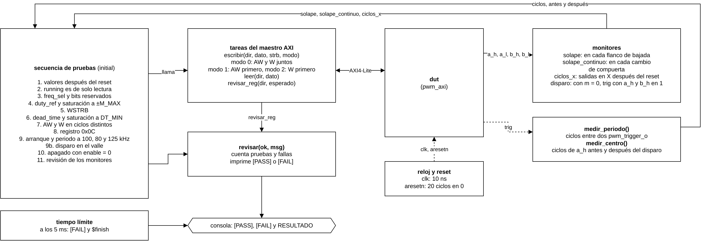

*Figura 32: estructura de `tb_pwm_axi`.*

El testbench hace de maestro AXI4-Lite, igual que el MicroBlaze V. La secuencia de pruebas llama a las tareas del maestro, que manejan los cinco canales del bus hacia el `dut`. Los monitores observan las salidas del `dut` todo el tiempo; `medir_periodo()` y `medir_centro()` miden cuando las llama la secuencia. Cada resultado pasa por `revisar()`, que cuenta las pruebas y las fallas. El mismo testbench sirve para la simulación RTL y para la post-implementación.

| Parte | Función |
|---|---|
| Reloj y reset | Reloj de 10 ns; `aresetn` en 0 durante 20 ciclos, porque en la post-implementación el reset global de la FPGA dura los primeros 100 ns |
| `escribir(dir, dato, strb, modo)` | Escritura completa; `modo` escoge AW y W juntos, AW 3 ciclos antes o W 3 ciclos antes |
| `leer(dir, dato)` y `revisar_reg()` | Lectura completa y comparación con el valor esperado |
| `medir_periodo()` y `medir_centro()` | Ciclos entre disparos y posición del disparo dentro del pulso alto |
| `solape` y `solape_continuo` | Revisan que no estén encendidos los dos transistores de una pierna, en cada flanco de bajada y cada vez que cambia una compuerta (para los retardos de la post-implementación) |
| Monitor del disparo | Con $m = 0$, revisa que en cada `pwm_trigger_o` estén encendidas `a_h` y `b_h` |
| `ciclos_x` | Cuenta ciclos con alguna salida en X |
| Tiempo límite | Si la simulación llega a 5 ms, imprime `[FAIL]` y termina |

Para la post-implementación, `pwm_axi` se implementa solo, como módulo superior, con `pwm_axi_ooc.xdc`, que define el reloj de 100 MHz en `S_AXI_ACLK`.

`tb_pwm_core` (prueba 1) prueba el núcleo solo, sin AXI. Además vigila durante toda la simulación que nunca haya solape, que siempre se respete el tiempo muerto y que `pwm_trigger_o` dure un solo ciclo.

---

## 12. Decisiones de diseño

| Decisión | Alternativa considerada | Razón |
|---|---|---|
| `duty_ref` en Q1.15 con signo | Ciclo de trabajo sin signo por pierna | Un solo valor $m$ con signo da las dos piernas ($+m$ y $-m$) |
| 100 / 80 / 125 kHz | 80 / 100 / 120 kHz | Las tres dan un número entero de ciclos y 100 kHz es la nominal de PEDP |
| Disparo y carga de registros en el valle | En el pico, o actualización inmediata | La muestra cae en el centro del pulso alto, lejos de los flancos, y ningún pulso se corta a la mitad |
| Tiempo muerto configurable en `0x08` | Parámetro fijo de síntesis | Se ajusta desde software al valor que mida PEDP, sin volver a sintetizar |
| Solo modulación unipolar, sin campo de selección de modulación | Reservar un bit para modulación bipolar | El puente se usa solo con modulación unipolar; un modo que no se usa agrega lógica y pruebas sin aportar al control |
| Saturación en hardware | Solo en software | El puente queda protegido aunque el software escriba un valor fuera de rango |
| PWM como *module reference* (`pwm_bd.v`) | Empaquetar el IP con Create and Package IP | Cada cambio del RTL se ve en el Block Design sin reempaquetar |
| XADC Wizard con su AXI4-Lite | Wrapper AXI4-Lite propio | Ya tiene inicio por software (CONVST), entrada `convst_in` y aviso EOC |
| $T_s$ = 50 µs | $T_s = 1/f_{sw}$ (10 µs) | Deja tiempo para la ISR con el PR en `float`; el PR no necesita correr a $f_{sw}$ |
| FPU y extensión M | Punto fijo | El PR en `float` es más fácil de seguir y de cambiar cuando PEDP ajuste los coeficientes |
| 64 KB de memoria local, sin caché | 32 KB y caché de 8 KB | Ver sección 5.2 |
| Concat y controlador de interrupciones con una sola fuente | Conectar el Timer directo a `INTERRUPT` | Ver sección 5.4 |
| Vivado y Vitis 2025.2 | 2025.1 | Es la versión instalada en las computadoras del equipo |
| Buffer congelado durante la exportación | Seguir escribiendo mientras se envía | Lo exportado es un bloque continuo que no cambia mientras se lee |
| Buffer de 2000 muestras en CSV | Decimación y formato binario | 2000 muestras cubren 5 ciclos de 50 Hz sin decimar, y el CSV se lee y grafica directo |
| Emulador RC en el XADC | Probar el lazo solo con la planta simulada | Cierra el lazo pasando por el PWM real y el XADC real, sin la etapa de potencia |

---

## 13. Plan de trabajo

| Fase | Contenido | Responsable |
|---|---|---|
| Sistema base | Block Design, programa de prueba, mapa de direcciones | Jordi |
| PWM | `pwm_core`, `pwm_axi`, testbenches y post-implementación | Abner (RTL), Justin (verificación AXI) |
| Adquisición y exportación | XADC, drivers, UART y script de Python | Justin |
| Software de control | ISR, PR, buffer y medición de tiempos | Mariana |
| Integración | Block Design completo, `.xdc`, pruebas en la tarjeta y con PEDP | Jordi y todos |

Cada parte va en su rama `feature/*` con su issue y entra por *pull request* revisado por otro integrante.

---

## 14. Referencias

[1] D. M. Harris y S. L. Harris, *Digital Design and Computer Architecture: RISC-V Edition*. Cambridge, MA, EE. UU.: Morgan Kaufmann, 2022.

[2] P. P. Chu, *FPGA Prototyping by SystemVerilog Examples: Xilinx MicroBlaze MCS SoC Edition*. Hoboken, NJ, EE. UU.: Wiley, 2018.

[3] AMD, *MicroBlaze V Embedded Design Tutorial*, UG1711. [En línea]. Disponible: https://docs.amd.com/r/en-US/ug1711-microblaze-v-embedded-design

[4] AMD, *MicroBlaze V Processor Reference Guide*, UG1629. [En línea]. Disponible: https://docs.amd.com/r/en-US/ug1629-microblaze-v-user-guide

[5] AMD, *Vivado Design Suite User Guide: Designing IP Subsystems Using IP Integrator*, UG994. [En línea]. Disponible: https://docs.amd.com/r/en-US/ug994-vivado-ip-subsystems

[6] AMD, *Vivado Design Suite: AXI Reference Guide*, UG1037. [En línea]. Disponible: https://docs.amd.com/v/u/en-US/ug1037-vivado-axi-reference-guide

[7] AMD, *7 Series FPGAs and Zynq-7000 SoC XADC Dual 12-Bit 1 MSPS Analog-to-Digital Converter User Guide*, UG480. [En línea]. Disponible: https://docs.amd.com/v/u/en-US/ug480_7Series_XADC

[8] AMD, *XADC Wizard LogiCORE IP Product Guide*, PG091. [En línea]. Disponible: https://docs.amd.com/v/u/en-US/pg091-xadc-wiz

[9] AMD, *AXI Timer LogiCORE IP Product Guide*, PG079. [En línea]. Disponible: https://docs.amd.com/r/en-US/pg079-axi-timer

[10] AMD, *Vitis Unified Software Platform Documentation*, UG1416. [En línea]. Disponible: https://docs.amd.com/v/u/en-US/ug1416-vitis-documentation

[11] D. W. Hart, *Power Electronics*. Nueva York, NY, EE. UU.: McGraw-Hill, 2011.

[12] M. A. Hernández R., "Diseño modular," Laboratorio de Diseño Lógico, Escuela de Ingeniería Electrónica, Instituto Tecnológico de Costa Rica, Cartago, Costa Rica, s.f.

[13] R. Teodorescu, F. Blaabjerg, M. Liserre y P. C. Loh, "Proportional-resonant controllers and filters for grid-connected voltage-source converters," *IEE Proceedings - Electric Power Applications*, vol. 153, n.º 5, pp. 750-762, 2006.
