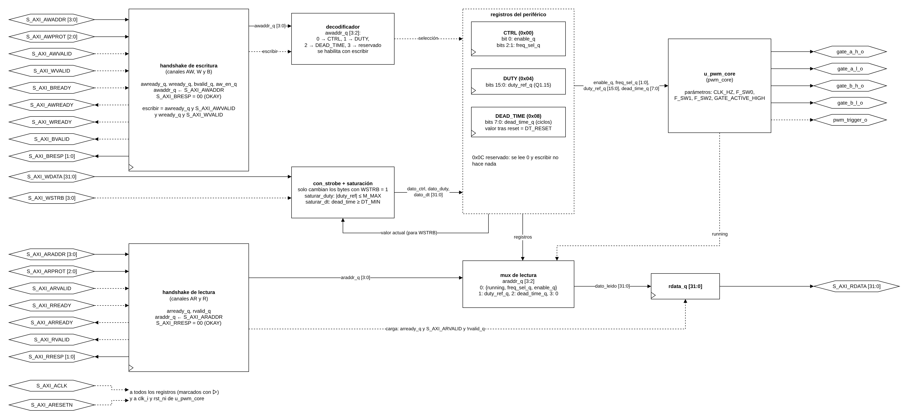
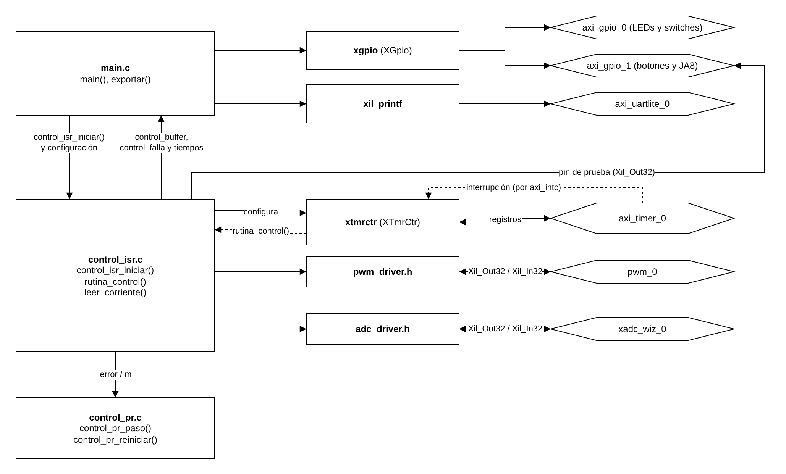
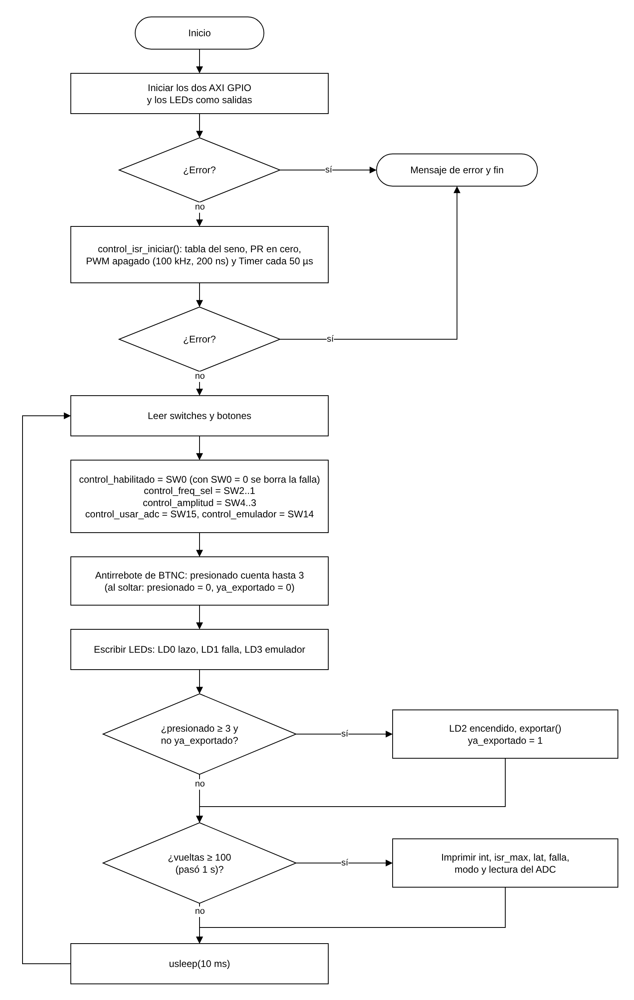
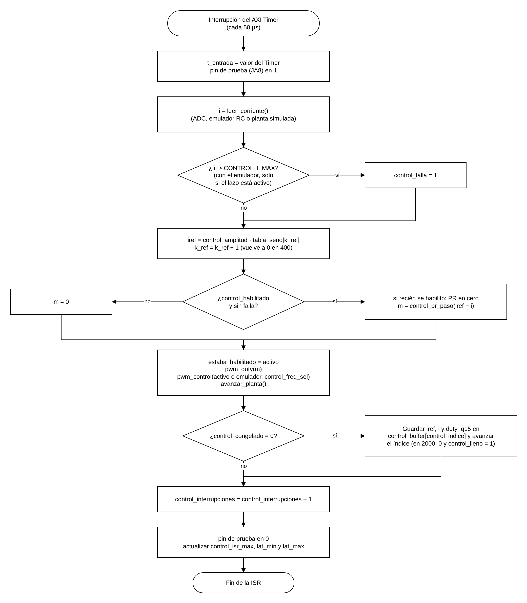

<h1 align="center">
  Documento de diseño <br>
  Control de corriente en un inversor monofásico mediante un regulador PR discreto sobre MicroBlaze V
</h1>

<p align="center">
  EL3313 Taller de Diseño Digital — Proyecto 4 — II Semestre 2026 <br>
  Mariana Fallas Fallas · Justin Garita Serrano · Abner López Méndez · Jordi Segura Chinchilla
</p>

---

## Contenido

1. [Alcance](#1-alcance)
2. [Idea general de la solución](#2-idea-general-de-la-solución)
3. [Arquitectura del sistema](#3-arquitectura-del-sistema)
4. [Parámetros de diseño](#4-parámetros-de-diseño)
5. [Estructura de módulos](#5-estructura-de-módulos)
6. [Periférico PWM](#6-periférico-pwm)
7. [Adquisición de la corriente (XADC)](#7-adquisición-de-la-corriente-xadc)
8. [Software de control](#8-software-de-control)
9. [Interfaz con PEDP](#9-interfaz-con-pedp)
10. [Estrategia de integración con la etapa de potencia](#10-estrategia-de-integración-con-la-etapa-de-potencia)
11. [Plan de validación](#11-plan-de-validación)
12. [Decisiones de diseño](#12-decisiones-de-diseño)
13. [Plan de trabajo](#13-plan-de-trabajo)
14. [Referencias](#14-referencias)

---

## 1. Alcance

El proyecto regula la corriente de un inversor monofásico en puente H con un regulador PR discreto que se ejecuta en un **MicroBlaze V** (procesador RISC-V de 32 bits de AMD) [3], [4] sobre la Nexys 4 (Artix-7 xc7a100t). El procesador corre la ley de control en C, sin sistema operativo, y los periféricos en hardware generan el PWM, adquieren la corriente y se comunican con la PC.

Este documento cubre la **parte digital** (Taller):

| Incluye | Lo diseña PEDP |
|---|---|
| Arquitectura del sistema embebido y Block Design | Puente H, drivers de compuerta y semiconductores |
| Periférico PWM personalizado (SystemVerilog + AXI4-Lite) | Dimensionamiento de la carga RL |
| Adquisición con el XADC y su sincronización con el PWM | Sintonización y discretización del PR |
| Software de control, buffer y exportación por UART | Sensor de corriente y su acondicionamiento |
| Estrategia de validación de la parte digital | Ensayos con la etapa de potencia |

El puente H se trata como un bloque externo: recibe las cuatro señales de compuerta de la FPGA y aplica la tensión sobre la carga. La corriente se mide con un sensor y una etapa de acondicionamiento que la lleva al rango de la entrada analógica del XADC (0 a 1 V).

### 1.1 Objetivos

**General.** Diseñar un sistema embebido sobre MicroBlaze V que regule la corriente de un inversor monofásico con un PR discreto, con un periférico PWM propio y muestreo sincronizado con la conmutación.

**Específicos.**

- Integrar el MicroBlaze V con sus periféricos en un Block Design de Vivado a 100 MHz.
- Diseñar un periférico PWM unipolar con tiempo muerto configurable, tres frecuencias de conmutación e interfaz AXI4-Lite.
- Sincronizar el inicio de conversión del XADC con la portadora del PWM.
- Ejecutar el PR en una rutina de interrupción periódica de 50 µs.
- Guardar las muestras en un buffer circular y exportarlas por UART sin afectar el lazo.
- Verificar el PWM con testbenches autoverificables, en RTL y post-implementación.

---

## 2. Idea general de la solución

El sistema es un lazo cerrado que se repite cada periodo de control $T_s = 50\ \mu s$:

1. **Base de tiempo.** El AXI Timer genera una interrupción cada 50 µs a través del AXI INTC.
2. **Generación del PWM.** El periférico PWM produce las cuatro señales de compuerta con modulación unipolar y tiempo muerto. El índice de modulación lo fija el registro `duty_ref`.
3. **Puente H (externo).** Aplica $+V_{dc}$, $0$ o $-V_{dc}$ sobre la carga RL.
4. **Medición.** El sensor y el acondicionamiento llevan la corriente a la entrada VAUX3 del XADC.
5. **Muestreo sincronizado.** El PWM emite `pwm_trigger_o` en cada valle de la portadora y ese pulso inicia la conversión del XADC. Así la muestra se toma siempre en el mismo punto de la conmutación.
6. **Cálculo del control.** En la interrupción, el MicroBlaze V lee la última muestra, la compara con la referencia de 50 Hz, calcula el PR y escribe el nuevo `duty_ref`.
7. **Registro y exportación.** Cada muestra se guarda en un buffer circular. Al presionar BTNC, el lazo principal envía el buffer por UART a la PC sin detener la interrupción.

### 2.1 Secuencia de un periodo de control

| Instante | Qué pasa | Quién lo hace |
|---|---|---|
| Valle de la portadora (cada $1/f_{sw}$) | `pwm_trigger_o` inicia una conversión del XADC; se cargan los valores nuevos de `duty_ref`, `freq_sel` y `dead_time` | PWM y XADC |
| ≈ 1 µs después del valle | La conversión termina y se levanta el aviso EOC | XADC |
| Cada 50 µs | Interrupción del Timer | AXI Timer y AXI INTC |
| Dentro de la ISR | Leer la muestra, revisar la protección, calcular la referencia y el PR, escribir `duty_ref`, guardar la muestra | Software |
| Siguiente valle | Se aplica el `duty_ref` nuevo | PWM |

A 100 kHz caben 5 periodos de conmutación en cada periodo de control (4 a 80 kHz y 6,25 a 125 kHz). La ISR siempre usa la conversión más reciente, que tiene como mucho un periodo de conmutación de antigüedad.

---

## 3. Arquitectura del sistema

La arquitectura se describe por niveles, siguiendo la metodología de diseño modular [10]: el sistema como un solo bloque, sus bloques generales, el diagrama modular y la estructura interna de cada módulo.

### 3.1 Primer nivel


*Figura 1: el sistema como un solo bloque, con sus entradas y salidas.*

| | Señal | Descripción |
|---|---|---|
| Entradas | `clk100_i`, `cpu_resetn_i` | Reloj de 100 MHz y botón CPU RESET (activo en bajo) |
| | `switches_tri_i [15:0]` | Habilitación del lazo, `freq_sel`, amplitud de la referencia y fuente de la corriente |
| | `buttons_tri_i [4:0]` | BTNC inicia la exportación |
| | `vaux3_v_p`, `vaux3_v_n` | Corriente de la carga ya acondicionada (0 a 1 V), JXADC1 y JXADC7 |
| | `uart_rxd` | Recepción de la UART (no se usa) |
| Salidas | `gate_a_h_o`, `gate_a_l_o`, `gate_b_h_o`, `gate_b_l_o` | Compuertas del puente H (JA1 a JA4) |
| | `pwm_trigger_o` | Disparo de la conversión; también sale a JA7 para medirlo |
| | `uart_txd` | Exportación de las muestras a la PC |
| | `leds_tri_o [15:0]` | Lazo habilitado, falla, exportando y modo emulador |
| | `prueba_tri_o` | Pin de prueba (JA8), en 1 mientras corre la ISR |

### 3.2 Segundo nivel


*Figura 2: bloques generales dentro de la FPGA.*

| Bloque | Tipo | Entradas | Salidas | Rol |
|---|---|---|---|---|
| `microblaze_riscv_0` y `microblaze_riscv_0_local_memory` | IP de AMD | Interrupción del INTC, depuración del MDM | Bus AXI4-Lite maestro | Ejecutan la aplicación en C desde 64 KB de BRAM |
| `microblaze_riscv_0_axi_periph` | IP de AMD (SmartConnect) | Bus AXI del procesador | Un bus AXI4-Lite por periférico | Reparte los accesos del procesador entre los periféricos |
| `pwm_0` | **Personalizado** | Bus AXI4-Lite | `gate_a_h_o`, `gate_a_l_o`, `gate_b_h_o`, `gate_b_l_o`, `pwm_trigger_o` | PWM unipolar con tiempo muerto y `pwm_trigger_o` |
| `xadc_wiz_0` | IP de AMD | Bus AXI4-Lite, `convst_in`, `vaux3_v_p`/`vaux3_v_n` | Muestra de 12 bits y aviso EOC por el bus | Conversión de la corriente; arranca con `pwm_trigger_o` o por software |
| `axi_timer_0`, `microblaze_riscv_0_axi_intc` | IP de AMD | Bus AXI4-Lite | Interrupción hacia el procesador | Interrupción periódica del lazo |
| `axi_uartlite_0` | IP de AMD | Bus AXI4-Lite, `uart_rxd` | `uart_txd` | Exportación a 115 200 baud |
| `axi_gpio_0`, `axi_gpio_1` | IP de AMD | Bus AXI4-Lite, switches y botones | LEDs y pin de prueba | LEDs y switches; botones y pin de prueba |
| `mdm_1` | IP de AMD | JTAG | Depuración del procesador | Depuración desde Vitis |
| `clk_wiz_1`, `rst_clk_wiz_1_100M` | IP de AMD | `clk100_i`, `cpu_resetn_i` | `clk_out1`, `peripheral_aresetn` | Reloj de 100 MHz y resets sincronizados |

### 3.3 Tercer nivel


*Figura 3: Block Design con las conexiones de datos (continuas) y de control (discontinuas).*

El reloj `clk_out1` y el reset `peripheral_aresetn` llegan a todos los bloques; para no llenar la figura no se dibujan aquí. El detalle de cada bloque del Block Design (memoria local, interrupciones, reloj y reset) está en `FPGA/DOCS/DOCUMENTACION_SISTEMA.md`.

### 3.4 Cuarto nivel

El cuarto nivel es la estructura interna de cada módulo. Los del periférico PWM, el XADC y el software están en las secciones 6, 7 y 8 de este documento. El detalle completo de cada módulo, con sus puertos, su funcionamiento y sus pruebas, está en la carpeta `DOCS` de cada parte:

| Módulo | Documento |
|---|---|
| Block Design (memoria, interrupciones, reloj y reset) | `FPGA/DOCS/DOCUMENTACION_SISTEMA.md` |
| `pwm_axi` y `pwm_core` | `FPGA/DOCS/DOCUMENTACION_PWM.md` |
| `tb_pwm_axi` | `FPGA/DOCS/DOCUMENTACION_TB_PWM_AXI.md` |
| Driver del PWM | `C/DOCS/DOCUMENTACION_PWM_DRIVER.md` |
| Driver del XADC y emulador | `C/DOCS/DOCUMENTACION_ADC.md` |
| ISR, PR y estados del control | `C/DOCS/DOCUMENTACION_CONTROL.md` |
| Buffer circular y exportación | `C/DOCS/DOCUMENTACION_BUFFER_UART.md` |
| Script de la PC | `PYTHON/DOCS/DOCUMENTACION_GRAFICAR.md` |

### 3.5 Configuración del MicroBlaze V

| Parámetro | Valor | Razón |
|---|---|---|
| Frecuencia | 100 MHz | Reloj de todo el sistema |
| Memoria local | 64 KB de BRAM | Deja espacio al programa, a la biblioteca de punto flotante y al buffer de 12 000 bytes |
| Caché | No | Todo el programa está en la memoria local, donde la caché no actúa |
| FPU y extensión M | Sí | El PR y la referencia se calculan en `float` |
| Bus de datos | AXI4-Lite maestro (`M_AXI_DP`) | Para llegar a los periféricos |
| Depuración | MDM | Carga del programa desde Vitis |
| Interrupción | AXI Timer → concat → AXI INTC → `INTERRUPT` | Única fuente de interrupción |

### 3.6 Mapa de direcciones

Las direcciones las asigna el Address Editor de Vivado; en C se toman de `xparameters.h`.

| Periférico | Dirección base | Rango |
|---|---|---|
| Memoria local | `0x0000_0000` | 64 KB |
| `pwm_0` | `0x0001_0000` | 4 KB |
| `axi_gpio_0` | `0x4000_0000` | 64 KB |
| `axi_gpio_1` | `0x4001_0000` | 64 KB |
| `axi_uartlite_0` | `0x4060_0000` | 64 KB |
| `microblaze_riscv_0_axi_intc` | `0x4120_0000` | 64 KB |
| `axi_timer_0` | `0x41C0_0000` | 64 KB |
| `xadc_wiz_0` | `0x44A0_0000` | 64 KB |

### 3.7 Reloj y reset

Hay un solo dominio de reloj de 100 MHz que sale del `clk_wiz_1`, así que no hay cruces de dominio. El botón CPU RESET (`cpu_resetn_i`, activo en bajo) entra al `rst_clk_wiz_1_100M`, que entrega `peripheral_aresetn` (síncrono, activo en bajo) a todos los periféricos AXI, incluido el PWM (`S_AXI_ARESETN`).

---

## 4. Parámetros de diseño

La carga y la alimentación vienen del diseño de potencia de PEDP.

| Parámetro | Valor |
|---|---|
| Reloj del sistema | 100 MHz |
| Carga | $R \approx 5{,}0\ \Omega$ (4,7 Ω más 0,3 Ω de las bobinas), $L \approx 197\ \mu H$ ($\tau = L/R \approx 39{,}4\ \mu s$) |
| Alimentación del puente | $V_{dc} = 18$ V |
| Frecuencia de conmutación | 100 kHz nominal; 80 y 125 kHz seleccionables |
| Tiempo muerto | 200 ns después del reset, mínimo 100 ns |
| Referencia | Sinusoide de 50 Hz; 0,2 / 0,5 / 1,0 A pico |
| Periodo de control | $T_s = 50\ \mu s$ (20 kHz) |

A 50 Hz la reactancia de la carga es de unos 62 mΩ, frente a 5 Ω de resistencia, así que la carga es casi resistiva. La tensión pico necesaria es $V_1 = I_{pico}\,|Z| \approx I_{pico}\,R$ y el índice de modulación es $m = V_1/V_{dc}$:

| $I_{pico}$ | $V_1$ | $m$ con 18 V |
|---|---|---|
| 0,2 A | 1,0 V | 0,056 |
| 0,5 A | 2,5 V | 0,139 |
| 1,0 A | 5,0 V | 0,278 |

Lo que esto implica para la parte digital:

- **Saturación.** El índice más alto en régimen es 0,278. El software limita $|m|$ a 0,8 y el PWM, como respaldo, satura en hardware a 0,95. Queda margen para que el PR corrija el tiempo muerto y los transitorios.
- **Resolución.** A 100 kHz la portadora tiene 500 pasos por semiperiodo (≈ 9 bits). Con 18 V cada paso son unos 36 mV; a 0,2 A la amplitud cubre unos 28 pasos.
- **Tiempo muerto.** Los 200 ns de tiempo muerto le quitan a la salida unos $2\,t_{muerto}\,f_{sw}\,V_{dc} \approx 0{,}7$ V. A 0,2 A solo se necesita 1 V, así que en lazo abierto la corriente sale mucho menor que la referencia; en lazo cerrado el PR lo compensa.
- **Retardo.** $\tau$ es del mismo orden que $T_s$ (39 µs frente a 50 µs), así que la planta responde en uno o dos periodos de control. Entre que se toma la muestra y se aplica el nuevo `duty_ref` pasa hasta un periodo de conmutación (antigüedad de la muestra), más la duración de la ISR, más la espera hasta el siguiente valle. Con el retenedor, el retardo total se acota en ≈ 1,5 $T_s$ = 75 µs para el análisis de estabilidad del PR.

---

## 5. Estructura de módulos

```text
sistema_microblaze (Block Design de Vivado)
├── microblaze_riscv_0                 MicroBlaze V (FPU + extensión M)
├── microblaze_riscv_0_local_memory    LMB + 64 KB de BRAM
├── microblaze_riscv_0_axi_intc        AXI INTC
├── microblaze_riscv_0_xlconcat        Vector de interrupciones
├── microblaze_riscv_0_axi_periph      AXI SmartConnect
├── mdm_1                              Depuración
├── clk_wiz_1 / rst_clk_wiz_1_100M     Reloj y reset
├── axi_timer_0                        Interrupción del lazo
├── axi_uartlite_0                     Exportación
├── axi_gpio_0 / axi_gpio_1            LEDs, switches, botones y pin de prueba
├── xadc_wiz_0                         XADC con interfaz AXI4-Lite (VAUX3)
└── pwm_0 (pwm_bd)                     Envoltura en Verilog
    └── u_pwm_axi (pwm_axi)            Interfaz AXI4-Lite, registros y saturación
        └── u_pwm_core (pwm_core)      Portadora, umbrales, tiempo muerto y pwm_trigger_o
```

| Módulo | Responsabilidad |
|---|---|
| `pwm_bd.v` | Envoltura en Verilog que solo instancia `pwm_axi`. Vivado no acepta un módulo en SystemVerilog como tope de un *module reference* [5]. |
| `pwm_axi.sv` | Esclavo AXI4-Lite (cinco canales y `WSTRB`), banco de registros, saturación de `duty_ref` y `dead_time`, lectura de `running`. |
| `pwm_core.sv` | Portadora triangular, cálculo de umbrales, comparación, tiempo muerto, salidas seguras y `pwm_trigger_o`. No conoce el protocolo AXI. |

---

## 6. Periférico PWM

### 6.1 Organización interna



*Figura 4: estructura interna de `pwm_axi`.*

El RTL separa la lógica secuencial (`always_ff`) de la combinacional (`always_comb`), como en [1] y [2]. `pwm_axi` recibe las transacciones del bus, guarda los registros y entrega a `pwm_core` cuatro señales: `enable`, `freq_sel`, `duty_ref` (ya saturado) y `dead_time` (ya saturado). De `pwm_core` solo lee `running`.


*Figura 5: estructura interna de `pwm_core`.*

### 6.2 Modulación unipolar

Un contador `cnt_q` sube de 0 a $P$ y baja de $P$ a 0, y forma la portadora triangular. Las dos piernas se comparan con la misma portadora, pero con referencias opuestas [9]:

$$d_A = \frac{1 + m}{2}, \qquad d_B = \frac{1 - m}{2}, \qquad \bar v_{AB} = V_{dc}\,(d_A - d_B) = V_{dc}\,m$$

La pierna A está arriba mientras $cnt < P\,(1+m)/2$. Con $m$ en Q1.15 eso es $cnt < P\,(m + 32768)/65536$: una suma, una multiplicación por $P$ y un corrimiento de 16 bits. El cálculo se hace en dos etapas registradas para cumplir el reloj de 100 MHz.

Cada transistor conmuta a $f_{sw}$, pero la tensión entre las salidas del puente tiene tres niveles y su componente principal está en $2 f_{sw}$ (200 kHz con 100 kHz).

### 6.3 Frecuencias de conmutación

$P = f_{clk}/(2 f_{sw})$ y el periodo de la portadora es de $2P$ ciclos.

| `freq_sel` | $f_{sw}$ | $P$ | Periodo |
|---|---|---|---|
| `00` | 100 kHz | 500 | 1000 ciclos (10 µs) |
| `01` | 80 kHz | 625 | 1250 ciclos (12,5 µs) |
| `10` | 125 kHz | 400 | 800 ciclos (8 µs) |
| `11` | 100 kHz | 500 | Se toma como `00` |

Las tres frecuencias dan un número entero de ciclos, así que son exactas. Todas se calculan a partir del parámetro `CLK_HZ`. La resolución va de 400 a 625 pasos por semiperiodo.

### 6.4 Tiempo muerto

Cada pierna tiene un contador que cuenta los ciclos desde el último cambio de su referencia. Cuando la referencia cambia, las dos compuertas de la pierna se apagan; cuando el contador llega a `dead_time`, se enciende la que corresponde. Así el tiempo muerto solo retrasa el encendido.

- `dead_time` está en ciclos de 10 ns: 20 después del reset (200 ns), mínimo 10 (100 ns), máximo 255 (2,55 µs).
- Una escritura menor que 10 se satura a 10.
- Un cambio de `dead_time` no corta un pulso que ya empezó.

### 6.5 Actualización en el valle y saturación

- **Saturación.** `duty_ref` en Q1.15 se limita a ±`M_MAX` = ±31129 (±0,95) al escribirlo. Así el umbral nunca llega a los extremos de la portadora. En operación normal el software limita $m$ a ±0,8, y con ese valor el pulso más angosto es varias veces más largo que el tiempo muerto.
- **Valle.** `duty_ref`, `freq_sel` y `dead_time` se copian a los registros del periodo solo en el valle de la portadora. Un cambio a mitad de periodo nunca corta un pulso. Como el cálculo de los umbrales tarda dos ciclos, un cambio de `duty_ref` o `freq_sel` se aplica en el siguiente valle o en el que sigue; `dead_time` se aplica en el primero.

### 6.6 `pwm_trigger_o`

Es un pulso de un ciclo en cada valle de la portadora. Pasa por los mismos dos registros que las compuertas, así que sale alineado con ellas. En el valle conduce el transistor de arriba de las dos piernas: es la mitad del pulso alto, lejos de los flancos de conmutación con valores normales de $m$. Además, en el centro del pulso la corriente pasa por su valor promedio del periodo de conmutación, así la muestra no queda afectada por el rizado.

### 6.7 Estados y estado seguro


*Figura 6: estados de la portadora en `pwm_core`.*

- Los estados no son una enumeración: salen de los registros `run_q` (0 en APAGADO) y `sube_q` (1 en SUBIENDO, 0 en BAJANDO).
- Con `enable = 0` o en reset, el contador se queda en 0, `running` baja y las cuatro compuertas y el disparo se apagan en el siguiente ciclo.
- `GATE_ACTIVE_HIGH = 1` deja las compuertas activas en alto. Si los drivers fueran activos en bajo, ese parámetro invierte las cuatro salidas.

### 6.8 Registros AXI4-Lite

La interfaz sigue el protocolo AXI4-Lite [6]. Dirección base `0x0001_0000`. Los registros se repiten dentro de los 4 KB del rango, porque solo se decodifican los bits [3:2] de la dirección.

| Offset | Bits | Campo | Acceso | Tras reset | Descripción |
|---|---|---|---|---|---|
| `0x00` | 0 | `enable` | R/W | 0 | Habilita el PWM |
| | [2:1] | `freq_sel` | R/W | `00` | Frecuencia de conmutación (tabla 6.3) |
| | 3 | `running` | RO | 0 | El PWM está generando; una escritura no lo cambia |
| | [31:4] | — | — | 0 | Reservado, lee 0 |
| `0x04` | [15:0] | `duty_ref` | R/W | 0 | Índice de modulación en Q1.15 con signo, saturado a ±0,95 |
| | [31:16] | — | — | 0 | Reservado, lee 0 |
| `0x08` | [7:0] | `dead_time` | R/W | 20 | Tiempo muerto en ciclos de 10 ns, mínimo 10 |
| | [31:8] | — | — | 0 | Reservado, lee 0 |
| `0x0C` | [31:0] | — | — | 0 | Reservado; escribirlo no hace nada |

Todas las respuestas son OKAY. `WSTRB` se respeta byte por byte. AW y W se pueden recibir en ciclos distintos y en cualquier orden. El periférico solo genera la modulación unipolar, así que no tiene un campo de selección de modulación.

### 6.9 Puertos y parámetros

| Puerto | Dir. | Ancho | Descripción |
|---|---|---|---|
| `S_AXI_*` | E/S | | Interfaz AXI4-Lite esclava (`S_AXI_ACLK`, `S_AXI_ARESETN` activo en bajo) |
| `gate_a_h_o`, `gate_a_l_o` | S | 1 | Compuertas de la pierna A (arriba, abajo) |
| `gate_b_h_o`, `gate_b_l_o` | S | 1 | Compuertas de la pierna B (arriba, abajo) |
| `pwm_trigger_o` | S | 1 | Disparo hacia `convst_in` del XADC |

| Parámetro | Valor | Uso |
|---|---|---|
| `CLK_HZ` | 100 000 000 | Todas las cuentas se calculan desde aquí |
| `F_SW0`, `F_SW1`, `F_SW2` | 100 000, 80 000, 125 000 | Frecuencias de `freq_sel` |
| `M_MAX` | 31129 | Límite de `duty_ref` (0,95) |
| `DT_RESET`, `DT_MIN` | 20, 10 | Tiempo muerto tras reset y mínimo |
| `GATE_ACTIVE_HIGH` | 1 | Polaridad de las compuertas |

---

## 7. Adquisición de la corriente (XADC)


*Figura 7: XADC, registros usados y funciones del driver.*

### 7.1 Configuración

Se usa el XADC Wizard [7] con su propia interfaz AXI4-Lite. Está en modo evento, con un solo canal (VAUX3) y entrada unipolar de 0 a 1 V. La conversión arranca de dos formas:

- **Por hardware:** `pwm_trigger_o` está conectado a `convst_in`.
- **Por software:** escribiendo 1 y después 0 en el registro CONVST (la conversión arranca con el flanco de subida).

| Registro | Offset | Uso |
|---|---|---|
| CONVST | `0x00C` | Inicio de conversión por software |
| IPISR | `0x060` | Bit EOC (`0x20`): hay una muestra nueva; se borra escribiendo 1 |
| VAUX3 | `0x24C` | Dato de 12 bits en [15:4] |

### 7.2 Uso en la ISR

Con el PWM encendido, la ISR no inicia conversiones: revisa EOC, borra el aviso, lee la muestra y la pasa a voltios. Si no hay muestra nueva, usa la anterior y lo cuenta. Con el PWM apagado no hay disparos, así que la ISR pide la siguiente conversión por software.

### 7.3 Conversión a amperios

El sensor es un ACS712, cuya salida está centrada en unos 2,5 V con corriente cero. Para el XADC esa salida se lleva al rango de 0 a 1 V con la etapa de acondicionamiento de PEDP, de forma que la corriente cero quede cerca de 0,5 V. En el software:

$$i = \frac{v_{adc} - V_{off}}{G}$$

$V_{off}$ y $G$ son constantes de `control_isr.h` (`SENSOR_OFFSET_V` y `SENSOR_GANANCIA`). $V_{off}$ se mide con el PWM apagado y corriente cero, leyendo los mV que imprime la terminal; $G$ se obtiene con una corriente DC conocida. $G$ es la sensibilidad del ACS712 multiplicada por la ganancia de la etapa de acondicionamiento.

### 7.4 Emulador para pruebas sin potencia

Para cerrar el lazo en la tarjeta sin el puente H, JA1 y JA4 pasan por un filtro RC hasta un nodo que entra a JXADC1. La tensión de ese nodo es un offset más una parte proporcional a $m$. Con SW14 = 1 el software la convierte en una corriente equivalente con $G_{emu} = 0{,}137$ V/A, escogida para que un mismo $m$ dé la misma corriente que la carga real ($V_{dc}\,m/R$). El offset se aprende mientras el lazo está apagado.

---

## 8. Software de control

### 8.1 Organización



*Figura 8: módulos del software y periféricos que usa cada uno.*

La aplicación se compila en Vitis [8] sobre la plataforma exportada del Block Design.

| Archivo | Contenido |
|---|---|
| `main.c` | Inicialización, lectura de switches y botones, LEDs y exportación |
| `control_isr.c/.h` | ISR, referencia, protección, buffer y variables compartidas (`volatile`) |
| `control_pr.c/.h` | Ecuación en diferencias del PR |
| `pwm_driver.h` | Offsets y funciones de acceso al PWM |
| `adc_driver.h` | Offsets y funciones de acceso al XADC |

`main.c` y la ISR no se llaman entre sí: se comunican con variables `volatile`. `main.c` escribe la configuración y la ISR escribe el buffer, la falla y los tiempos medidos.

### 8.2 Programa principal



*Figura 9: diagrama de flujo de `main.c`.*

1. Se inician los GPIO y se llama a `control_isr_iniciar()`: PWM apagado, `duty_ref = 0`, 100 kHz, tiempo muerto de 200 ns, Timer con recarga automática de 50 µs y su interrupción conectada al INTC.
2. Cada 10 ms se leen los switches y los botones, se actualizan las variables compartidas y los LEDs, y se exporta si se presionó BTNC (antirrebote de 30 ms).
3. Cada segundo se imprimen los tiempos medidos de la ISR.

### 8.3 Rutina de interrupción (cada 50 µs)



*Figura 10: diagrama de flujo de `rutina_control()`.*

Siempre ejecuta la misma secuencia:

1. Leer el Timer y poner en 1 el pin de prueba.
2. Leer la corriente (XADC, emulador o planta simulada).
3. Protección: si $|i|$ supera `CONTROL_I_MAX` (1,5 A), marcar falla. En el modo emulador solo se revisa con el lazo activo, porque al entrar al modo el XADC lee 0 V y eso parecería una sobrecorriente.
4. Referencia: $i_{ref} = A \sin(2\pi\,50\,n T_s)$, tomada de una tabla de 400 puntos (un ciclo de 50 Hz).
5. Si el lazo está activo, calcular el PR; si no, $m = 0$.
6. Escribir `duty_ref` y el registro de control del PWM. Así una falla apaga el PWM en la misma interrupción.
7. Guardar la muestra en el buffer, si no se está exportando.
8. Poner en 0 el pin de prueba y guardar la duración y la latencia.

La ISR no usa la UART ni tiene esperas.

### 8.4 Estados del control


*Figura 11: estados del lazo de control y de la exportación.*

- **APAGADO**: $m = 0$ y PWM apagado. Es el estado después de iniciar.
- **ACTIVO**: con SW0 = 1 y sin falla. Al entrar se ponen en cero los estados del PR.
- **FALLA**: si la corriente supera el límite. El PWM se apaga en la misma interrupción y LD1 se enciende. Solo se sale bajando SW0.

### 8.5 Controlador PR


*Figura 12: estructura de `control_pr_paso()`.*

PEDP definió el PR ideal

$$C(s) = K_p + \frac{K_r\,s}{s^2 + \omega_0^2}, \qquad K_p = 2,\ K_r = 3000,\ \omega_0 = 2\pi\,50$$

y lo discretizó con Tustin y *prewarping* a 50 Hz [11] con $T_s = 50\ \mu s$:

$$y[n] = b_0\,e[n] + b_2\,e[n-2] - a_1\,y[n-1] - a_2\,y[n-2]$$

$$u[n] = K_p\,e[n] + y[n], \qquad m[n] = \text{sat}_{\pm 0{,}8}\!\left(\frac{u[n]}{V_{dc}}\right)$$

con $b_0 = -b_2 = 0{,}0750$, $a_1 = -2\cos(\omega_0 T_s) = -1{,}99975$ y $a_2 = 1$. Los polos de la parte resonante quedan sobre el círculo unitario a 50 Hz, por eso la ganancia a esa frecuencia es muy alta y el error en régimen tiende a cero. El PR se calcula en `float` y está en una sola función (`control_pr_paso`): si cambian los coeficientes, solo cambian las constantes.

### 8.6 Buffer circular y exportación por UART


*Figura 13: camino de una muestra desde la ISR hasta la PC.*

| Parámetro | Valor |
|---|---|
| Tamaño | 2000 muestras = 100 ms = 5 ciclos de 50 Hz |
| Cada muestra | `iref_ma`, `i_ma` (mA) y `duty_q15`, 16 bits cada uno (12 000 bytes en total) |
| UART | 115 200 baud, 8N1 |
| Formato | CSV: línea `INICIO` con $T_s$ y $N$, encabezado, una muestra por línea y `FIN` |


*Figura 14: diagrama de flujo de `exportar()`.*

Al presionar BTNC, el lazo principal pone `control_congelado = 1`, recorre el buffer de la muestra más vieja a la más nueva y lo envía. Mientras tanto la ISR sigue controlando cada 50 µs, pero no guarda muestras, así lo que se exporta es un bloque continuo que no cambia mientras se envía. En la PC, `graficar_muestras.py` recibe el CSV, revisa que lleguen las $N$ muestras en orden y las grafica.

### 8.7 Interfaz de usuario

| Control | Función |
|---|---|
| SW0 | Habilita el lazo (al bajarlo se borra la falla) |
| SW2..SW1 | `freq_sel` |
| SW4..SW3 | Amplitud: `00` = 0,2 A, `01` = 0,5 A, `1x` = 1,0 A pico |
| SW15 | 1 = corriente del XADC, 0 = planta simulada en software |
| SW14 | Modo emulador RC (solo sin la etapa de potencia) |
| SW13 | Lazo abierto: $m$ sale de SW4..SW3 (0,1 / 0,25 / 0,5) y no del PR |
| SW12 | Con SW13, $m$ constante en lugar de un seno de 50 Hz |
| BTNC | Exportar |
| LD0 / LD1 / LD2 / LD3 / LD4 | Lazo habilitado / falla / exportando / modo emulador / lazo abierto |

---

## 9. Interfaz con PEDP

| Dato | Valor usado en la parte digital |
|---|---|
| Frecuencia de conmutación | 100 kHz nominal; 80 y 125 kHz seleccionables |
| Periodo de control | 50 µs |
| Instante de muestreo | Valle de la portadora (`pwm_trigger_o`) |
| Tiempo muerto | 200 ns tras reset, configurable de 100 ns a 2,55 µs |
| Compuertas | 4 salidas de 3,3 V, activas en alto (`GATE_ACTIVE_HIGH = 1`) |
| Driver | IR2110 con la lógica (VDD) alimentada con los 3,3 V del Pmod, para que los umbrales de HIN y LIN correspondan a las salidas de 3,3 V de la FPGA; VSS a la tierra de la FPGA |
| Arranque | Con `enable = 0` y en reset las cuatro salidas están apagadas; PEDP pone resistencias *pull-down* en HIN y LIN para el tiempo antes de configurar la FPGA |
| Sensor | ACS712, con su salida llevada al rango de 0 a 1 V del XADC; el offset y la ganancia son constantes de `control_isr.h` (`SENSOR_OFFSET_V`, `SENSOR_GANANCIA`) que se ajustan al calibrar |
| PR | $K_p = 2$, $K_r = 3000$, Tustin con *prewarping* a 50 Hz |
| Límite de $m$ | ±0,8 en software y ±0,95 en el PWM |
| Protección de corriente | 1,5 A en software; la fuente con limitación de corriente es de PEDP |

---

## 10. Estrategia de integración con la etapa de potencia

1. **Sin potencia.** Lazo cerrado con la planta simulada (SW15 = 0) y con el emulador RC (SW14 = 1), para probar el PR, la ISR, el XADC y la exportación.
2. **Señales de compuerta.** Con el puente desenergizado y el PWM en lazo abierto, revisar con el osciloscopio las cuatro compuertas, el tiempo muerto en los pines de los MOSFET y `pwm_trigger_o`.
3. **Medición.** Con el sensor conectado y corriente cero, revisar el offset que lee el XADC; con una corriente conocida, la ganancia.
4. **Energizar en lazo abierto.** Con SW13 = 1, $m$ fijo sin el PR. $V_{dc}$ bajo y fuente con limitación de corriente, $m$ pequeño; después 18 V.
5. **Lazo cerrado.** 0,2 A → 0,5 A → 1,0 A pico, con la protección activa.
6. **Ensayos de potencia.** Cambios de amplitud y cambio de R de al menos 25 %, exportando cada ensayo para medir error de amplitud, fase y rizado.

---

## 11. Plan de validación

| # | Prueba | Herramienta | Criterio de paso |
|---|---|---|---|
| 1 | `tb_pwm_core`: periodo de cada `freq_sel`, ancho de pulsos, tiempos muertos, cambios en el valle, `pwm_trigger_o`, `enable` y reset | Simulación RTL en Vivado | Todas las pruebas `[PASS]`; nunca dos transistores de una pierna encendidos |
| 2 | `tb_pwm_axi`: reset, lectura y escritura, `running` RO, saturación, `WSTRB`, AW y W en ciclos distintos, arranque, apagado y posición del disparo | Simulación RTL en Vivado | Todas las pruebas `[PASS]` |
| 3 | `tb_pwm_axi` con retardos reales | Simulación post-implementación temporizada | Todas las pruebas `[PASS]`, sin solape ni salidas en X |
| 4 | Síntesis e implementación | Vivado | Sin latches; timing cerrado a 100 MHz |
| 5 | Registros del PWM desde C | Nexys 4 | Se leen los valores escritos y la saturación |
| 6 | Compuertas, frecuencias, tiempo muerto y disparo en los pines | Osciloscopio | Periodo exacto, tiempo muerto de 200 ns, sin solape, disparo en el valle |
| 7 | XADC con los dos disparos | Nexys 4 | Lectura correcta y una muestra nueva por interrupción |
| 8 | Lazo cerrado con planta simulada y con emulador RC | Nexys 4 | La corriente sigue a la referencia en las tres amplitudes |
| 9 | Exportación por UART | Nexys 4 y `graficar_muestras.py` | Llegan las 2000 muestras con `n` de 0 a 1999 |
| 10 | Periodo, duración de la ISR y jitter | Pin JA8 con osciloscopio y contador del Timer | Periodo de 50 µs; ISR menor que 50 µs, también durante la exportación |
| 11 | Integración con la etapa de potencia | Pasos de la sección 10 | Corriente sinusoidal de 50 Hz con la amplitud de la referencia |

Los testbenches son autoverificables: cada prueba imprime `[PASS]` o `[FAIL]` y al final se imprime el total de pruebas, las fallas y el resultado.

---

## 12. Decisiones de diseño

| Decisión | Alternativa considerada | Razón |
|---|---|---|
| `duty_ref` en Q1.15 con signo | Ciclo de trabajo sin signo por pierna | Un solo valor $m$ con signo da las dos piernas ($+m$ y $-m$) |
| 100 / 80 / 125 kHz | 80 / 100 / 120 kHz | Las tres dan un número entero de ciclos y 100 kHz es la nominal de PEDP |
| Disparo y carga de registros en el valle | En el pico, o actualización inmediata | La muestra cae en el centro del pulso, lejos de los flancos, y ningún pulso se corta a la mitad |
| Tiempo muerto configurable en `0x08` | Parámetro fijo de síntesis | Se ajusta desde software al valor que mida PEDP, sin volver a sintetizar |
| Saturación en hardware | Solo en software | El puente queda protegido aunque el software escriba un valor fuera de rango |
| PWM como *module reference* (`pwm_bd.v`) | Empaquetar el IP con Create and Package IP | Cada cambio del RTL se ve en el Block Design sin reempaquetar |
| XADC Wizard con su AXI4-Lite | Wrapper AXI4-Lite propio | Ya tiene inicio por software (CONVST), entrada `convst_in` y aviso EOC |
| $T_s$ = 50 µs | $T_s = 1/f_{sw}$ (10 µs) | Deja tiempo para la ISR con el PR en `float`; el PR no necesita correr a $f_{sw}$ |
| FPU y extensión M | Punto fijo | El PR en `float` es más fácil de seguir y de cambiar cuando PEDP ajuste los coeficientes |
| 64 KB de memoria local, sin caché | 32 KB y caché de 8 KB | El programa, la biblioteca de punto flotante y el buffer necesitan más de 32 KB; la caché no actúa sobre la memoria local |
| Vivado y Vitis 2025.2 | 2025.1 | Es la versión instalada en las computadoras del equipo |
| Buffer congelado durante la exportación | Seguir escribiendo mientras se envía | Lo exportado es un bloque continuo que no cambia mientras se lee |
| Buffer de 2000 muestras en CSV | Decimación y formato binario | 2000 muestras cubren 5 ciclos de 50 Hz sin decimar, y el CSV se lee y grafica directo |
| Emulador RC en el XADC | Probar el lazo solo con la planta simulada | Cierra el lazo pasando por el PWM real y el XADC real, sin la etapa de potencia |

---

## 13. Plan de trabajo

| Fase | Contenido | Responsable |
|---|---|---|
| Sistema base | Block Design, programa de prueba, mapa de direcciones | Jordi |
| PWM | `pwm_core`, `pwm_axi`, testbenches y post-implementación | Abner (RTL), Justin (verificación AXI) |
| Adquisición y exportación | XADC, drivers, UART y script de Python | Justin |
| Software de control | ISR, PR, buffer y medición de tiempos | Mariana |
| Integración | Block Design completo, `.xdc`, pruebas en la tarjeta y con PEDP | Jordi y todos |

Cada parte va en su rama `feature/*` con su issue y entra por *pull request* revisado por otro integrante. La documentación de cada parte está en la carpeta `DOCS` de su rama.

---

## 14. Referencias

[1] D. M. Harris y S. L. Harris, *Digital Design and Computer Architecture: RISC-V Edition*. Cambridge, MA, EE. UU.: Morgan Kaufmann, 2022.

[2] P. P. Chu, *FPGA Prototyping by SystemVerilog Examples: Xilinx MicroBlaze MCS SoC Edition*. Hoboken, NJ, EE. UU.: Wiley, 2018.

[3] AMD, *MicroBlaze V Embedded Design Tutorial*, UG1711.

[4] AMD, *MicroBlaze Processor Reference Guide*, UG984.

[5] AMD, *Vivado Design Suite User Guide: Creating and Packaging Custom IP*, UG1118.

[6] AMD, *Vivado Design Suite: AXI Reference Guide*, UG1037.

[7] AMD, *7 Series FPGAs and Zynq-7000 SoC XADC Dual 12-Bit 1 MSPS Analog-to-Digital Converter User Guide*, UG480.

[8] AMD, *Vitis Unified Software Platform Documentation*, UG1416.

[9] D. W. Hart, *Power Electronics*. Nueva York, NY, EE. UU.: McGraw-Hill, 2011.

[10] M. A. Hernández R., "Diseño modular," Laboratorio de Diseño Lógico, Escuela de Ingeniería Electrónica, Instituto Tecnológico de Costa Rica, Cartago, Costa Rica, s.f.

[11] R. Teodorescu, F. Blaabjerg, M. Liserre y P. C. Loh, "Proportional-resonant controllers and filters for grid-connected voltage-source converters," *IEE Proceedings - Electric Power Applications*, vol. 153, n.º 5, pp. 750-762, 2006.
