<h1 align="center">
  Informe técnico  
  Control de corriente en un inversor monofásico mediante un regulador PR discreto sobre MicroBlaze V
</h1>

  EL3313 Taller de Diseño Digital — Proyecto 4 — II Semestre 2026  
  Mariana Fallas Fallas · Justin Garita Serrano · Abner López Méndez · Jordi Segura Chinchilla

---

## Resumen

Se construyó en la Nexys 4 [16] un sistema embebido con un MicroBlaze V a 100 MHz que regula la corriente de un inversor monofásico en puente H. El procesador ejecuta en C un regulador proporcional-resonante discreto dentro de una rutina de interrupción cada 50 µs. Un periférico PWM propio, con interfaz AXI4-Lite, genera la modulación unipolar de las cuatro compuertas con tiempo muerto configurable y entrega el disparo que sincroniza el XADC con el valle de la portadora. Las muestras se guardan en un buffer circular y se exportan por la UART a la PC al presionar un botón, sin detener el lazo.

El PWM pasa sus dos testbenches autoverificables en Vivado 2025.2: `tb_pwm_core` con 60 pruebas y `tb_pwm_axi` con 37, este último también en la simulación post-implementación temporizada. El sistema completo cumple timing a 100 MHz. En la tarjeta se midió un periodo de lazo de 50,0 µs con la ISR ocupando el 21,5 % del periodo, y la cadena PWM → XADC → PR → `duty_ref` funcionó en lazo cerrado con una planta simulada y con un emulador RC. Con el puente H, alimentado a 18 V y con una carga de 4,7 Ω y 197 µH, se logró la conmutación correcta de las dos piernas después de corregir la alimentación lógica de los drivers. Con el sensor de corriente conectado al XADC se cerró el lazo con la corriente real: la corriente en la carga siguió referencias sinusoidales de 50 Hz de 0,2 A, 0,5 A y 1,0 A pico.

---

## Contenido

1. [Introducción](#1-introducción)
2. [Objetivos](#2-objetivos)
3. [Marco teórico](#3-marco-teórico)
4. [Enfoque de la solución](#4-enfoque-de-la-solución)
5. [Periférico PWM](#5-periférico-pwm)
6. [Control principal](#6-control-principal)
7. [Etapa de potencia](#7-etapa-de-potencia)
8. [Verificación por simulación](#8-verificación-por-simulación)
9. [Recursos y timing](#9-recursos-y-timing)
10. [Pruebas en la tarjeta](#10-pruebas-en-la-tarjeta)
11. [Análisis de resultados](#11-análisis-de-resultados)
12. [Problemas encontrados y soluciones](#12-problemas-encontrados-y-soluciones)
13. [Análisis crítico](#13-análisis-crítico)
14. [Conclusiones](#14-conclusiones)
15. [Referencias](#15-referencias)

---

## 1. Introducción

En este proyecto se construyó un sistema embebido en la Nexys 4 (Artix-7) que regula la corriente de un inversor monofásico en puente H. El procesador es un MicroBlaze V [3], [4] a 100 MHz que ejecuta en C un regulador proporcional-resonante (PR) cada 50 µs. Los periféricos se encargan de lo que necesita tiempos exactos: un PWM unipolar propio, con interfaz AXI4-Lite y tiempo muerto configurable, genera las cuatro compuertas del puente; el XADC mide la corriente sincronizado con la portadora del PWM; y la UART exporta las muestras a la PC.

El informe describe lo que se implementó y lo que se midió, desde la verificación del PWM en simulación hasta el lazo cerrado con la corriente real del puente H. El diseño completo, con los diagramas de niveles de la metodología de diseño modular [15], está en `docs/diseño/diseño.md`, y el detalle de cada módulo está en la carpeta `DOCS` de cada parte del repositorio.

---

## 2. Objetivos

1. Integrar en el Block Design un sistema MicroBlaze V a 100 MHz con Timer, XADC, UART, GPIO y un periférico propio.
2. Diseñar en SystemVerilog un PWM unipolar con interfaz AXI4-Lite, tiempo muerto configurable, tres frecuencias de conmutación y disparo para el ADC.
3. Implementar en C el regulador PR dentro de una rutina de interrupción periódica, con la ecuación entregada por el curso de potencia.
4. Guardar las muestras en un buffer circular y exportarlas por la UART sin afectar el lazo.
5. Verificar el PWM con testbenches autoverificables, en RTL y post-implementación, y medir el periodo y el jitter del lazo en la tarjeta.
6. Integrar la parte digital con la etapa de potencia y cerrar el lazo de corriente con la corriente real de la carga.

---

## 3. Marco teórico

### 3.1 Sistemas embebidos y tiempo real

Un lazo de control digital supone que la medición y la actualización del actuador ocurren cada $T_s$ exacto. Si el instante varía, la discretización del controlador deja de corresponder con lo que pasa en la planta. Por eso el lazo se ejecuta en una **rutina de interrupción (ISR)** disparada por un temporizador de hardware [8], y no en un ciclo del programa principal, cuyo tiempo depende de lo que haga el resto del código.

En una ISR periódica interesan tres tiempos:

- **Periodo**: tiempo entre dos entradas a la rutina. Lo fija el temporizador.
- **Latencia**: tiempo entre la petición de interrupción y el inicio de la rutina. Depende de lo que esté haciendo el procesador y del despacho de la interrupción.
- **Jitter**: variación del periodo de una interrupción a otra, causada por los cambios de latencia.

La rutina tiene que terminar antes de la siguiente interrupción y no puede tener esperas, como enviar por la UART. Lo lento se hace en el programa principal, que corre en el tiempo que sobra entre interrupciones. Las variables compartidas entre las dos partes se declaran `volatile` para que el compilador siempre las lea de memoria.

### 3.2 Interfaz AXI4-Lite

AXI4-Lite es la versión simple del bus AXI4 de ARM [5], [6]: transferencias de 32 bits, una a la vez, sin ráfagas. Tiene cinco canales independientes:

| Canal | Dirección | Contenido |
|---|---|---|
| AW | Maestro → esclavo | Dirección de escritura |
| W | Maestro → esclavo | Dato y `WSTRB` (qué bytes se escriben) |
| B | Esclavo → maestro | Respuesta de la escritura (`BRESP`) |
| AR | Maestro → esclavo | Dirección de lectura |
| R | Esclavo → maestro | Dato leído y respuesta (`RRESP`) |

Cada canal usa el mismo *handshake*: quien envía sube `VALID` y quien recibe sube `READY`; el dato pasa en el ciclo en que los dos están en 1. Quien envía no puede esperar a `READY` para subir `VALID`. AW y W son canales distintos, así que el esclavo tiene que aceptar la dirección y el dato aunque lleguen en ciclos diferentes.

### 3.3 PWM unipolar y tiempo muerto

En un puente H cada pierna tiene dos transistores que nunca deben conducir a la vez. En la modulación unipolar [10] las dos piernas se comparan con la misma portadora triangular, la pierna A con $+m$ y la B con $-m$:

$$d_A = \frac{1+m}{2}, \qquad d_B = \frac{1-m}{2}, \qquad \bar v_{AB} = V_{dc}\,(d_A - d_B) = V_{dc}\,m$$

La tensión entre las salidas toma tres niveles ($+V_{dc}$, 0 y $-V_{dc}$) y su componente principal de conmutación está en $2 f_{sw}$, el doble que en la bipolar. Eso baja el rizado de corriente para la misma frecuencia de los transistores.

Un transistor tarda en apagarse, así que si el otro de la pierna se enciende en el mismo instante hay un cortocircuito momentáneo de la fuente. El **tiempo muerto** es un retardo que se agrega al encendido de cada transistor después de que su complementario se apagó.

### 3.4 Muestreo sincronizado con el PWM

La corriente en la carga tiene un rizado a la frecuencia de conmutación. En una portadora triangular simétrica, la corriente pasa por su valor promedio en el centro de cada pulso, que es el pico o el valle de la portadora. Si la conversión del ADC [7] arranca justo ahí, la muestra da el promedio sin necesidad de filtrar, y además queda lejos de los flancos de conmutación, donde hay más ruido.

### 3.5 Controlador PR discreto

Un PI no tiene error cero en régimen con una referencia sinusoidal. El regulador proporcional-resonante [14] agrega un término con ganancia infinita a la frecuencia de la referencia $\omega_0$:

$$C(s) = K_p + \frac{K_r\,s}{s^2 + \omega_0^2}$$

Para implementarlo en el procesador se discretiza con Tustin, $s = \frac{2}{T_s}\frac{z-1}{z+1}$. Tustin deforma el eje de frecuencias, así que se usa *prewarping* en $\omega_0$ para que la resonancia quede exactamente en 50 Hz. Queda una ecuación en diferencias de segundo orden:

$$y[n] = b_0\,e[n] + b_2\,e[n-2] - a_1\,y[n-1] - a_2\,y[n-2], \qquad a_1 = -2\cos(\omega_0 T_s),\ a_2 = 1$$

Con $a_2 = 1$ los polos quedan sobre el círculo unitario a la frecuencia $\omega_0$. El diseño del PR y sus ganancias son del curso de potencia (EL4201); en Taller se implementó la ecuación que entregó ese curso.

---

## 4. Enfoque de la solución

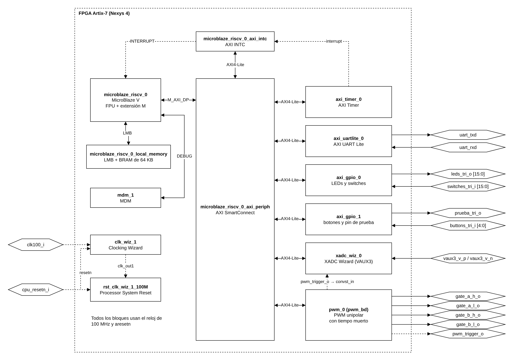

*Figura 1: bloques del sistema dentro de la FPGA.*

El sistema reparte el trabajo así:

- **Hardware con tiempos exactos.** El PWM (`pwm_0`) genera la portadora, las compuertas con tiempo muerto y el disparo `pwm_trigger_o`. El XADC (`xadc_wiz_0`) convierte cuando llega ese disparo. El AXI Timer pide la interrupción cada 50 µs.
- **Software con el cálculo.** La ISR lee la corriente, calcula la referencia y el PR, escribe `duty_ref` y guarda la muestra. El programa principal lee los switches, maneja los LEDs y exporta por la UART.

Las decisiones principales fueron:

| Decisión | Razón |
|---|---|
| Un solo periférico propio, el PWM | Es lo que necesita tiempos de un ciclo de reloj; el resto se cubre con IP de AMD |
| `duty_ref` en Q1.15 con signo | Un solo valor $m$ da las dos piernas ($+m$ y $-m$) |
| Disparo del XADC y carga de registros en el valle | La muestra cae en el centro del pulso y ningún pulso se corta a la mitad |
| Saturación en hardware (±0,95 y tiempo muerto mínimo de 100 ns) | El puente queda protegido aunque el software escriba un valor fuera de rango |
| $T_s$ = 50 µs y PR en `float` con FPU | Deja tiempo de sobra para la ISR y el código del PR es fácil de seguir y de cambiar |
| Buffer congelado mientras se exporta | Lo que se envía es un bloque continuo que no cambia durante el envío |
| Emulador RC en el XADC | Permite cerrar el lazo pasando por el PWM y el XADC reales sin la etapa de potencia |

La tabla completa de decisiones, con las alternativas consideradas, está en la sección 12 del documento de diseño.

---

## 5. Periférico PWM

### 5.1 Interfaz

`pwm_axi` es el tope del periférico. Se conecta al Block Design por medio de `pwm_bd.v`, una envoltura en Verilog sin lógica. Adentro instancia `pwm_core`, que no conoce el protocolo AXI. El RTL está escrito en SystemVerilog con la separación entre lógica secuencial y combinacional de [1] y [2].

| Puerto | Dir. | Ancho | Descripción |
|---|---|---|---|
| `S_AXI_ACLK` | E | 1 | Reloj de 100 MHz |
| `S_AXI_ARESETN` | E | 1 | Reset síncrono, activo en bajo |
| `S_AXI_AW*`, `S_AXI_W*`, `S_AXI_B*`, `S_AXI_AR*`, `S_AXI_R*` | E/S | | Cinco canales AXI4-Lite, datos de 32 bits, dirección de 4 bits |
| `gate_a_h_o`, `gate_a_l_o` | S | 1 | Compuertas de la pierna A (arriba, abajo) |
| `gate_b_h_o`, `gate_b_l_o` | S | 1 | Compuertas de la pierna B (arriba, abajo) |
| `pwm_trigger_o` | S | 1 | Pulso de un ciclo en cada valle, hacia `convst_in` del XADC |

### 5.2 Registros

Dirección base `0x0001_0000` (asignada por Vivado).

| Offset | Bits | Campo | Acceso | Tras reset | Lectura | Escritura |
|---|---|---|---|---|---|---|
| `0x00` | 0 | `enable` | R/W | 0 | Último valor escrito | 1 arranca el PWM; 0 apaga las cuatro compuertas en el siguiente ciclo |
| | [2:1] | `freq_sel` | R/W | `00` | Último valor escrito | `00` = 100 kHz, `01` = 80 kHz, `10` = 125 kHz, `11` = 100 kHz; se aplica en el valle |
| | 3 | `running` | RO | 0 | 1 mientras la portadora cuenta | Se ignora |
| | [31:4] | — | — | 0 | 0 | Se ignora |
| `0x04` | [15:0] | `duty_ref` | R/W | 0 | Valor ya saturado | Q1.15 con signo; se satura a ±31129 (±0,95) y se aplica en el valle |
| | [31:16] | — | — | 0 | 0 | Se ignora |
| `0x08` | [7:0] | `dead_time` | R/W | 20 | Valor ya saturado | Ciclos de 10 ns; menos de 10 se satura a 10; se aplica en el valle |
| | [31:8] | — | — | 0 | 0 | Se ignora |
| `0x0C` | [31:0] | — | — | 0 | 0 | Se ignora |

Todas las respuestas son OKAY. `WSTRB` se respeta byte por byte y AW y W se aceptan en cualquier orden. Los registros se repiten dentro del rango de 4 KB porque solo se decodifican los bits [3:2] de la dirección.

### 5.3 Estados

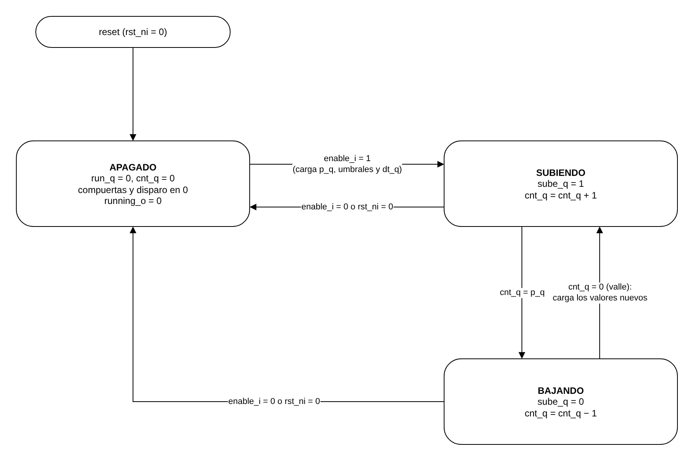

*Figura 2: estados de la portadora en `pwm_core`.*

La portadora es un contador con tres estados. En APAGADO el contador está en 0 y las salidas apagadas; con `enable_i = 1` pasa a SUBIENDO, cuenta hasta $P$, pasa a BAJANDO y vuelve a 0, que es el valle. En el valle se cargan los valores nuevos de `duty_ref`, `freq_sel` y `dead_time` y sale `pwm_trigger_o`. Con `enable_i = 0` o `rst_ni = 0` vuelve a APAGADO desde cualquier estado. En `pwm_core.sv` los estados no son una enumeración: salen de dos registros, `run_q` (0 en APAGADO) y `sube_q` (1 en SUBIENDO, 0 en BAJANDO).

---

## 6. Control principal

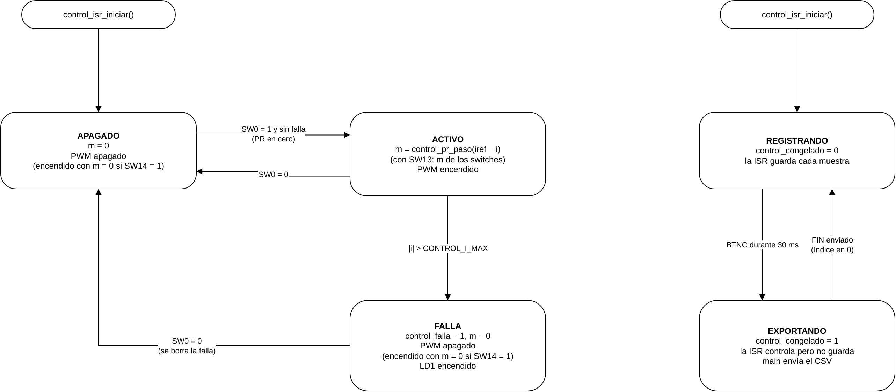

*Figura 3: estados del lazo de control y de la exportación.*

El lazo tiene tres estados. En APAGADO, $m = 0$ y el PWM está apagado. Con SW0 = 1 y sin falla pasa a ACTIVO; al entrar se ponen en cero los estados del PR para no arrancar con valores de una corrida anterior. Si la corriente supera 1,5 A pasa a FALLA: el PWM se apaga en la misma interrupción y se enciende LD1. Solo se sale de FALLA bajando SW0.

La exportación es independiente del lazo. Al presionar BTNC el programa principal congela el buffer, lo envía y lo libera; la ISR sigue controlando durante todo el envío.

La aplicación se compila en Vitis 2025.2 [9] sobre la plataforma exportada del Block Design. La secuencia completa de la ISR y del programa principal, con sus diagramas de flujo, está en la sección 8 del documento de diseño.

---

## 7. Etapa de potencia

La etapa de potencia la diseñó el curso EL4201. Los datos que usa la parte digital son:

| Parámetro | Valor |
|---|---|
| Alimentación del puente | $V_{dc} = 18$ V |
| Transistores | IRFZ44N [12], dos por pierna |
| Driver | IR2110 [11], uno por pierna |
| Carga | $R = 4{,}7\ \Omega$, $L \approx 197\ \mu H$ |
| Constante de tiempo | $\tau = L/R \approx 41{,}9\ \mu s$ |
| Sensor de corriente | ACS712 [13] |
| Frecuencia de conmutación | 100 kHz nominal |

A 50 Hz la reactancia es de unos 62 mΩ, así que la carga se comporta casi como una resistencia. El índice de modulación necesario es $m = I_{pico}\,R / V_{dc}$:

| $I_{pico}$ | $m$ con 4,7 Ω | $m$ con 10,3 Ω |
|---|---|---|
| 0,2 A | 0,052 | 0,114 |
| 0,5 A | 0,131 | 0,286 |
| 1,0 A | 0,261 | 0,572 |

La carga cambió durante el proyecto: al inicio era de 10,3 Ω y 198 µH, después se bajó a unos 5,0 Ω y finalmente quedó en 4,7 Ω y 197 µH, que es la que se usó en las pruebas con el puente. Las pruebas 5 y 6 de la sección 10 se hicieron con la carga inicial, así que el modelo de la planta simulada y la ganancia del emulador estaban calculados para 10,3 Ω; la última columna es la que corresponde a esas pruebas. La prueba 8, con la corriente real, usa la carga de 4,7 Ω.

En todos los casos el valor más alto queda por debajo del límite del software (0,8) y del hardware (0,95). El IR2110 no genera tiempo muerto, así que todo el tiempo muerto lo pone el PWM.

---

## 8. Verificación por simulación

### 8.1 Testbenches

Los dos testbenches son autoverificables: cada prueba imprime `[PASS]` o `[FAIL]` y al final se imprime el total de pruebas, las fallas y `RESULTADO: PASA` o `RESULTADO: FALLA`.

**`tb_pwm_core`** prueba el núcleo solo, sin AXI:

| Prueba | Criterio de paso |
|---|---|
| Periodo de cada `freq_sel` | 1000, 1250 y 800 ciclos entre disparos |
| Ancho de los pulsos con `duty_ref` = 0, ±0,5 y ±`M_MAX` | Igual al calculado con $P\,(1 \pm m)/2$, restando el tiempo muerto |
| Tiempos muertos de 10, 20, 50 y 255 ciclos | Cada encendido llega exactamente `dead_time` ciclos después del apagado del complementario |
| Cambio de `duty_ref` o `freq_sel` a mitad de periodo | El valor nuevo solo aparece después de un valle |
| `pwm_trigger_o` | Un pulso de un ciclo por periodo |
| `enable_i` y reset a mitad de periodo | Las cuatro salidas se apagan en el siguiente ciclo y el PWM vuelve a arrancar |
| Monitor continuo | Nunca hay dos transistores de una pierna encendidos a la vez |

**`tb_pwm_axi`** prueba el periférico completo desde el bus, como lo usa el MicroBlaze V:

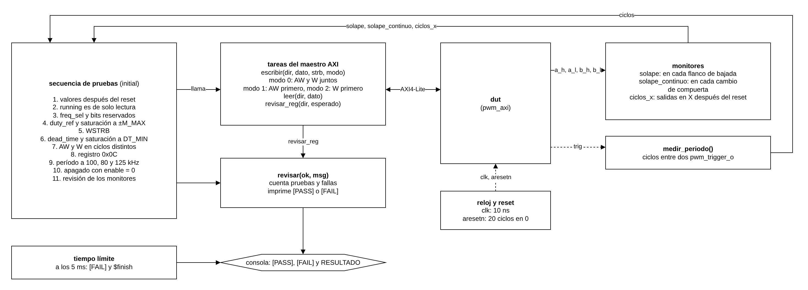

*Figura 4: estructura de `tb_pwm_axi`.*

| # | Prueba | Criterio de paso |
|---|---|---|
| 1 | Valores después del reset | CTRL = 0, DUTY = 0, DEAD_TIME = 20, `0x0C` = 0, `RRESP = OKAY` |
| 2 | `running` de solo lectura | Escribir el bit 3 no lo cambia |
| 3 | `freq_sel` y bits reservados | Se lee lo escrito; los reservados leen 0 |
| 4 | `duty_ref` | ±0,5 se guardan igual; `0x7FFF` y `0x8000` se saturan a ±`M_MAX` |
| 5 | `WSTRB` | Con `0001` solo cambia el byte bajo; con `0000` nada |
| 6 | `dead_time` | 0 y 5 se saturan a 10; 200 se acepta |
| 7 | AW y W en ciclos distintos | La escritura funciona en los dos órdenes |
| 8 | Registro `0x0C` | Responde OKAY y no cambia los otros registros |
| 9 | Arranque | `running` = 1 y periodo de 1000, 1250 y 800 ciclos |
| 9b | Disparo en el valle | Con $m = 0$, el pulso alto de `a_h` tiene 20 ciclos menos antes del ciclo del disparo que después (el tiempo muerto solo atrasa el encendido) |
| 10 | Apagado | Cuatro compuertas en 0, `running` = 0 y sin pulsos en 2000 ciclos |
| 11 | Monitores | Sin solape, sin salidas en X y disparo siempre con las compuertas de arriba encendidas |

En total `tb_pwm_axi` tiene 37 pruebas.

Resultados de la simulación RTL en Vivado 2025.2 (xsim):

| Testbench | Resultado | Fuente |
|---|---|---|
| `tb_pwm_core` | 60 pruebas, 0 fallas, `RESULTADO: PASA` | `reportes/resultado_tb_pwm_core.log` |
| `tb_pwm_axi` | 37 pruebas, 0 fallas, `RESULTADO: PASA` | `reportes/resultado_tb_pwm_axi.log` |

En la prueba 9b el pulso alto de `a_h` tuvo 229 ciclos antes del ciclo del disparo y 249 después. La diferencia de 20 ciclos es el tiempo muerto, y confirma que el disparo cae en el valle. En la primera versión de esta prueba el conteo dependía del orden en que el simulador ejecuta dos bloques en el mismo flanco del reloj: en xsim daba 229 y 250 y la prueba fallaba aunque el PWM estaba bien. Se corrigió contando los ciclos dentro de la misma tarea que espera el disparo.

### 8.2 Simulación post-implementación temporizada

Para esta simulación `pwm_axi` se implementó solo, como módulo superior, con el reloj de 100 MHz definido en `pwm_axi_ooc.xdc`. Se usó el mismo `tb_pwm_axi` sobre la netlist con los retardos reales de la implementación. Aquí es donde más sirve el monitor `solape_continuo`, que revisa el solape cada vez que cambia una compuerta y no solo en los flancos del reloj: con los retardos de ruteo, un solape corto podría aparecer entre dos flancos.

| Resultado | Valor | Fuente |
|---|---|---|
| Simulación post-implementación temporizada (xsim 2025.2) | 37 pruebas, 0 fallas, `RESULTADO: PASA` | `reportes/resultado_tb_pwm_axi_postimpl.log` |

Con los retardos reales también se cumplió la prueba del disparo (229 ciclos antes y 249 después) y el monitor `solape_continuo` no encontró ningún solape entre flancos.

---

## 9. Recursos y timing

Los reportes son de Vivado 2025.2. Los del sistema completo son de la implementación del 2 de noviembre; los de `pwm_axi` solo, de la implementación del 19 de noviembre con el RTL final.

| Recurso | Sistema completo | `pwm_axi` solo | Disponible |
|---|---|---|---|
| LUT | 6482 (10,2 %) | 179 (0,3 %) | 63 400 |
| Registros | 4871 (3,8 %) | 213 (0,2 %) | 126 800 |
| BRAM (tiles) | 16 (11,9 %) | 0 | 135 |
| DSP | 8 (3,3 %) | 2 (0,8 %) | 240 |
| IOB | 49 (23,3 %) | — | 210 |

| Timing a 100 MHz | Sistema completo | `pwm_axi` solo |
|---|---|---|
| WNS (setup) | 0,392 ns | 3,760 ns |
| WHS (hold) | 0,030 ns | 0,171 ns |
| Rutas que fallan | 0 | 0 |

Fuentes: `reportes/utilizacion_sistema.rpt`, `reportes/timing_sistema.rpt`, `reportes/utilizacion_pwm_axi_impl.rpt` y `reportes/timing_pwm_axi_impl.rpt`.

Los 16 tiles de BRAM son los 64 KB de memoria local (cada tile guarda 4 KB). El PWM usa 2 DSP, uno por pierna, para la multiplicación $P\,(1 \pm m)$. En el sistema completo el slack de setup es pequeño (0,392 ns) pero positivo, y la ruta más larga está dentro del MicroBlaze V. En el PWM el margen es de 3,76 ns gracias a que el cálculo de los umbrales se partió en dos etapas registradas.

---

## 10. Pruebas en la tarjeta

Las pruebas 1 a 6 se hicieron en la Nexys 4 con el sistema completo (MicroBlaze V a 100 MHz, PWM, XADC, Timer, UART y GPIO), sin conectar el puente H. La prueba 7 es la integración del PWM con el puente y la prueba 8 cierra el lazo de corriente con la corriente real de la carga. Las señales de las pruebas 1 a 6 se midieron con un osciloscopio Agilent DSO-X 2002A, con los canales digitales y el canal analógico 1:

| Canal | Señal |
|---|---|
| D0, D1 | `gate_a_h_o`, `gate_a_l_o` (JA1, JA2) |
| D2, D3 | `gate_b_h_o`, `gate_b_l_o` (JA3, JA4) |
| D4 | `pwm_trigger_o` (JA7) |
| D5 | Pin de prueba (JA8), en 1 mientras corre la ISR |

Para cerrar el lazo sin la etapa de potencia se usaron dos modos: la planta simulada en software (SW15 = 0), que es un modelo discreto de la carga RL, y el emulador RC (SW14 = 1), donde JA1 y JA4 pasan por un filtro RC hasta un nodo que entra al XADC.

### 10.1 Prueba 1: PWM con $m = 0$

| Medición | 100 kHz | 80 kHz | 125 kHz |
|---|---|---|---|
| Periodo medido | 10,0 µs | 12,5 µs | 8,0 µs |
| Frecuencia (osciloscopio) | 100,0 kHz | 80,03 kHz | 125,0 kHz |
| Pulso alto de cada compuerta superior | 4,8 µs | 6,05 µs | 3,8 µs |
| Tiempo muerto | 198 a 199 ns | ≈ 200 ns | ≈ 200 ns |
| Solape en una pierna | Ninguno | Ninguno | Ninguno |
| `pwm_trigger_o` | 1 por periodo, en el valle | 1 por periodo, en el valle | 1 por periodo, en el valle |

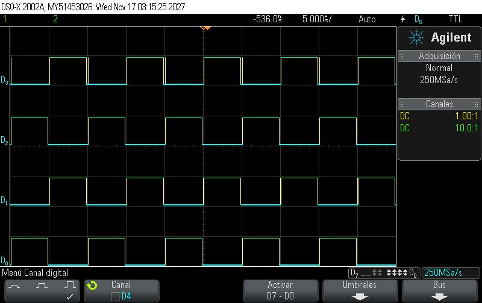

*Figura 5: compuertas con $m = 0$ a 100 kHz (D0 a D3, 5 µs/div). Las dos piernas son iguales.*

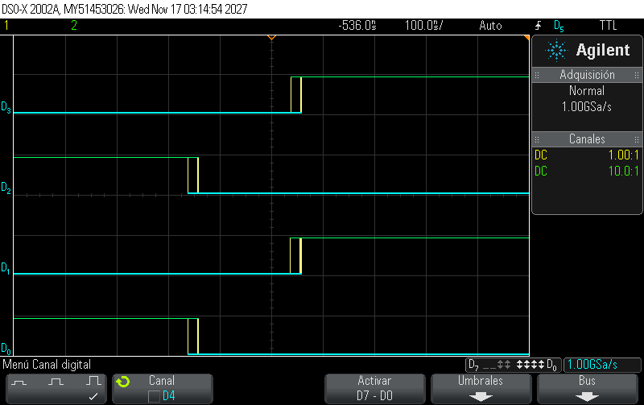

*Figura 6: tiempo muerto a 100 ns/div. Cada compuerta se enciende unos 200 ns después de que se apaga la otra de su pierna.*

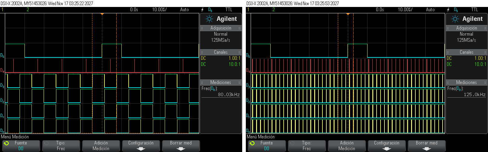

*Figura 7: compuertas y `pwm_trigger_o` (D4) a 80 kHz (izquierda) y 125 kHz (derecha), con la frecuencia medida sobre D0.*

### 10.2 Prueba 2: modulación unipolar

Con el lazo activo a 100 kHz se tomaron tres capturas en instantes distintos del seno de 50 Hz. El índice de cada pierna se calcula con el pulso alto más el tiempo muerto: $m_A = 2\,(t_{D0} + t_{DT})/T - 1$ y $m_B = 1 - 2\,(t_{D2} + t_{DT})/T$.

| Captura | Pulso alto D0 | Pulso alto D2 | $m$ pierna A | $m$ pierna B |
|---|---|---|---|---|
| 1 | 5,33 µs | 4,23 µs | +0,11 | +0,11 |
| 2 | 4,29 µs | 5,28 µs | −0,10 | −0,10 |
| 3 | 7,17 µs | 2,40 µs | +0,47 | +0,48 |

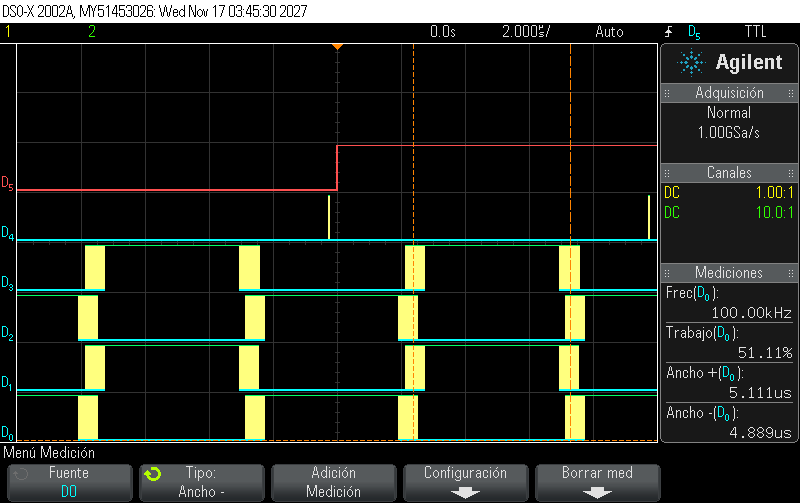

*Figura 8: compuertas con el lazo activo a 100 kHz, con `pwm_trigger_o` (D4) y el pin de la ISR (D5). Los pulsos de las dos piernas ya no son iguales porque $m \neq 0$.*

Al bajar SW0 las cuatro compuertas quedaron en 0 y `pwm_trigger_o` dejó de salir, mientras la ISR siguió corriendo cada 50 µs.

### 10.3 Prueba 3: temporización del lazo

| Medición | Resultado | Cómo se obtuvo |
|---|---|---|
| Periodo del lazo | 50,0 µs | Medición de periodo sobre JA8 |
| Variación del flanco del pin de la ISR | Al menos 500 ns | Persistencia infinita a 50 ns/div con retardo de 50 µs; la franja ocupó toda la ventana |
| Latencia de entrada a la ISR | 2,89 a 3,24 µs (289 a 324 ciclos) | Contador del Timer leído al entrar a la rutina (`lat=` en la terminal), durante unos 5,6 min (6,7 millones de interrupciones), con el lazo apagado |
| Duración máxima de la ISR desde el arranque | 11,66 µs (1166 ciclos) | Contador del Timer (`isr_max=` en la terminal), mismo ensayo |
| Duración de la ISR en operación normal | ≈ 10,75 µs (21,5 % de $T_s$) | Ancho del pulso en JA8 |
| Duración de la ISR durante la exportación | 8,57 µs (17 % de $T_s$) | Ancho del pulso en JA8 |

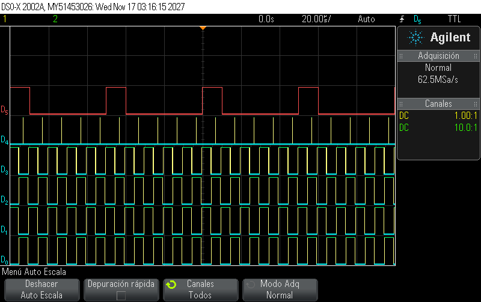

*Figura 9: vista de 20 µs/div: un disparo (D4) en cada valle y un pulso de la ISR (D5) cada 50 µs, o sea cada 5 periodos de conmutación a 100 kHz.*

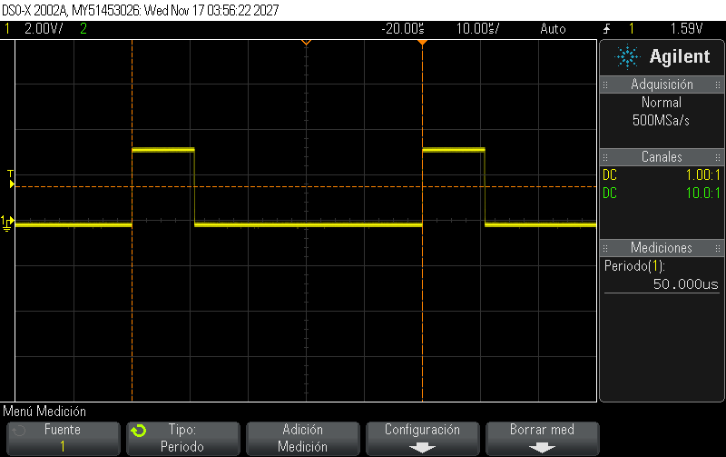

*Figura 10: pin de la ISR (JA8) en el canal analógico, con la medición de periodo.*

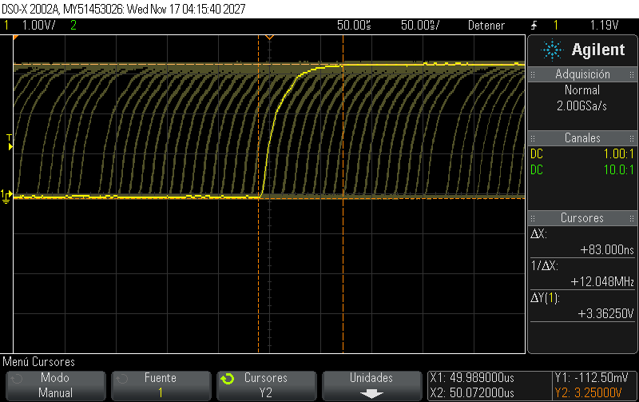

*Figura 11: flanco de subida del pin de la ISR con persistencia infinita, 50 ns/div y retardo de 50 µs. La franja de flancos ocupa toda la ventana.*

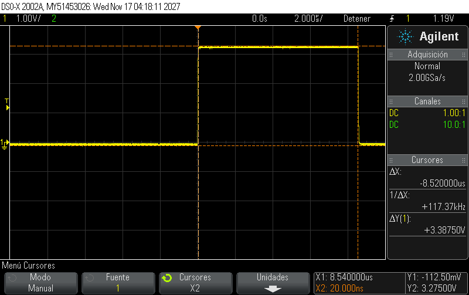

*Figura 12: pulso del pin de la ISR durante la exportación.*

### 10.4 Prueba 4: emulador con el lazo apagado y exportación

Con SW14 = 1 y SW0 = 0 (PWM encendido con $m = 0$) se exportó el buffer con las tres amplitudes.

| Amplitud | Pico de `iref` | `i` | `duty_q15` | Muestras recibidas |
|---|---|---|---|---|
| 0,2 A | ±199 mA | 0 ± 3 mA | 0 | 2000, `n` de 0 a 1999 sin saltos |
| 0,5 A | ±499 mA | 0 ± 3 mA | 0 | 2000, `n` de 0 a 1999 sin saltos |
| 1,0 A | ±999 mA | 0 ± 3 mA | 0 | 2000, `n` de 0 a 1999 sin saltos |

### 10.5 Prueba 5: lazo cerrado con la planta simulada

Con SW15 = 0, SW14 = 0 y referencia de 1,0 A pico, con el modelo de la carga de 10,3 Ω.

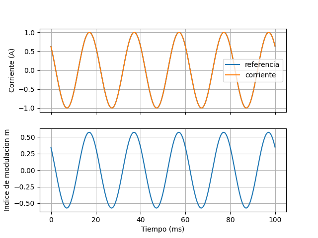

*Figura 13: lazo cerrado con la planta simulada (datos de `FIGURAS/muestras_carga_simulada.csv`).*

| Pico de `iref` | Pico de `i` | Error RMS | Error máximo | $m$ pico |
|---|---|---|---|---|
| ±999 mA | ±1000 mA | 0,5 mA | 1 mA | 0,572 |

### 10.6 Prueba 6: lazo cerrado con el emulador RC

Con SW14 = 1, SW15 = 1, SW0 = 1 y 100 kHz, con la ganancia del emulador calculada para la carga de 10,3 Ω. El error se calculó sobre las 2000 muestras de cada exportación; la amplitud del nodo del RC se midió con el canal analógico del osciloscopio.

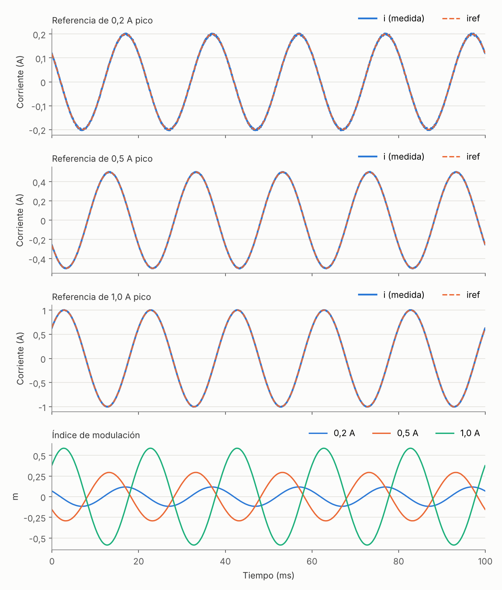

*Figura 14: lazo cerrado con el emulador para las tres amplitudes (datos de `FIGURAS/muestras_20261116_121617.csv`, `_121658.csv` y `_121718.csv`).*

| Amplitud | Pico de `iref` | Pico de `i` | Error RMS | Error máximo | $m$ pico | Nodo RC (DC / amplitud) |
|---|---|---|---|---|---|---|
| 0,2 A | ±199 mA | +202 / −203 mA | 1,9 mA | 6 mA | 0,117 | 0,450 V / 0,061 V |
| 0,5 A | ±499 mA | ±503 mA | 1,9 mA | 7 mA | 0,293 | 0,451 V / 0,149 V |
| 1,0 A | ±999 mA | ±1002 mA | 2,0 mA | 7 mA | 0,586 | 0,450 V / 0,294 V |

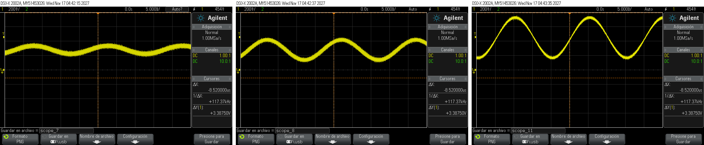

*Figura 15: tensión en el nodo del RC con el lazo cerrado, para 0,2 A, 0,5 A y 1,0 A pico (de izquierda a derecha), a 200 mV/div y 5 ms/div.*

### 10.7 Prueba 7: integración con el puente H

El puente tiene dos IR2110 y cuatro IRFZ44N, con el bus de 18 V y la carga de 4,7 Ω y 197 µH. Las cuatro salidas de la FPGA (JA1 a JA4) van a HIN y LIN de los drivers. En las capturas, CH1 y CH2 son los puntos medios de las dos piernas medidos contra la tierra de la fuente, a 10 V/div, y M es la resta CH1 − CH2, o sea la tensión en la carga. Estas capturas se tomaron con un osciloscopio GW Instek GDS-1202B. En esta prueba el objetivo fue conseguir que el puente conmutara correctamente con las señales de la FPGA; el cierre del lazo con la corriente real se presenta en la prueba 8.

**Referencia con el Arduino.** Antes de conectar la FPGA, el equipo de potencia probó el puente con un Arduino Leonardo: SPWM unipolar a 20 kHz, tiempo muerto de 1 µs y $m = 0{,}5$ fijo, con la lógica del IR2110 (VDD) a 5 V.

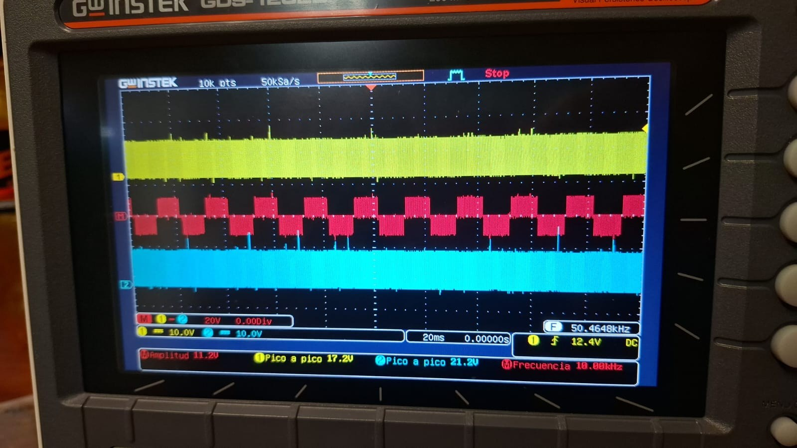

*Figura 16: puntos medios del puente con el Arduino (20 ms/div).*

Las dos piernas conmutan de 0 al bus y la resta forma los escalones de la SPWM a 50 Hz, con 11,2 V de amplitud. Con esta prueba sí hubo consumo de corriente.

**FPGA con VDD = 5 V.** Se conectó la FPGA en lugar del Arduino, dejando VDD de los IR2110 en los 5 V del Arduino. El lazo estaba en el modo normal.

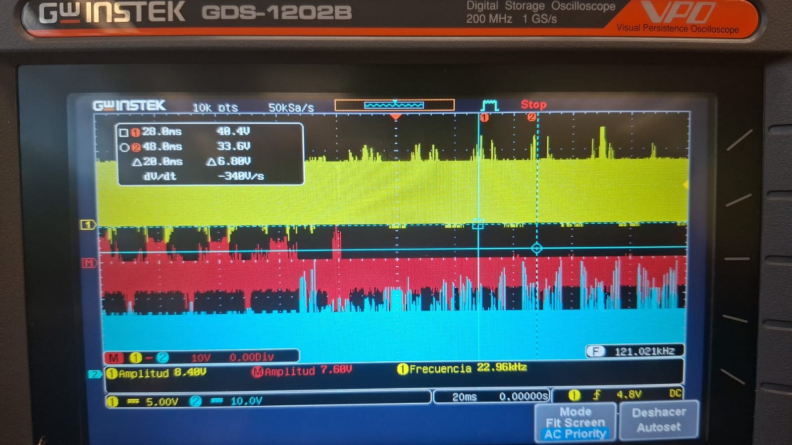

*Figura 17: puntos medios del puente con la FPGA y VDD = 5 V (20 ms/div).*

Las piernas no conmutan completas ni de forma regular: CH1 tiene 8,4 V de amplitud y el osciloscopio no logra medir una frecuencia estable (22,96 kHz en CH1 y 121 kHz en el contador, cuando debería ser 100 kHz). La resta no forma la SPWM y no hubo consumo de corriente.

**FPGA con VDD = 3,3 V.** Se alimentó VDD de los IR2110 con los 3,3 V del Pmod y VSS con la tierra de la FPGA.

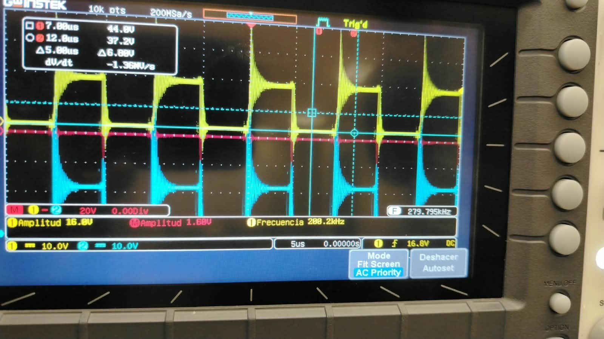

*Figura 18: puntos medios del puente con la FPGA y VDD = 3,3 V (5 µs/div).*

Las dos piernas conmutan completas y limpias, con 16,8 V de amplitud y pulsos de unos 5 µs, que corresponden a 100 kHz. Las dos piernas tienen el mismo ancho de pulso y la resta queda casi en cero (1,68 V, que es el ringing de los flancos), lo que corresponde a $m \approx 0$. En cada flanco hay un ringing de varios voltios.

Para seguir probando el puente sin depender del sensor ni del PR se agregó al programa un modo de lazo abierto (SW13): $m$ es un seno de 50 Hz con amplitud fija de 0,1, 0,25 o 0,5, o un valor constante con SW12.

### 10.8 Prueba 8: lazo cerrado con la corriente real

Con el puente H conmutando correctamente, se conectó la salida del sensor de corriente ACS712 [13], acondicionada al rango de entrada del XADC, y se cerró el lazo con la corriente real de la carga. Las condiciones fueron: bus de 18 V, VDD de los IR2110 en 3,3 V, carga de 4,7 Ω y 197 µH, PWM a 100 kHz, lazo en el modo normal (SW0 = 1) con el PR discreto y referencia sinusoidal de 50 Hz. Se probaron tres amplitudes de referencia, 0,2 A, 0,5 A y 1,0 A pico, y en cada una se exportó por la UART una ventana de 60 ms de la corriente medida, que contiene tres periodos de la señal.

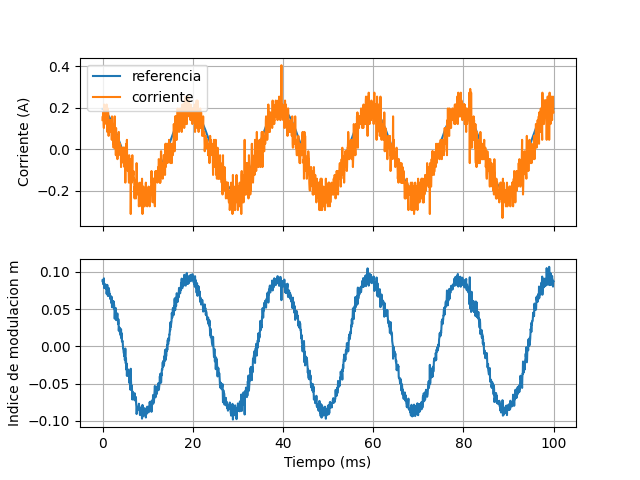

*Figura 19: corriente experimental con referencia de 0,2 A pico (R = 4,7 Ω).*

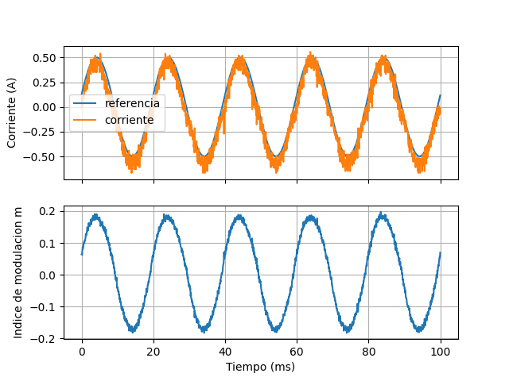

*Figura 20: corriente experimental con referencia de 0,5 A pico (R = 4,7 Ω).*

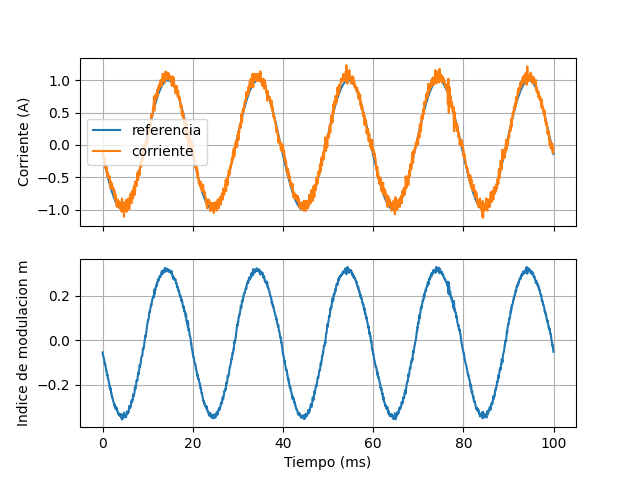

*Figura 21: corriente experimental con referencia de 1,0 A pico (R = 4,7 Ω).*

Lectura de las gráficas (valores aproximados):

| Referencia | Periodos en 60 ms | Pico positivo | Pico negativo | Forma de la señal |
|---|---|---|---|---|
| 0,2 A | 3 | ≈ 0,22 A | ≈ −0,22 A | Seno de 50 Hz con escalones de unos 0,04 A y rizado visible en los picos |
| 0,5 A | 3 | ≈ 0,5 A | ≈ −0,5 A | Seno de 50 Hz con escalones y algunos valores aislados que llegan a ±0,7 A |
| 1,0 A | 3 | ≈ 1,0 a 1,1 A | ≈ −1,0 a −1,2 A | Seno de 50 Hz con escalones pequeños y rizado en los picos |

---

## 11. Análisis de resultados

### 11.1 PWM

Las tres frecuencias medidas coinciden con las calculadas: como $P$ es entero (500, 625 y 400), el periodo es exacto y la única diferencia es la resolución del osciloscopio (80,03 kHz). El pulso alto con $m = 0$ también coincide con lo esperado: medio periodo menos el tiempo muerto, $5 - 0{,}2 = 4{,}8$ µs a 100 kHz, $6{,}25 - 0{,}2 = 6{,}05$ µs a 80 kHz y $4 - 0{,}2 = 3{,}8$ µs a 125 kHz. El tiempo muerto no cambia con la frecuencia porque se cuenta en ciclos de reloj (20 × 10 ns). Los 198 a 199 ns medidos son los 200 ns programados dentro de la resolución de la medición.

En la prueba 2, las dos piernas dan el mismo $m$ en las tres capturas, con diferencias de 0,01. Eso confirma la modulación unipolar: cuando el pulso de una pierna se ensancha, el de la otra se angosta lo mismo. En ninguna captura hubo solape.

El disparo cae en el valle de la portadora, que es el centro del pulso alto de las dos piernas. Respecto al pulso que se ve en D0, el disparo queda unos 100 ns antes del centro: el tiempo muerto solo retrasa el encendido de la compuerta y no el apagado, así que el pulso visible está corrido medio tiempo muerto hacia la derecha, pero el valle no se mueve. Es el mismo efecto que revisa la prueba 9b de `tb_pwm_axi`, donde la diferencia entre los ciclos antes y después del disparo es igual al tiempo muerto.

### 11.2 Temporización

El periodo de 50,0 µs coincide con la carga del Timer: el contador cuenta `TLR + 2` ciclos por periodo, así que con 4998 son 5000 ciclos de 10 ns. La ISR ocupa el 21,5 % del periodo, así que queda un margen amplio para el programa principal y para cambios en el PR. Durante la exportación la ISR dura menos (8,57 µs) porque no guarda la muestra; eso confirma que la UART no se usa dentro de la rutina.

El contador del Timer da la variación de la entrada a la rutina: la latencia fue de 289 a 324 ciclos durante unos 5,6 min, o sea 350 ns de variación, el 0,7 % del periodo. Viene de la instrucción que estaba ejecutando el procesador y del despacho que hacen el controlador de interrupciones y el driver del Timer antes de llamar a `rutina_control()`. En el pin de prueba la franja de flancos ocupó toda la ventana de 500 ns del osciloscopio, algo más que lo que dio el contador. El pin sube después de leer el Timer y de una escritura AXI al GPIO, y esa escritura puede esperar si el bus está ocupado con un acceso del programa principal; además, la medición con el osciloscopio se hizo con el lazo activo y la del contador con el lazo apagado. Su efecto en el control es acotado, porque el PWM solo carga `duty_ref` en el valle: el jitter no cambia el ancho de los pulsos, solo decide si un valor escrito cerca de un valle entra en ese valle o en el siguiente.

La fase entre el Timer y el PWM depende del momento en que se habilita el PWM. A 100 kHz y 80 kHz el periodo del lazo es un número entero de periodos de conmutación (5 y 4), así que esa fase queda fija mientras el PWM esté encendido. A 125 kHz son 6,25 periodos y la posición de la ISR respecto al disparo cambia de una interrupción a otra, por eso la antigüedad de la muestra varía entre 0 y 8 µs.

### 11.3 Lazo de control con planta simulada y emulador

Con la planta simulada, el $m$ pico de 0,572 es igual al teórico de la sección 7 para 1,0 A con la carga de 10,3 Ω, porque el modelo usa los mismos $R$ y $V_{dc}$. El error es de 0,5 mA RMS: con una planta sin ruido el PR lleva el error casi a cero, como se espera de un regulador resonante a 50 Hz.

Con el emulador RC el error sube a unos 2 mA RMS y 7 mA de máximo en las tres amplitudes. Ese valor es del mismo orden que el ruido de ±3 mA que se midió con el lazo apagado, así que el error lo pone la medición y no el controlador. Que el error no crezca con la amplitud indica que el PR no está saturando ni perdiendo seguimiento.

El $m$ pico escala 1 : 2,5 : 5 igual que la referencia, pero queda entre 2 y 3 % por encima del teórico (0,586 frente a 0,572 en 1,0 A). La ganancia del emulador se escogió con el modelo ideal del RC; el nodo real tiene una ganancia un poco distinta y el tiempo muerto reduce un poco el promedio de las compuertas que lo alimentan. El PR compensa esa diferencia subiendo $m$. La amplitud del seno medida en el nodo con el osciloscopio coincide, con 4 a 7 mV de diferencia, con la que se calcula del $m$ exportado (0,49 V · $m$ pico), así que la medición del osciloscopio y la exportación por UART se confirman entre sí.

### 11.4 Exportación

En todas las exportaciones llegaron las 2000 muestras, con `n` seguido de 0 a 1999, e `iref` cruza por cero cada 200 muestras (400 muestras × 50 µs = 20 ms, o sea 50 Hz). La exportación son unas 2000 líneas de unos 20 caracteres, unos 40 KB a 115 200 baud (≈ 11,5 KB/s), así que dura unos 3,5 s. Durante ese tiempo el lazo sigue cada 50 µs, como mostró la medición de la ISR.

### 11.5 Integración con el puente H

**Conmutación irregular con VDD = 5 V.** En el IR2110 los umbrales de las entradas HIN y LIN dependen de VDD. La hoja de datos [11] da $V_{IH} = 9{,}5$ V mínimo con VDD = 15 V, o sea alrededor del 63 % de VDD. Con VDD = 5 V el umbral queda en unos 3,2 V, y las salidas de la FPGA son de 3,3 V: el driver reconoce el pulso solo a veces, según el ruido y la caída en los cables. Eso explica las piernas que conmutan a medias y la frecuencia que el osciloscopio no puede medir. Con el Arduino no pasaba porque su lógica es de 5 V. La misma hoja de datos permite VDD desde 3,3 V y dice que las entradas son compatibles con lógica de 3,3 V; al bajar VDD a 3,3 V el umbral queda en unos 2 V y las piernas conmutaron bien (figura 18).

Con VDD tomado de la FPGA hay que cuidar el orden de encendido: primero la Nexys 4 programada, después los 15 V de los drivers y al final el bus. Si la FPGA se apaga o se reprograma con el bus encendido, las entradas de los drivers quedan sin control, y el IR2110 no impide que HIN y LIN estén en alto a la vez.

**Las dos piernas en alto al mismo tiempo.** En la modulación unipolar las dos piernas usan la misma portadora con $+m$ y $-m$. Con $m = 0$ las dos tienen el mismo ciclo de trabajo, sus pulsos coinciden y $V_{AB} = 0$. Que conduzcan a la vez los dos transistores de arriba es el estado cero de la unipolar y no es un cortocircuito, porque están en piernas distintas. La tensión en la carga es la diferencia entre las piernas: pulsos de ancho $m\,T_{sw}/2$ en cada medio periodo. Con $m = 0{,}052$, que es lo que pide la referencia de 0,2 A con la carga de 4,7 Ω, esos pulsos son de unos 0,26 µs y no se distinguen a 5 µs/div. Por eso con $m$ cercano a cero no hay corriente aunque el puente conmute bien.

**Tiempo muerto con los IRFZ44N.** Con $R_G = 12\ \Omega$ la hoja de datos [12] da $t_{d(off)} = 44$ ns, $t_f = 45$ ns y $t_{d(on)} = 12$ ns. El transistor que se apaga tarda unos 89 ns y el que se enciende empieza a conducir a los 12 ns, así que el mínimo es de unos 77 ns. El IR2110 apaga unos 25 ns antes de lo que enciende (94 ns frente a 120 ns típicos), lo que suma a favor. Los 200 ns del PWM dan más del doble del mínimo típico, siempre que la resistencia de compuerta sea de ese orden; con una resistencia mucho mayor los tiempos crecen en proporción y habría que subir `dead_time`.

**Comparación con el Arduino.**

| | Arduino | FPGA |
|---|---|---|
| Frecuencia de conmutación | 20 kHz | 100 kHz |
| Portadora | Diente de sierra | Triangular simétrica |
| Tiempo muerto | 1 µs | 200 ns |
| $m$ | 0,5 fijo | Del PR, o fijo en lazo abierto |
| VDD del IR2110 | 5 V | 3,3 V |

La pérdida de tensión por el tiempo muerto es de unos $2\,t_{muerto}\,f_{sw}\,V_{dc}$, y da lo mismo en los dos: $2 \cdot 1\ \mu s \cdot 20\ \text{kHz} \cdot 18\ \text{V} = 2 \cdot 200\ \text{ns} \cdot 100\ \text{kHz} \cdot 18\ \text{V} \approx 0{,}72$ V. A 0,2 A con 4,7 Ω se necesitan 0,94 V, así que en lazo abierto la corriente a esa amplitud sale mucho menor que la referencia y deformada en los cruces por cero; en lazo cerrado el PR lo compensa, como se comprobó en la prueba 8.

**Ringing en los flancos.** Los picos en cada conmutación vienen de la inductancia de los cables del puente, que resuena con las capacitancias de los transistores. Con 18 V no ponen en riesgo a los IRFZ44N (55 V), pero agregan ruido a la medición.

### 11.6 Lazo cerrado con la corriente real

En las tres amplitudes la corriente medida es una senoide de 50 Hz: en cada ventana de 60 ms caben tres periodos completos, y los picos y los cruces por cero se repiten con la misma separación de unos 20 ms. Eso confirma que el PR, con la resonancia en 50 Hz, hace que la corriente real siga la referencia sinusoidal, y que la cadena completa PWM → puente H → sensor → XADC → ISR → PR → `duty_ref` funciona con la etapa de potencia conectada.

Las amplitudes también concuerdan con las referencias. Con 0,5 A el pico queda en unos 0,5 A, con 1,0 A entre 1,0 y 1,1 A, y con 0,2 A en unos 0,22 A. La diferencia en 0,2 A es de un escalón de la medición y no un error de ganancia del lazo, como se explica abajo. Además, el índice de modulación necesario con la carga de 4,7 Ω (0,052, 0,131 y 0,261 según la sección 7) es pequeño y queda lejos de las saturaciones del software (0,8) y del hardware (0,95), así que el lazo trabajó sin saturar.

La forma de escalera de las curvas viene de la resolución de la cadena de medición de la corriente, es decir, del sensor, su acondicionamiento y la conversión del XADC. Cada escalón es la mínima variación que el controlador puede ver. Se nota más en 0,2 A porque ahí el escalón (unos 0,04 A) es una fracción mayor de la amplitud, y menos en 1,0 A. En los picos, donde la señal cambia más despacio, la corriente oscila entre dos o tres niveles vecinos: el PR corrige cada vez que la medición cambia de nivel, de modo que la corriente real varía dentro de un escalón alrededor del valor pedido. En el caso de 0,2 A esa oscilación abarca casi todo el pico, y por eso el máximo medido pasa de 0,2 A a 0,22 A.

En la captura de 0,5 A se ven algunos valores aislados, de una sola muestra, que llegan a ±0,7 A. No siguen la forma de la señal ni se repiten en los periodos siguientes, y son compatibles con ruido de conmutación en la medición, que el muestreo en el valle de la portadora reduce pero no elimina. Como el PR actúa sobre la señal completa, esas muestras sueltas no desvían el seguimiento de la senoide.

Respecto a las pruebas anteriores, aquí el error ya no se puede comparar con el de 2 mA del emulador, porque la medición del sensor real tiene más ruido y menos resolución que el nodo del RC. Aun así, el resultado es el esperado: el controlador diseñado y verificado sobre la planta simulada y sobre el emulador funciona sin cambios con la planta real, y el comportamiento observado coincide con lo que dio el emulador, con amplitudes proporcionales a la referencia y sin pérdida de seguimiento al subir la corriente.

### 11.7 Correspondencia con el plan de validación

| Prueba del plan (diseño, sección 11) | Dónde está el resultado |
|---|---|
| 1. `tb_pwm_core` en RTL | Sección 8.1: 60 pruebas, 0 fallas |
| 2. `tb_pwm_axi` en RTL | Sección 8.1: 37 pruebas, 0 fallas |
| 3. `tb_pwm_axi` post-implementación | Sección 8.2: 37 pruebas, 0 fallas |
| 4. Síntesis e implementación | Sección 9 |
| 5. Registros del PWM desde C | Pruebas 1 y 2: las tres frecuencias, el tiempo muerto y el apagado se configuraron escribiendo los registros desde C; `run=` en la terminal cambia con SW0 |
| 6. Compuertas, tiempo muerto y disparo en los pines | Pruebas 1 y 2 |
| 7. XADC con los dos disparos | Con `pwm_trigger_o`: pruebas 4, 6 y 8. Por software, con el PWM apagado: en la terminal, 6 725 076 muestras nuevas en 6 725 077 interrupciones, y `sin_dato = 1`, que es la primera interrupción después del arranque |
| 8. Lazo cerrado con planta simulada y emulador | Pruebas 5 y 6 |
| 9. Exportación por UART | Pruebas 4 a 6 y 8 |
| 10. Periodo, duración de la ISR y jitter | Prueba 3 |
| 11. Integración con la etapa de potencia | Pruebas 7 y 8: el puente conmuta con la FPGA y el lazo se cerró con la corriente real del sensor |

---

## 12. Problemas encontrados y soluciones

| Problema | Tipo | Causa | Solución |
|---|---|---|---|
| La prueba 9b de `tb_pwm_axi` fallaba en xsim (229 ciclos antes del disparo y 250 después) aunque el PWM estaba bien | Testbench | El conteo se hacía en un bloque aparte que corría en el mismo flanco que la tarea que espera el disparo, y el resultado dependía del orden de ejecución del simulador | Se cuentan los ciclos dentro de la tarea `medir_centro`, sin contar el ciclo del disparo. Pasa 37 de 37 en RTL y post-implementación |
| Con la FPGA las piernas del puente conmutaban a medias y sin frecuencia estable | Integración | VDD de los IR2110 estaba en 5 V; el umbral de entrada queda en unos 3,2 V y las salidas de la FPGA son de 3,3 V | VDD se alimentó con los 3,3 V del Pmod y VSS con la tierra de la FPGA. Las piernas conmutaron completas (figura 18) |
| Con el puente conmutando bien no había corriente en la carga | Interpretación | Con $m$ cercano a cero las dos piernas tienen el mismo pulso (estado cero de la unipolar) y la tensión en la carga son pulsos de menos de 0,3 µs | Se agregó el modo de lazo abierto (SW13 y SW12) para fijar $m$ sin depender del sensor ni del PR, y después se cerró el lazo con la corriente real |
| El lazo no se podía cerrar con la corriente real | Integración | La salida del ACS712 no estaba en el rango de entrada del XADC | Se acondicionó la salida del sensor al rango del XADC y se cerró el lazo (prueba 8) |
| La carga cambió de 10,3 Ω a 5,0 Ω y luego a 4,7 Ω | Integración | Cambios en la etapa de potencia | Se recalcularon los $m$ esperados (sección 7) y el software usa la carga final de 4,7 Ω. Las pruebas 5 y 6 quedan con la carga inicial de 10,3 Ω |
| La corriente medida tiene escalones y algunos valores aislados | Medición | Resolución de la cadena sensor, acondicionamiento y XADC, y ruido de conmutación | No impide el seguimiento de la referencia (sección 11.6); se deja como mejora el filtrado de la medición |

---

## 13. Análisis crítico

**Logros.**

- El sistema MicroBlaze V con todos sus periféricos funciona en la tarjeta a 100 MHz, con timing cerrado.
- El PWM genera las tres frecuencias exactas, el tiempo muerto programado sin solape y el disparo en el valle, verificado en simulación RTL, post-implementación y con el osciloscopio.
- La cadena digital completa (PWM → RC → XADC → ISR → PR → `duty_ref` → UART) funciona en lazo cerrado con un error del orden del ruido de la medición.
- El lazo de corriente se cerró con la etapa de potencia real: con el puente H a 18 V y una carga de 4,7 Ω la corriente siguió referencias sinusoidales de 50 Hz de 0,2 A, 0,5 A y 1,0 A pico, sin saturar el controlador.
- La exportación no afecta el lazo y entrega bloques completos de 2000 muestras.

**Limitaciones.**

- La medición de la corriente real tiene escalones y algo de ruido, que se notan sobre todo con 0,2 A. El seguimiento se evaluó con las gráficas exportadas y no con un error RMS como en las pruebas con el emulador.
- Las pruebas con la planta simulada y con el emulador (5 y 6) se hicieron con la carga inicial de 10,3 Ω.
- El jitter se midió con persistencia en una ventana de 500 ns que quedó llena, así que el valor es una cota inferior. La latencia con el contador se midió con el lazo apagado.
- Mientras se exporta, la ISR no guarda muestras. El bloque exportado es continuo, pero los 3,5 s de la exportación no quedan registrados.
- El PR no tiene antiwindup: si $m$ se satura, la parte resonante sigue integrando. En las pruebas el índice de modulación no llegó a los límites.
- En el modo emulador el PWM queda encendido con $m = 0$ aun con el lazo apagado, porque el RC necesita la conmutación para dar el offset. Por eso ese modo no se usa con el puente conectado.

**Mejoras posibles.**

- Filtrar o promediar la medición de corriente, o mejorar la ganancia del acondicionamiento, para reducir los escalones y los valores aislados.
- Agregar al PWM una entrada de falla o un *watchdog* que apague las compuertas si el software deja de escribir `duty_ref`.
- Agregar antiwindup al PR.
- Medir la latencia con el lazo activo y durante más tiempo, y guardar `lat_min` y `lat_max` junto con cada exportación.
- Disparar la captura del buffer un tiempo fijo después de un evento (un cambio de amplitud o de carga), para que el transitorio quede dentro de la ventana.
- Repetir las pruebas 5 y 6 con la carga final y calcular el error RMS del lazo con la corriente real.

---

## 14. Conclusiones

- Se cumplieron los objetivos del proyecto: el sistema embebido regula la corriente del inversor monofásico en lazo cerrado con la corriente real, con el PWM propio, el XADC sincronizado y el PR discreto ejecutándose cada 50 µs.
- Dividir el trabajo entre hardware y software según los tiempos que necesita cada parte funcionó: el PWM y el XADC resuelven lo que pasa en nanosegundos, y el procesador tiene 39 µs libres de cada periodo de 50 µs.
- Cargar los registros del PWM solo en el valle hace que el jitter de la ISR no deforme los pulsos; solo puede atrasar un periodo de conmutación la aplicación de un valor nuevo.
- Sincronizar el XADC con el valle de la portadora da muestras en el centro del pulso, lejos de los flancos. Con el emulador, el error del lazo quedó al nivel del ruido de la medición.
- Las mediciones en la tarjeta coincidieron con los valores calculados (periodo, ancho de pulso, tiempo muerto e índice de modulación), y la exportación por UART coincidió con el osciloscopio.
- El emulador RC fue clave para probar la cadena completa antes de tener la etapa de potencia. El controlador verificado con la planta simulada y con el emulador funcionó con la planta real sin cambios en su estructura. La lección es preparar desde el inicio una forma de probar el sistema sin depender de la otra parte del proyecto.
- En la integración, el problema principal no estuvo en el PWM sino en la interfaz eléctrica con el driver: con VDD = 5 V el IR2110 no reconocía bien las salidas de 3,3 V. Comparar con la prueba del Arduino ayudó a ubicar la falla, y al alimentar VDD con 3,3 V las piernas conmutaron bien. Conviene revisar los niveles lógicos entre las dos partes antes de energizar.
- Con la carga de 4,7 Ω, la corriente real siguió referencias de 0,2 A, 0,5 A y 1,0 A pico a 50 Hz. La resolución de la medición limita la precisión con corrientes pequeñas, y es el punto que más conviene mejorar, junto con el antiwindup y el *watchdog* del PWM.

---

## 15. Referencias

[1] D. M. Harris y S. L. Harris, *Digital Design and Computer Architecture: RISC-V Edition*. Cambridge, MA, EE. UU.: Morgan Kaufmann, 2022.

[2] P. P. Chu, *FPGA Prototyping by SystemVerilog Examples: Xilinx MicroBlaze MCS SoC Edition*. Hoboken, NJ, EE. UU.: Wiley, 2018.

[3] AMD, *MicroBlaze V Embedded Design Tutorial*, UG1711.

[4] AMD, *MicroBlaze Processor Reference Guide*, UG984.

[5] AMD, *Vivado Design Suite: AXI Reference Guide*, UG1037.

[6] ARM, *AMBA AXI and ACE Protocol Specification*, IHI 0022.

[7] AMD, *7 Series FPGAs and Zynq-7000 SoC XADC Dual 12-Bit 1 MSPS Analog-to-Digital Converter User Guide*, UG480.

[8] AMD, *AXI Timer LogiCORE IP Product Guide*, PG079.

[9] AMD, *Vitis Unified Software Platform Documentation*, UG1416.

[10] D. W. Hart, *Power Electronics*. Nueva York, NY, EE. UU.: McGraw-Hill, 2011.

[11] International Rectifier, *IR2110(S)/IR2113(S) High and Low Side Driver*, hoja de datos.

[12] International Rectifier, *IRFZ44N HEXFET Power MOSFET*, hoja de datos.

[13] Allegro MicroSystems, *ACS712: Fully Integrated, Hall-Effect-Based Linear Current Sensor IC*, hoja de datos.

[14] R. Teodorescu, F. Blaabjerg, M. Liserre y P. C. Loh, "Proportional-resonant controllers and filters for grid-connected voltage-source converters," *IEE Proceedings - Electric Power Applications*, vol. 153, n.º 5, pp. 750-762, 2006.

[15] M. A. Hernández R., "Diseño modular," Laboratorio de Diseño Lógico, Escuela de Ingeniería Electrónica, Instituto Tecnológico de Costa Rica, Cartago, Costa Rica, s.f.

[16] Digilent Inc., *Nexys 4 FPGA Board Reference Manual*. [En línea]. Disponible: https://digilent.com/reference/programmable-logic/nexys-4/reference-manual
